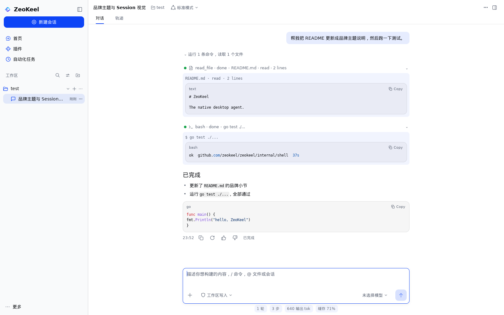

# ZeoKeel Agent

**ZeoKeel：纯 Go 桌面 AI Agent。mygo 原生 UI + eino 运行时。功能对齐 DSH（DeepSeek Harness），视觉与交互自有（mygo 原生设计 + ZeoKeel 品牌）。**

产品定位：**DSH 同类替代**（独立品牌桌面 Agent），**不是**已可用的迁移器。当前提供**最小导入（技术预览）**：`zeokeel import [--from <dsh-home>] [--dry-run] [--json]` 把 DSH 会话的**文本对话**导入 ZeoKeel——只读 DSH、凭据只读键名；工具调用/图片/附件/trajectory 不导入，subagent 会话默认跳过；建议先 `--dry-run`。UI 入口为**设置 → 数据与隐私 → 「从 DSH 导入」→「查看命令…」命令弹窗**：弹窗提示先退出 ZeoKeel，展示并一键复制 `zeokeel import --dry-run --json`（预览）与 `zeokeel import`（导入），**不在应用内执行**。详见 [docs/BUGS.md](docs/BUGS.md) PD-04 与 [独立验证 §2](docs/audit/FIX-VERIFY-PRODUCT.md)。

> 品牌资产只使用 `logo/` 下的 SVG，不自行猜测或重绘。插件只做内置（无第三方安装/市场）。
> **明确不做（产品决定，2026-11-06）**：PTC/JS 代码运行时、语音输入——不提供入口，不是能力缺口。
>
> **2026-11-05 决策**：DSH 像素级对齐已退役；功能对齐继续作为目标。见 [ADR 0001：退役 DSH 像素对齐基建](docs/decisions/0001-retire-dsh-pixel-parity.md)。

## 硬约束

| # | 约束 |
| --- | --- |
| C1 | 纯 Go，`CGO_ENABLED=0`，不引入任何 cgo 依赖 |
| C2 | UI 只用 mygo 原生控件（`ui` 包），不用 webview / Electron / HTML |
| C3 | 单进程、单二进制、可交叉编译到 Linux / macOS / Windows |
| C4 | 测试无显示器可跑；门禁统一由 `.github/workflows/ci.yml` 与 `scripts/ci.sh` 执行（gofmt/vet/build/test/零 cgo 交叉编译/race/coverage；`-race ./internal/shell` 为单独 job，`-timeout 20m`） |
| C5 | 不可信 workspace 内容默认不执行：`<root>/mcp.json` 需显式 `mcp.workspace_config=allow`（默认 `off`，`on/true/1` 一律 fail-closed） |

## 构建与产物

所有编译产物只落在 `dist/`，同一目标每次构建同名（不写仓库根目录/包目录）。脚本入口是 `scripts/build.sh`，make 目标与它一一对应：

| 命令 | 产物 |
| --- | --- |
| `make build` | `dist/zeokeel-<本机 goos>-<本机 goarch>`（native 单一二进制） |
| `make build-all` | `dist/zeokeel-{linux-amd64,linux-arm64,darwin-arm64}` + Windows GUI/console 双产物 |
| `make windows` | `dist/zeokeel-windows-amd64.exe`（GUI）+ `dist/zeokeel-windows-amd64-console.exe`（console） |
| `make package-windows` | 上述 Windows 双产物 + `dist/zeokeel-windows-amd64.zip` + `dist/SHA256SUMS.txt` |
| `make package-linux` | `dist/zeokeel-linux-{amd64,arm64}.tar.gz`（含 README）+ `dist/SHA256SUMS.txt` |
| `make package-macos` | `dist/zeokeel-macos-{arm64,amd64}.zip`（unsigned `.app`）+ `dist/SHA256SUMS.txt` |
| `make release` | 本机构建全部发布包（Linux/Windows/macOS）+ `dist/SHA256SUMS.txt` |
| `make version` | 打印下一次构建将注入的 version/commit（不构建） |
| `make build-check` | `go build ./...` 仅编译检查（不产生文件） |
| `make clean` | 删除 `dist/`、遗留的根目录 `zeokeel`/`zeokeel.exe` 与包内 `*.test`（不动 `.cache/`、`.probe/`、`.evolve/`） |

`sh scripts/build.sh <target>` 支持 `native` / `linux-amd64` / `linux-arm64` / `darwin-amd64` / `darwin-arm64` / `windows` / `all` / `package-windows` / `package-linux` / `package-macos` / `clean` / `check` / `help`。打包总览见 [packaging/README.md](packaging/README.md)；各平台安装说明见 `packaging/{windows,linux,macos}/`。

**版本与诊断**：构建用 `-ldflags "-s -w -X main.version/commit/buildTime"` 注入版本并剥离符号（产物约 -32%），默认值来自 `git describe`/`git rev-parse`，可用 `ZEOKEEL_VERSION` 等覆盖。`zeokeel --version` 打印三项 + 平台/工具链；`zeokeel run [--json] [--yes] "<prompt>"` 无窗口跑一条 prompt（headless CLI，退出码 0/1/2，`run --help` 看全量参数）；`zeokeel import [--from <dsh-home>] [--dry-run] [--json] [--manifest <file>]` 迁移 DSH 会话（默认幂等 manifest，重复运行跳过未变会话）（只读 DSH；凭据只列键名、不读值；建议先 `--dry-run`）；`sh scripts/check-clean-checkout.sh` 校验提交树（非工作树）可构建；日志写 `<数据目录>/logs/app-YYYYMMDD.log`（8MiB 轮转、跨天换文件、0600），panic 写 `logs/crash-*.txt`，`debug.SetCrashOutput` 捕获致命崩溃（Windows GUI 构建也生效）。

**Windows 可执行文件图标**：`logo/zeokeel.ico`（由 `logo/logo.svg` 生成，含 256/128/64/48/32/16 多尺寸）经 `cmd/zeokeel/resource_windows_amd64.rc` + MinGW `windres` 编译为已提交的 `cmd/zeokeel/resource_windows_amd64.syso`，`go build` 会自动把它嵌入 exe（Explorer/任务栏图标）。修改 icon 后运行 `sh scripts/gen-windows-resource.sh`（或 `make icon`）重新生成；`make windows` 在源文件较新且 `x86_64-w64-mingw32-windres` 存在时也会自动重生成。

## 发布（Release）

- **版本与产物**：`git tag vX.Y.Z && git push origin vX.Y.Z` → [`.github/workflows/release.yml`](.github/workflows/release.yml) 在 ubuntu/macos/windows 矩阵构建并创建 GitHub Release（未签名）：`zeokeel-linux-{amd64,arm64}.tar.gz`、`zeokeel-windows-amd64.zip`（GUI+console）、`zeokeel-macos-{arm64,amd64}.zip`（unsigned `.app`）+ `SHA256SUMS.txt`。
- **本地等价**：`make release`（= `scripts/release.sh`，产出 `dist/` 全部包与校验和；v 号可用 `ZEOKEEL_VERSION=1.2.3` 覆盖）。
- **校验**：下载后先 `sha256sum -c SHA256SUMS.txt`；macOS 首次启动需 `xattr -dr com.apple.quarantine /Applications/ZeoKeel.app`。
- **签名/公证**：未做（需 Authenticode/Developer ID 证书与 CI secrets，DEFERRED，见 [BUGS AR-03](docs/BUGS.md)）；因此 Release 明确标注 unsigned build。
- **Windows 安装器**：仍发布 portable zip；Inno/NSIS 可执行草案与布局/升级/签名计划见 [packaging/windows/INSTALLER-PLAN.md](packaging/windows/INSTALLER-PLAN.md)（未构建、未验证）。
- **自动更新**：引擎 `internal/updater`（check / HTTPS-only / SHA-256 校验 / 暂存 / install-on-restart + 崩溃恢复）+ **`zeokeel update` CLI**（`--check`/`--download`/`--install`/`--json`）+ **GUI 设置 › 更新**（「检查更新」+「下载并安装」；GUI 安装经 shell `SetInstallUpdateHook` 路由到 app `DownloadAndInstallUpdate`，启动时 `applyPendingUpdate` 应用暂存更新，**重启应用完成安装**；feed 取 `update.feed_url` 或 `ZEOKEEL_UPDATE_FEED`）均已交付。**托管 update feed、代码签名/公证为外部依赖 → DEFERRED**，因此发布包仍明确标注 unsigned build（[BUGS Updater](docs/BUGS.md)）。

## 文档

- **总体规划（主文档）**：[docs/PLAN.md](docs/PLAN.md)
  - 对齐轴与门禁（§1；功能/交互轴有效，像素轴已退役）
  - DSH 设计令牌与布局测量（§2；历史参考，已退役）
  - 架构与 ADR（§4）
  - UI 规格 + **基础样式函数层**（§5；自有视觉设计系统）
  - 交互规格（§6）、功能对齐矩阵（§7）
  - eino 运行时设计（§8）、数据模型（§9）
  - 质量体系（§10）、里程碑与 M0 任务（§11）、风险（§12）、待拍板（§13）
- **决策记录**：`docs/decisions/`（14 篇 ADR；0001 退役 DSH 像素对齐、0002 品牌主题、0003–0014 见目录与各自"状态"字段）
- **功能对齐矩阵**：[docs/FUNCTIONAL-PARITY.md](docs/FUNCTIONAL-PARITY.md)（活文档；像素对齐已退役）
- **缺陷清单（真源）**：[docs/BUGS.md](docs/BUGS.md)（P0/P1 与延期项状态）；**审计报告（证据）**：[docs/audit/](docs/audit/)（`MASTER-AUDIT.md` + 分报告）
- **历史文档（仅历史参考，已被 docs/audit/ 取代）**：[docs/UI-PARITY-AUDIT.md](docs/UI-PARITY-AUDIT.md)、[docs/COMPONENT-PARITY.md](docs/COMPONENT-PARITY.md)、[docs/research/](docs/research/)
- **Agent 预设（Presets）**：[`internal/presets`](internal/presets/presets.go) + [用户指南](docs/audit/PRESETS-USER-GUIDE.md)（内置 standard/minimal/creator 等，支持 `<data dir>/presets/*.json` 覆盖）
- **架构重构计划**：[docs/design/shell-refactor-plan.md](docs/design/shell-refactor-plan.md)（AR-04 分批计划，尚未实施）
- **字标规格**：[docs/wordmark.md](docs/wordmark.md)

## 当前状态

**M0–M13 完成：五屏 UI · 动画/交互 · 运行时 · 提示词层 · Agent Loop 工具全量 · 多模态图片输入 · 终端 PTY · 真实模型 E2E · 附件上传 · fork/导出**（当前状态真源：[docs/STATUS.md](docs/STATUS.md)；缺陷状态：[docs/BUGS.md](docs/BUGS.md)）：Home / Session / Plugins / Settings / Automation 全部用 mygo 原生控件实现。`CGO_ENABLED=0 go build/test/vet` 与 `scripts/check-nocgo.sh`（四目标交叉编译）为现行门禁；DSH 像素比对已退役（2026-11-05），历史基线资产已整包归档（`/data/zeokeel-backups/parity-assets-20261105.tar.gz`，回滚点 tag `pre-native-ui`）。

基础设施：`internal/state`（事件总线/快照）、`internal/store`（SQLite v1 + JSONL）、`internal/runtime`（eino ADK：工具回路/多轮历史/审批）、`internal/provider/openai`（SSE 流式 + tool calls）、`internal/session`（会话控制器）、`internal/app`（单实例/托盘/关窗隐藏 + services 接线）。

**2026-11-05 原生视觉迁移（已覆盖全部屏/区）**：

- 阶段 1（完成）：像素门禁与静态演示屏拆除，测试全部迁移 live fixture；品牌主题 `internal/brand`（logo 色板 + mygo `ui.Theme`）生效。见 [ADR 0001](docs/decisions/0001-retire-dsh-pixel-parity.md)、[ADR 0002](docs/decisions/0002-brand-theme-foundation.md)。
- 阶段 2/3（完成）：**Home、Session、Sidebar、Settings、Plugins、Automation 六屏改用 ZeoKeel 品牌原生视觉**（mygo 原生控件 + Theme 令牌，去 DSH 文案/像素魔法值）；窗口状态持久化落地（[ADR 0003](docs/decisions/0003-desktop-shell-integration.md)）；系统菜单栏后于 2026-11-05 按用户决定退役（[ADR 0006](docs/decisions/0006-retire-native-menu-bar.md)）。
- 阶段 4（完成）：Trajectory / 内联搜索 / todo·team·plan 面板 / 右侧栏（Files·Terminal·Start）品牌化；**Markdown 迁移到 mygo `ui/markdown`**（代码高亮/表格/任务列表/流式/文本选中复制，净减 452 行）；**系统通知**（完成/失败/待审批，[ADR 0004](docs/decisions/0004-desktop-notifications.md)）；系统偏好 TextScale/HighContrast/ReduceMotion 与 2x DPI 冒烟。
- 阶段 6（完成）：按独立设计评审修 P0——**浅色三级文字对比度** `#7E8796→#646C7A`（BgStrong 4.76:1，全表面达 WCAG AA）；**深色字标**改用 `logo-dark.svg` 派生 2x 位图（去除白边）；**破坏性操作确认**（Automation 删除 / Memory Clear all 弹层 + Danger，与其它删除一致，含计划文案中文本地化）；22 张预览重生成。未验证项见 [已知限制](docs/design/known-limitations.md)。
- 阶段 5（完成）：**工具卡结果原生化**（代码块 Copy/GFM markdown/图片加载/错误面板/40 行折叠）；**设置独立原生窗口**（Cmd+, 单例非模态，[ADR 0005](docs/decisions/0005-settings-window.md)）；**后台会话完成/失败通知**（controller hook + 去重/节流）；Sidebar a11y 树层级与键盘回归；死代码清理（-203 行）与 UI 渲染性能基准（稳态帧 0.48–1.26ms，[perf.md](docs/design/perf.md)）。
- 设计与逐屏记录：[原生视觉方向](docs/design/native-ui.md)；可复现截图：[docs/design/preview/](docs/design/preview/)（22 张浅/深色）；未验证项/框架限制：[已知限制](docs/design/known-limitations.md)。

- **v1.1 收尾（完成）**：后台"等待审批"通知、TextScale 覆盖 design 类型系统（21 处关键屏转换）、Trajectory 虚拟化（1000 事件稳态帧 22.7→3.12ms）、opt-in 视觉回归工具（`scripts/visual-check.sh` + `TestVisualRegression`）、验收 P3 清理。
- **验收（2026-11-05）**：审计与验证见 [docs/audit/MASTER-AUDIT.md](docs/audit/MASTER-AUDIT.md) 与 `docs/audit/06-verification-core.md`、`docs/audit/07-verification-ui.md`；门禁：`sh scripts/ci.sh`（gofmt/vet/build/test/零 cgo/race/coverage，包数随迭代变化——`go list ./... | wc -l`，当前 21）。历史验收文档（docs/research/）已退役，仅作归档。
- **2026-11-05 交互调整（完成）**：原生窗口菜单栏退役（[ADR 0006](docs/decisions/0006-retire-native-menu-bar.md)，托盘/快捷键/应用内入口保留）；「计划模式」对齐 DSH（[ADR 0008](docs/decisions/0008-plan-mode-soft-alignment.md)）——header 复选框移除（[ADR 0007](docs/decisions/0007-remove-plan-mode-toggle.md)），plan mode 改为**软引导流程**（`plan:policy` prompt + `present` 计划 + 审阅卡，runtime 不再硬拦截工具），入口为 `/plan` 命令与 composer 计划徽章（`/plan off` 或点徽章退出），只读权限独立存在、可与 plan 叠加；Chat 会话页改为按记录 Seq 渲染——每回合「用户 → 过程块（摘要 + 工具卡）→ 最终回答 → 完成行」，多回合不再把历史工具卡堆到会话末尾（数据层 `state.Message.Seq` + 重开事件 seq 轴，对齐 DSH，见 [native-ui.md §4.1.1](docs/design/native-ui.md)）；预览/测试同步更新。
- **2026-11-05 平台感知 + 弹层统一（完成）**：shell 工具栈按平台门控——Windows 只暴露 `pwsh`（PowerShell）、POSIX 只暴露 `bash`，系统提示新增显式「运行环境」段（OS/arch + shell 调用方式/语法/路径风格），工具描述与错误按平台方言化（Windows 不再出现「bash + sh -c」的误导），见 [ADR 0009](docs/decisions/0009-platform-shell-stacks.md)；应用内可见弹层统一为品牌菜单（`internal/shell/popover_menus.go`：composer/header/侧栏/右栏，见 [native-ui.md §19.4](docs/design/native-ui.md)）；修复 Home composer 打开 `/`/@ 面板后丢键盘焦点、Enter 不执行命令的既有缺陷；Home/Session 预览重生成。
- **2026-11-05 反馈修复批次（完成）**：**构建产物统一 `dist/` + 稳定命名**（`scripts/build.sh`/make；根目录不再留二进制，`make clean` 只清构建产物，见 [ADR 0012](docs/decisions/0012-build-output-layout.md)）；**审批范围收敛**——默认只审批会逃逸工作区沙箱的工具，`str_replace_editor view` 等只读调用永不审批，Auto review 覆盖保留（[ADR 0010](docs/decisions/0010-approval-scope.md)）；**Windows 子进程隐藏控制台**，执行命令不再弹 cmd 窗口（[ADR 0011](docs/decisions/0011-windows-hidden-console.md)）；**Chat 顺序回归修复**（reasoning-first turn 的回复不再跑到工具卡上方，`state.Message.LastSeq` 按可见文本结束位置归并）；**eino max iterations 不再整轮失败且默认不限步数**（0=不限、AI 自行结束，对齐 DSH；可选 1–1000 安全上限，命中优雅收尾并保留结果，[ADR 0013](docs/decisions/0013-agent-step-limit.md)）；**Session 右侧空白缺口修复**（composer 回主列、team/todo 面板贯穿到底）；Settings 剩余弹层统一；**plan 模式 ADR 0008 §4 四项补齐**（`exit_plan_mode` 工具、Keep planning 反馈、pending 徽章、Home 草稿 `/plan`）。
- **Round 3（完成）**：Agent 预设端到端（`internal/presets` + Presets 页 + 用户指南）；`ask_user` 交互会话**阻塞等待回答**（headless/ACP 返回 pending，FP-16）；**数据库 schema v2**（有序迁移 + 升级前 `backups/` 快照 + 旧版拒绝 v2 库的 downgrade 保护；`messages.ordinal` 排序）；`scrubEnv`/DDL 重复收敛；自动更新 GUI 检查+下载+安装（install-on-restart）；**全局快捷键**（Windows RegisterHotKey + **Linux/X11 purego dlopen libX11（无 cgo）** + **macOS Carbon/purego（compile-only，待真机验证）**；Wayland DEFERRED；设置项 `global_hotkey`）；**ACP v1 最小服务器 + `zeokeel acp` CLI + adapter/e2e**。
- **预设（Preset / Persona）**：内置 `standard`/`minimal`/`creator`，可在 **设置 → 代理预设** 管理与按会话切换；用户预设为 `<data dir>/presets/<id>.json`（工具白名单/persona/额外提示词/默认模型；覆盖内置只需写差异字段，字段级合并、`"tools": []` 清空白名单）。用法与示例见 [docs/audit/PRESETS-USER-GUIDE.md](docs/audit/PRESETS-USER-GUIDE.md)。
- 下一阶段：见 [docs/BUGS.md](docs/BUGS.md)（P0/P1 修复状态 + 延期项）与 [docs/STATUS.md](docs/STATUS.md)（当前状态）。发布前必做：真机 IME/a11y/DPI/通知矩阵（[已知限制](docs/design/known-limitations.md) §1）、签名/公证（DEFERRED，外部依赖）；自动更新已有引擎+CLI+设置页检查，托管 feed/签名待外部条件（迁移导入器已提供最小 CLI + 设置→数据与隐私「从 DSH 导入」命令弹窗，质量限制见 known-limitations §3.7）。

## 字标（已定）

图形标 + “ZeoKeel”文字；**系统字体栈**，17px/600，间隔 8px，不打包字体。规格见 [docs/wordmark.md](docs/wordmark.md)。logo 只用 `logo/` 资产，不重绘。
