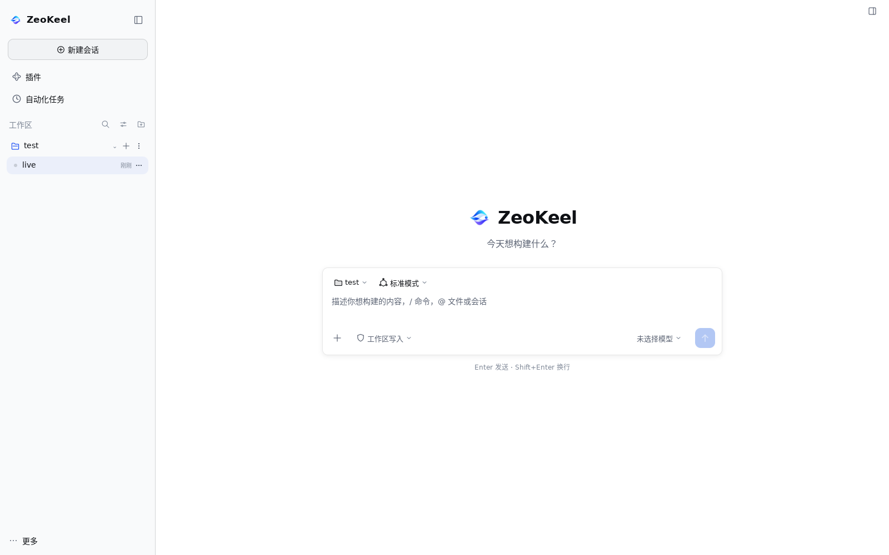

# ZeoKeel Agent

**ZeoKeel：纯 Go 桌面 AI Agent。mygo 原生 UI + eino 运行时。功能对齐 DSH（DeepSeek Harness），视觉与交互自有（mygo 原生设计 + ZeoKeel 品牌）。**

> 品牌资产只使用 `logo/` 下的 SVG，不自行猜测或重绘。插件只做内置（无第三方安装/市场）。
>
> **2026-11-05 决策**：DSH 像素级对齐已退役；功能对齐继续作为目标。见 [ADR 0001：退役 DSH 像素对齐基建](docs/decisions/0001-retire-dsh-pixel-parity.md)。

## 硬约束

| # | 约束 |
| --- | --- |
| C1 | 纯 Go，`CGO_ENABLED=0`，不引入任何 cgo 依赖 |
| C2 | UI 只用 mygo 原生控件（`ui` 包），不用 webview / Electron / HTML |
| C3 | 单进程、单二进制、可交叉编译到 Linux / macOS / Windows |
| C4 | 测试无显示器可跑；功能与交互验收进 CI（DSH 像素/基线门禁已于 2026-11-05 退役） |

## 文档

- **总体规划（主文档）**：[docs/PLAN.md](docs/PLAN.md)
  - 对齐轴与门禁（§1；功能/交互轴有效，像素轴已退役）
  - DSH 设计令牌与布局测量（§2；历史参考，已退役）
  - 架构与 ADR（§4）
  - UI 规格 + **基础样式函数层**（§5；自有视觉设计系统）
  - 交互规格（§6）、功能对齐矩阵（§7）
  - eino 运行时设计（§8）、数据模型（§9）
  - 质量体系（§10）、里程碑与 M0 任务（§11）、风险（§12）、待拍板（§13）
- **决策记录**：[docs/decisions/](docs/decisions/)（0001 退役 DSH 像素对齐；0002 品牌主题基础）
- **功能对齐矩阵**：[docs/FUNCTIONAL-PARITY.md](docs/FUNCTIONAL-PARITY.md)（活文档；像素对齐已退役）
- **历史文档（已退役，不再维护）**：[docs/UI-PARITY-AUDIT.md](docs/UI-PARITY-AUDIT.md)、[docs/COMPONENT-PARITY.md](docs/COMPONENT-PARITY.md)、[docs/research/](docs/research/)
- **字标规格**：[docs/wordmark.md](docs/wordmark.md)

## 当前状态

**M0–M13 完成：五屏 UI · 动画/交互 · 运行时 · 提示词层 · Agent Loop 工具全量 · 多模态图片输入 · 终端 PTY · 真实模型 E2E · 附件上传 · fork/导出**：Home / Session / Plugins / Settings / Automation 全部用 mygo 原生控件实现。`CGO_ENABLED=0 go build/test/vet` 与 `scripts/check-nocgo.sh`（四目标交叉编译）为现行门禁；DSH 像素比对已退役（2026-11-05），历史基线资产已整包归档（`/data/zeokeel-backups/parity-assets-20261105.tar.gz`，回滚点 tag `pre-native-ui`）。

基础设施：`internal/state`（事件总线/快照）、`internal/store`（SQLite v1 + JSONL）、`internal/runtime`（eino ADK：工具回路/多轮历史/审批）、`internal/provider/openai`（SSE 流式 + tool calls）、`internal/session`（会话控制器）、`internal/app`（单实例/托盘/关窗隐藏 + services 接线）。

**2026-11-05 原生视觉迁移进行中**：
- 阶段 1（完成）：像素门禁与静态演示屏已拆除，测试全部迁移到 live fixture；品牌主题 `internal/brand`（logo 色板 + mygo `ui.Theme`）已生效。见 [ADR 0001](docs/decisions/0001-retire-dsh-pixel-parity.md)、[ADR 0002](docs/decisions/0002-brand-theme-foundation.md)。
- 阶段 2（Home pilot 完成）：Home 屏改为 ZeoKeel 自有视觉——品牌 mark + 字标 + 双语 tagline、令牌化布局、原生 `ui.TextArea`/`ButtonBase` composer；设计与截图见 [原生视觉方向](docs/design/native-ui.md) 与 `docs/design/preview/`。`go build/vet/test` 全绿。

下一阶段：Session / Sidebar / Settings·Plugins·Automation 逐屏原生化，以及桌面交互 P0（菜单栏、文本选择、系统通知等）。

## 视觉与交互方向（2026-11-05 起）

- **功能对齐 DSH**：能力与行为对齐（`docs/FUNCTIONAL-PARITY.md`）；不再承诺逐像素/逐交互复刻。
- **视觉自有**：mygo 原生 `ui.Theme` + ZeoKeel 品牌主题（`internal/brand`），设计令牌以品牌资产为源。
- **交互自有**：按桌面平台惯例本地化（系统菜单栏、通知、文本选择、DPI/文本缩放、窗口状态等）。
- **验收口径**：自有设计系统组件样本 + 关键屏自身视觉回归，不再与 DSH 截图做像素比对。

## 字标（已定）

图形标 + “ZeoKeel”文字；**系统字体栈**，17px/600，间隔 8px，不打包字体。规格见 [docs/wordmark.md](docs/wordmark.md)。logo 只用 `logo/` 资产，不重绘。
