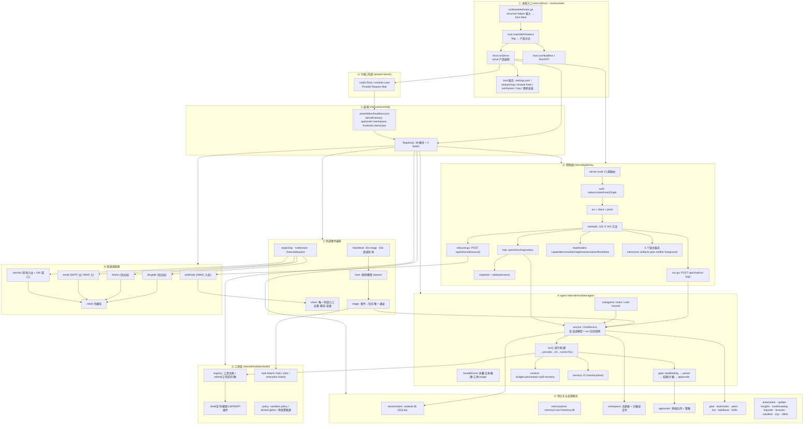
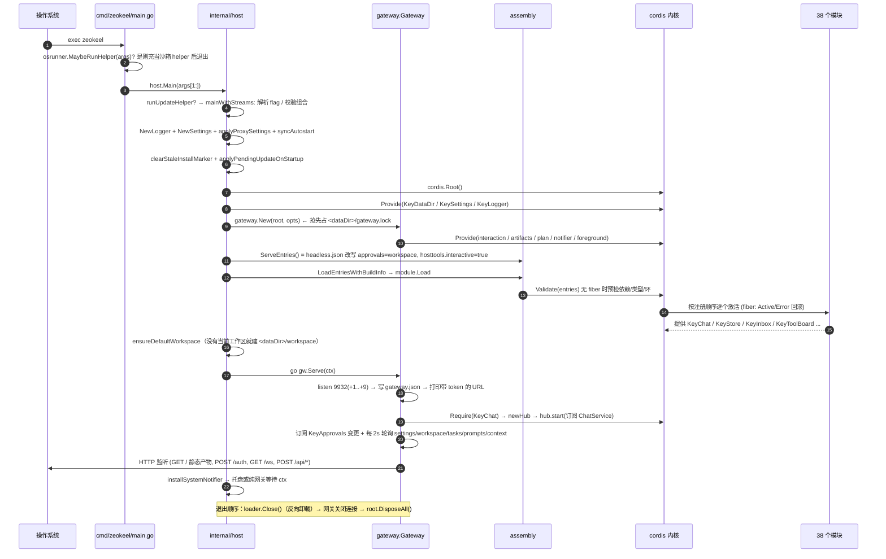
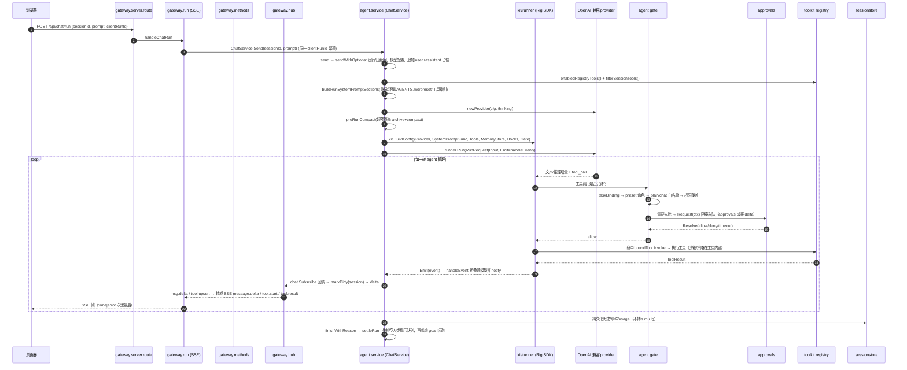
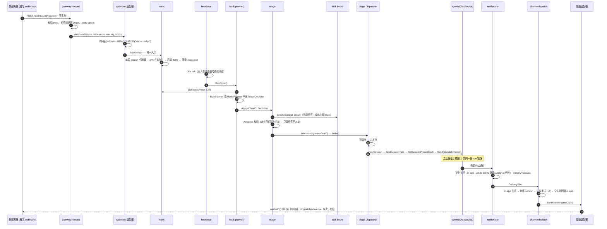
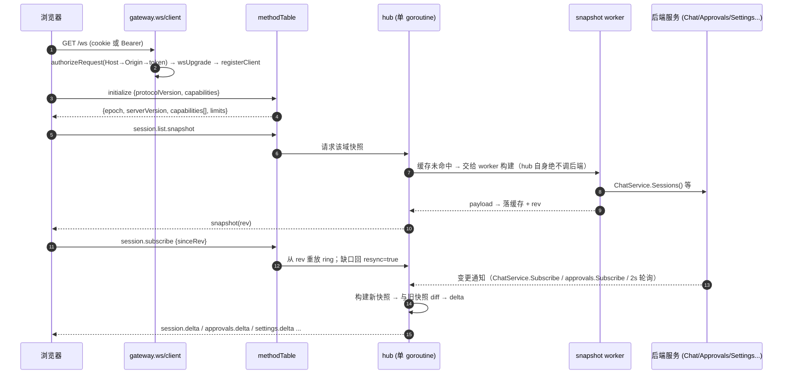

# ZeoKeel 后端架构图 & 程序运行示意图

> 口径：只读代码。**只看后端**（Go：`cmd/` + `internal/`），`web/`（前端 SPA）不计入调用关系分析，
> 仅作为"网关同源提供的静态产物"出现。扫描基线 commit `3f1d1b2`（VERSION 0.4.1）。
>
> 规模：**62 个包 / 734 个 .go 文件 / 178,431 行**（其中测试 403 文件；生产代码 **331 文件 / 77,402 行**），
> 编译期注册 **38 个描述符（37 模块 + 1 空 group 容器）**，WS 控制面 **119 个方法**，HTTP 路由 **12 类**。
> 结构库：**206 个模块（167 叶子）/ 368 条接口 / 131 条带方向的调用箭头**，最深 4 层，39 层渲染数据。

---

## 1. 一句话架构

一个**单进程、编译期装配**的 kernel（cordis）容器：进程宿主（`internal/host`）拉起 `cordis.Root` 并把
数据目录/设置/日志作为 builtin 服务提供出去 → `internal/assembly` 从内嵌 JSON 选出 38 个模块并校验依赖 →
每个模块以**服务键**（`contracts.Key*`）互相 `Provide/Require`，**模块之间不 import**（只有 `contracts` 是共享面）→
`internal/gateway` 把内核里的服务翻译成浏览器协议（WS 状态面 + SSE 单轮流 + HTTP 读模型），
`internal/modules/agent` 用 Rig SDK 跑"模型 ↔ 工具"多轮循环，`inbox → triage → lead → heartbeat`
把外部渠道事件变成任务再变成一次真实运行。

```
            ┌───────────────────────── web/ (浏览器 SPA, 不计入后端) ─────────────────────────┐
            │  GET / 同源静态产物   POST /auth 换 cookie   GET /ws JSON-RPC   POST /api/chat/run (SSE) │
            └───────────────┬──────────────────────────────────────────────────────────────┘
                            ▼
   ╔════════════════════ internal/gateway  ═════════════════════╗
   ║ server.route → auth → ws/client → methods(119) → hub/delta ║
   ║                → run(SSE) / inbound(HMAC) / readmodels      ║
   ╚═══════════════════════┬════════════════════════════════════╝
                           ▼ contracts.Key*  (唯一共享面)
   ╔════════════════  cordis 内核 (zeokeel-kernel)  ════════════╗
   ║ Root / Registry / module.Load / fiber / Provide / Require   ║
   ╚═══════════════════════┬════════════════════════════════════╝
                           ▼
   ╔════════════════ 38 个模块 (internal/modules/*)  ═══════════╗
   ║ agent · toolkit · sessionstore · approvals · workspace ...  ║
   ╚═══════════════════════┬════════════════════════════════════╝
                           ▼
   ╔════════════════ 外部世界 / SDK (zeokeel-rig)  ═════════════╗
   ║ OpenAI 兼容 provider · 工具执行 · SQLite · 渠道 HTTP 端点    ║
   ╚════════════════════════════════════════════════════════════╝
```

---

## 2. 分层架构图（功能调用关系）



**读图要点**

- 只有两类"竖线"：**装配（谁被加载）** 和 **服务键（谁 call 谁）**。模块之间的横向箭头在代码里全都不存在 import，
  都由 `contracts.Key*` 在运行时解析（`internal/assembly/registry.go:59-128` 的注册顺序就是依赖顺序）。
- `gateway` 不 import 任何模块，只 `root.Require(contracts.KeyChat)` 之类取值；`agent` 不 import `gateway`，
  它只实现 `contracts.ChatService`（`internal/modules/agent/agent.go:377-390`）。
- `toolkit` 是唯一把**工具实现**塞进 Rig `*tools.Registry` 的地方，并以两条服务键对外：
  `hosttools.KeyRegistry`（宽，Rig 注册表）与 `contracts.KeyToolCatalog`（窄，仅名称/数量）。

---

## 3. 程序运行示意图 ①：启动（`--product serve`）



---

## 4. 程序运行示意图 ②：一次对话轮次（浏览器 → 模型 → 工具 → 回传）



---

## 5. 程序运行示意图 ③：外部事件 → 任务 → 派单 → 回复



---

## 6. 程序运行示意图 ④：WS 状态面（快照 + 增量）



---

## 7. 工具执行与审批闸门顺序（`agent.gate`，`internal/modules/agent/plan_mode.go:271`）

网关/模型永远不直接执行工具，所有调用都过同一道闸门，顺序**只允许越来越宽**：

1. **task binding**：会话绑定了任务 → 只允许任务绑定的工具（`taskbinding.go`）
2. **preset 角色**：会话选了带白名单的 preset → 只允许其列出的工具（lead 角色因此"不能"写文件，而不是"不愿"）
3. plan/chat 模式的工具白名单
4. 每会话权限覆盖（只读 / 工作区 / 全权）
5. OS 沙箱豁免（`sandbox` 探测到的 bwrap/Seatbelt/ACL runner）
6. 交互类工具豁免（ask_user / present / plan）
7. 记住的"总是允许"
8. 最后才 `approvals.Request` → 入队等待人（网关把 pending 推成 delta；渠道可回文字审批）

执行时：`toolkit.rebind.boundTool.Invoke` → 执行类工具按 job/session 路由到 owner build →
否则按 ctx 工作区根选 build → 工具内部策略（`newPolicy` / `newReadPolicy` / denied globs）→
`textenc.RepairOutput` 修 Windows 非 UTF-8 输出。

---

## 8. 服务键连线（模块 ↔ 模块的唯一通道）

| 提供方模块 | 提供的服务键 | 主要 Require |
|---|---|---|
| `host`（进程宿主） | `KeyDataDir` `KeySettings` `KeyLogger` `KeyModuleLister` | — |
| `gateway`（serve 时） | `KeyUserInteraction` `KeyArtifactPresenter` `KeyPlanReviewer` `KeyNotifier` `KeyForegroundSession` | `KeyChat` `KeyApprovals` |
| `agent` | `KeyChat` `KeyContext` `KeySubagents` `KeyTeam` `KeyChildAgents` `KeySessionLogExporter` | `hosttools.KeyRegistry` `KeySettings` `KeyStore` `KeyApprovals` `KeyDataDir` |
| `toolkit` | `hosttools.KeyRegistry` `KeyToolCatalog` `KeyPlugins` `KeyTaskBoard` `KeyJobs` `KeyExecutionHistory` `KeyTodo` `KeyMCP*` `KeyToolPolicy` `KeyUndo` | 工作区 / 沙箱 / memory |
| `inbox` | `KeyInbox` | `KeyDataDir` |
| `triage` | `KeyTriage` | `KeyInbox` `KeyTaskBoard` `KeyTaskLease`（可选 `KeyChat`） |
| `lead` | `KeyLead` | `KeyInbox` `KeyTriage` `KeyDataDir` |
| `heartbeat` | `KeyHeartbeat` | `KeyLead` + 渠道适配器 |
| `sessionstore` | `KeyStore` | `KeyDataDir` `KeyLogger` |
| `memorystore` | `KeyMemoryService` | `KeyDataDir` |
| `approvals` | `KeyApprovals` `KeyApprovalAction` | `KeyLogger` |
| `workspace` / `skills` | `KeyWorkspace` / `KeySkills` `KeySkillsEditor` | `KeyDataDir` `KeyLogger` |
| `webhook` / `wechat` | `KeyWebhook` / `KeyWeChat` `KeyWeChatLogin` | `KeyInbox` `KeyDataDir` |
| `dingtalk` / `feishu` / `email` | `KeyDingTalk` / `KeyFeishu` / `KeyEmail` | （dingtalk/feishu 无依赖，email 需 `KeyInbox`） |
| `tasklease` | `KeyTaskLease` `KeyTaskSendHolder` `KeyTaskRequester` | `KeyTaskBoard` `KeyDataDir` |
| `automation` | `KeyAutomation` | `KeyDataDir` `KeyLogger` `KeyChat` |
| `acp` | `KeyACP` | `KeyChat` `KeyLogger` |

---

## 9. 持久化落盘清单（只看代码里真实出现的路径）

| 路径 | 写入方 | 内容 |
|---|---|---|
| `<dataDir>/zeokeel.db` | sessionstore | SQLite：历史、检查点、事件日志、会话元数据、搜索 |
| `<dataDir>/memory/<workspaceID>/memory.db` | memorystore | memory v2（按工作区隔离） |
| `<dataDir>/settings.json` | host | 扁平键值设置 |
| `<dataDir>/zeokeel.log` | host | 进程日志 |
| `<dataDir>/gateway.json` / `gateway.lock` | gateway | 运行实例描述（含 token）/ 单实例锁 |
| `<dataDir>/inbox.json` | inbox | 待 triage 的外部事件 |
| `<dataDir>/rules.json` | lead | triage 规则 |
| `<dataDir>/tasklease/leases.json` | tasklease | 任务租约/证据/复核 |
| `<dataDir>/bots/bots.json`、`users/users.json`、`skilldraft/drafts.json`、`automations.json` | 各模块 | 0600 原子写 |
| `<dataDir>/updates/pending.json`、`install-now` | update / gateway | 更新计划与立即安装标记 |
| `<dataDir>/workspace/` | host | 默认工作区 |

---

## 10. 图在哪里看

- **交互式架构图（可逐层下钻）**：`/normify-zeokeel/normify.html`
- **结构数据**：`/normify-zeokeel/tree.json`、`api-index.json`、`receipt.json`
- 深链示例：`normify.html#module=zeokeel.gateway.methods`、`#module=zeokeel.agent.run.loop`


---

## 11. ASCII 版（不依赖 mermaid 渲染器）

### 11.1 分层（谁调谁）

```
 浏览器 SPA
   │  GET /  GET /ws(JSON-RPC)  POST /api/chat/run(SSE)  POST /api/inbound/{source}
   ▼
┌────────────────────────── internal/gateway ──────────────────────────┐
│ server.route ─► auth ─► ws/client ─► methods{119} ─► hub ─► snapshot/delta
│      │                                   │
│      ├─► run.go  ── ChatService.Send ────┼──► agent
│      ├─► inbound ── Webhook.Receive ─────┼──► channels.webhook ─► inbox
│      └─► readmodels ── skills/models/insights/automation/files
└───────────────────────────────┬──────────────────────────────────────┘
                                │ 只有 contracts.Key*（模块之间无 import）
┌───────────────────────────────▼──────────────────────────────────────┐
│ cordis 内核：Root / module.Load / fiber / Provide / Require           │
└───────────────────────────────┬──────────────────────────────────────┘
   ┌──────────────┬─────────────┼──────────────┬───────────────┐
   ▼              ▼             ▼              ▼               ▼
 agent        toolkit        orch          channels         data/control
 ChatService  工具注册表      inbox         webhook(入)      zeokeel.db
 run 循环      shell/files   lead          wechat(轮询入)    memory.db
 gate→审批     tasks/todo    triage        dingtalk/feishu   workspace
 子代理/团队   mcp/lsp       heartbeat     邮件(IMAP/SMTP)   tasklease/…
   │              │             │              │
   └──────────────┴──────► OpenAi 兼容 provider / 工具执行 / SQLite / 渠道 HTTP 端点
```

### 11.2 一次对话轮次

```
浏览器 ──POST /api/chat/run──► gateway.run
                                └─► ChatService.Send ─► agent.send/sendWithOptions
                                       ├─ enabledRegistryTools + filterSessionTools
                                       ├─ buildRunSystemPromptSections（身份/环境/AGENTS.md/preset）
                                       ├─ newProvider(OpenAI 兼容)
                                       ├─ preRunCompact（超预算先压缩）
                                       └─ kit.BuildConfig ─► runner.Run
环路：provider 返回 tool_call
       └─► agent.gate：taskBinding → preset 角色 → 白名单 → 权限 → 沙箱 → approvals.Request(阻塞)
             └─► toolkit 工具执行（boundTool.Invoke → 策略 → textenc 修编码）
                   └─► Emit(handleEvent) → 读模型变更 → gateway.hub → SSE/Ws delta → 浏览器
收尾：recordRunUsage → finishWithReason → settleRun（先排人类提示队列，再 goal 续跑）
```

### 11.3 外部事件 → 任务 → 回复

```
外部系统 ──POST /api/inbound/{source}+签名──► gateway.inbound ─► webhook.Receive(±窗口+HMAC)
                                                                   └─► inbox.Add（60/min、24h 去重、容量 2000）
heartbeat 30s ─► lead.RunOnce ─► inbox.List(new,≤20) ─► planner(规则|模型) ─► triage.Apply
                                                                            ├─ board.Create
                                                                            └─ dispatch.Wake(assignee=lead)
                                                                                 ├─ NewSession + BindSessionTask
                                                                                 ├─ SetSessionPreset(lead)
                                                                                 └─ chat.Send（= 11.2 那条轮次链）
回复：notifyroute.Plan(类别/静音/健康) ─► channeldispatch.Deliver ─► adapter.Send（失败重试一次，兜底 in-app）
```

---

## 12. M1「审计自动循环」实现（2026-11-26 落地）

### 12.1 新增的四个部件

| 部件 | 位置 | 职责 |
|---|---|---|
| 契约 | `internal/contracts/audit.go`、`tasklease.go` | `TaskRework`、`DefaultMaxRework=3`、`ErrLeaseReviewerRoleMismatch`、`ErrLeaseReworkExhausted`、`KeyAudit`、`TaskReviewQueue`、`AuditService.Sweep` |
| 返工计数 | `internal/modules/tasklease/rework.go` | `Rework` / `ResetRework`；Accept 清零、Reject +1、到顶拒绝 Claim/Submit；`leases.json` 追加 `rework` 键 |
| 复核队列 | `internal/modules/tasklease/queue.go` | `AwaitingReview`：只读列出 `state=review` 的租约 |
| 审计循环 | `internal/modules/audit/` | 5 秒 sweep：派审计会话、打回返工、到顶升级；模块已注册进 registry 与 headless 装配 |
| 任务工具 | `internal/modules/hosttools/tasks.go` | `task_submit`（executor，隐式认领 + 必须带证据）、`task_review`（auditor 专用，accept/reject） |
| WS 方法 | `gateway/orchestration.go` | `tasks.rework.get` / `tasks.rework.reset`（reset 需 approve 权限） |

### 12.2 运行示意

```
task board ──dispatch──► executor 会话（preset=executor, 绑定任务）
                            │ tools: task_submit(evidence)
                            ▼
                    lease.state = review
                            │
                    audit.Sweep（5s）
                            │ 每个 (task, lease.Until) 只派一次
                            ▼
                    auditor 会话（preset=auditor, 绑定任务, 只读工具 + task_review）
                            │
              ┌─────────────┴──────────────┐
        accept │                            │ reject（必须写原因）
              ▼                            ▼
      board.completed              rework +1 → 自动返工（再派 executor）
      返工计数清零                   │
                                     ├─ 未到上限(3)：回到上图
                                     └─ 到顶：notifyroute 发 needs_decision（每任务一次）
                                              任务停止自动流转，等 tasks.rework.reset
```

### 12.3 三条不可绕过的规则

1. **executor 角色不能验收**：即使 reviewer 身份与 owner 不同、即使有人手改 preset 把 `task_review` 加回去，租约层也会返回 `ErrLeaseReviewerRoleMismatch`。
2. **证据是硬门槛**：`Submit` 与 `task_submit` 都要求至少一条 evidence；没有证据的"完成"只是一个声明。
3. **上限只能失败关闭**：`leases.json` 里负数/缺失的 rework 行被夹到 0，计数丢失不会让循环变长；到顶后 Claim/Submit 一律 `ErrLeaseReworkExhausted`，直到人执行 `ResetRework`。

---

## 13. M2「阶段化 workflow」实现（2026-11-26 落地）

### 13.1 新增的部件

| 部件 | 位置 | 职责 |
|---|---|---|
| 定义契约 | `internal/contracts/workflow.go` | `Workflow`/`WorkflowStage`、`ValidateWorkflow`、`StageOrder`（稳定拓扑序）、`ReadyStages`、运行态类型、`WorkflowService`、`KeyWorkflow`、`WorkflowDispatcher` |
| 运行器 | `internal/modules/workflow/` | `workflows.json`（定义+运行同一原子文档）、`List/Get/Put/Delete`、`Start`、`Advance`（10s 循环） |
| WS 方法 | `gateway/orchestration.go` | `workflow.snapshot/put/delete/run.start/advance`，条件能力 `workflow`（标记 `KeyWorkflow`） |

### 13.2 运行示意（与 M1 审计循环的衔接）

```
workflow 定义（阶段 + 角色 + 提示 + 验收 + dependsOn）
    │ workflow.run.start / 或 PUT 后手动 Start
    ▼
Start → 只派根阶段：board.Create(stage 任务) → NewSession → BindSessionTask → SetSessionPreset(role) → Send
    │
每 10s Advance：
    ├─ 已派阶段的 task 状态 = completed → 该阶段 done（**完成状态只来自任务板**）
    ├─ ReadyStages(依赖已 done 且自身仍 pending) → 派下一阶段
    ├─ 全部阶段 done → run = done
    └─ 定义里已消失的阶段 → report.Errors（不悬挂）
    │
阶段任务的验收仍走 M1：auditor 会话 + task_review + 返工上限
```

### 13.3 三个设计约束

1. **没有第二套完成定义**：阶段完成 = 该阶段任务被 `Accept`；运行器只读任务板，不写自己的完成状态。
2. **定义校验在契约层**：非法 id、重复阶段、未知依赖、自依赖、环、超长文本都在 `ValidateWorkflow` 里被拒（`ErrWorkflowInvalid`/`ErrWorkflowCycle`，消息指名字段），HTTP 面与运行器共用同一套措辞。
3. **角色只校验形状**，不校验存在性：角色是用户可编辑的 preset，保存时验证存在会让"改个角色名"把已存 workflow 判成非法；未知角色在运行期表现为阶段派发失败并记入 report。

---

## 14. M3「角色管理与 deny 列表」实现（2026-11-26 落地）

### 14.1 新增/改动的部件

| 部件 | 位置 | 职责 |
|---|---|---|
| `AgentPreset.Deny` | `internal/contracts/presets.go` | 角色级 denylist：「除了 X 全都可以」，空 allowlist 表达不了它；写入时拒绝空名/重复/与 `tools` 矛盾 |
| 闸门与工具面 | `internal/modules/agent/preset.go` | deny 在 **工具面**（`filterSessionToolsWith`）与 **闸门**（`presetToolsDenialForPreset`，位于所有允许分支之前）两处生效，不能被"总是允许"/沙箱豁免/审批对话框放宽 |
| 内置 executor | 同上 | `Deny: ["task_review"]`：能提交（`task_submit`），不能给自己的活签字（租约层还会再拒一次） |
| 角色 CRUD | `internal/modules/agent/presets_admin.go` | `AgentPresetService`（`KeyAgentPresets`）：List/Get/Put/Delete，**只写用户行**；内置角色只能覆盖，删除覆盖即恢复出厂；畸形行可被一次写入修好 |
| WS 方法 | `gateway/orchestration.go` | `presets.snapshot / put / delete`，条件能力 `presets`（标记 `KeyAgentPresets`）；写/删需 approve 权限 |

### 14.2 为什么 deny 必须是"两处"

```
角色 executor（allowlist 为空 = 全部工具，deny = task_review）
   │
   ├─ 工具面过滤：模型看不到 task_review（不再学着调用被拒的工具）
   └─ 闸门检查：即使旧调用被重放 / 队友序列化了调用，也会在
        taskBinding → preset allow → deny → 权限 → 沙箱 → 记忆允许 → 审批 之前被拒
```
只做工具面过滤是"建议"，只做闸门是"能跑但一直失败"——两处同时做才是"不能"。

### 14.3 三个设计约束

1. **只写用户行**：内置角色由代码发货；覆盖（Put）与恢复（Delete 覆盖）都不删角色，避免"整理名册"把正在以 lead 运行的会话的工具清零。
2. **写入即校验**：`ValidateAgentPresets` 在 `presets.agents` 写入前跑，矛盾角色（同时允许与拒绝某工具）直接 `ErrAgentPresetInvalid`，不会存进一个"读者只能二选一"的行。
3. **畸形行可修复**：读取侧把畸形行当"无用户角色"，管理写侧也把它当"无用户角色"并整体替换——否则 UI 永远修不好一个手滑写坏的行。

### 14.4 仍未做（M3b）

- `AgentPreset` 的 `skills[]` / `mcpServers[]`（角色级 skill 与 MCP 分配）：目前 skill 仍是工作区级扫描、MCP 仍是工作区级启停，角色只能靠工具名（`mcp__server__tool`）间接约束。

---

## 15. M3b「角色能力域 + 派单时工具分配」实现（2026-11-26 落地）

### 15.1 lead 分配任务工具

| 部件 | 位置 | 行为 |
|---|---|---|
| `task_tools` 工具 | `internal/modules/hosttools/tasks.go` | `{taskId?, tools[]}` → `TaskLeaseService.SetTools`；省略 taskId 用会话绑定的任务；**空列表拒绝**（清绑定是另一个显式动作）；名字非法/未知任务可读报错 |
| lead 白名单 | `internal/contracts/presets.go` | lead 的 allowlist 增加 `task_tools`，派单时可以"配工具"而不只是"派活" |
| workflow 阶段 tools | `contracts/workflow.go` + `modules/workflow` | 阶段可声明 `tools`；派发顺序 = 建任务 → 建会话 → 绑定任务 → **写入工具绑定** → 发提示；无租约层或写入失败 → 阶段拒绝派发（失败关闭） |
| 执行 | `agent` 的 `taskBindingDenial` | 会话绑定任务 → 该任务的工具绑定就是上限（已有机制，M5） |

### 15.2 角色的 MCP 与 skill

| 字段 | 语义 | 执行点 |
|---|---|---|
| `AgentPreset.MCPServers` | 只允许这些 MCP server（空=全部） | 工具面过滤 `mcp__<server>__<tool>` + 闸门再拒（`presetToolsDenialForPreset`，在 allowlist 之前） |
| `AgentPreset.Skills` | 只允许这些 skill（空=全部） | toolkit 的 `filteredSkillStore` 每次 List/Read 问 `contracts.KeySkillScope`（agent 实现：会话→角色→skills）；越权 Read 直接报错 |

### 15.3 不变的规则

- **空列表 = 不限**（历史行为）；只有"角色明确列了名字"才收窄。
- 所有收窄**两处生效**：工具面（模型看不到）+ 闸门（旧调用/序列化调用也进不来）。
- 失败关闭：workflow 阶段声明了 tools 但产品没有租约层 → 阶段不派发，而不是"悄悄不限"。

---

## 16. M4「结构化报告与投递降级」实现（2026-11-26 落地）

### 16.1 部件

| 部件 | 位置 | 职责 |
|---|---|---|
| 契约 | `internal/contracts/reports.go` | `Report`（goal / evidence / openQuestions / verdict / delivered / deferred+原因）、`ReportService`（List/Get/Put/Deliver/Sweep）、`KeyReports`；通知类别 `report` |
| 报告后端 | `internal/modules/reports/` | 校验（**pass 必须有证据**、verdict 封闭词汇）、`reports.json` 原子持久、投递结果如实记录、每分钟 sweep |
| lead 工具 | `internal/modules/hosttools/report.go` | `report{goal,verdict,evidence[],openQuestions[],deliver}`，把「已送达 via X」或「已存储但延迟（原因）」如实告诉模型 |
| WS | `gateway/orchestration.go` | `reports.snapshot` / `reports.deliver`，条件能力 `reports`（KeyReports） |

### 16.2 投递降级（微信 24h 窗口）

```
report 工具 → reports.Put（校验+落盘）→ reports.Deliver
    └─► channeldispatch.Deliver(category=report, text)
          ├─ 外部渠道接单（wechat/dingtalk/feishu/email）→ delivered=true
          └─ 只回落 in-app（窗口关 / 静默 / 无绑定渠道）→ deferred=true + reason
                └─ 每分钟 Sweep：把全部 deferred 合成**一条 digest** 重投
                      └─ 成功 → 逐条 delivered；仍未通 → 保留并更新原因
```

**为什么要 digest**：窗口关闭期间攒下 5 份报告，恢复时发 5 条消息等于骚扰；发 1 条"有 5 份报告此前未能送达，汇总如下"才是人想要的。这也是"逐条已读"与"一次性全到"之间的折中。

### 16.3 两条规则

1. **投递是记录的事实**：`Channel == inapp` 一律视为未送达（deferred），哪怕路由器认为成功了——人没被告知就是没告知。
2. **pass 必须有证据**：与任务租约的 `Submit` 同一条规则，报告不能成为"我完成了"的另一种说法。

---

## 17. 收尾记录（2026-11-26）

### 17.1 已完成的收尾项

| # | 项 | 结果 |
|---|---|---|
| 2 | 仓库卫生 | `internal/modules/agent/memory/memory/**` 的 150 个文件（75 个空 memoryvfs 目录，共 908K）已从 git 移除并删除；`.gitignore` 增加 `/internal/modules/agent/memory/`。它们是 v2 迁移遗留的空壳（`{"version":1,"pages":[]}`），无代码读取 |
| 3 | 文档漂移 | `internal/host/host.go` 包注释重写为当前产品（浏览器 SPA + headless 两个入口，host 只提供 dataDir/settings/log）；`contracts/contracts.go` 删除原生 UI 遗产：整个 `Slot*` 常量块、`KeyNavigator`/`KeyTheme`/`KeyScreenLister` 与 `Navigator`/`ScreenLister` 接口（无任何 Provide/Get），assembly 测试改用 `KeyForegroundSession` 作为"headless 没有 UI 服务"的探针 |
| 5 | notifyroute 持久化 | 路由表落到 `notify.routes` 设置行（`contracts.ParseNotifyRoutes`/`EncodeNotifyRoutes`），重启保留用户绑定；settings 为可选依赖（stripped assembly 仍按默认路由工作）。同时修复 `Routes()` 用硬编码 6 类导致 `report` 路由"能投递但界面看不见"的问题——顺序表移到 `contracts.NotifyCategories()`，未知类别追加在后 |
| 6 | 多工作区 | 按决定保持单工作区，不做派单钉工作区（风险仅在多工作区下成立） |
| 7 | 缓存/临时目录 | `.gomodcache/`、`.gocache/` 已在忽略列表；`.zk-analysis/` 已删 |
| 4 | normify 建模精度 | 给 M2/M4 新增模块补了两条真实锚定边（`orch.reports → orch.dispatch` 的 `rpc:ReportService.Deliver → rpc:contracts.ChannelDispatchService.Deliver`、`orch.workflow → data.tasklease.lease` 的 `rpc:WorkflowService.Advance → rpc:tasks.tools.get / tasks.tools.set`）。其余为存量债务，见 17.2 |

### 17.2 已知建模债务（不影响代码，也不阻塞发布）

- `dep/unanchored`：102 条存量箭头两端都有 API 但未锚定。补锚定需要逐条判断"这条边钉在哪一行 API 上"，猜测会产生比缺失更糟的假精确，因此保留为 warning。
- `api/leaf-empty`：23 个叶子模块没有对外接口（纯内部步骤，如 prompt 拼装、事件回流）。给它们编 API 只是为了消警告。
- `structure/leaf-too-coarse`：15 个叶子跨度偏大，其中 `agent.prompt.system`（880 行）与 `agent.prompt.preset`（599 行）最值得拆，但拆分要连带改 deps 的 to，属于独立的重构切片。

### 17.3 收尾后的全量验证

```
go build ./...   → 通过
go vet ./...     → 干净
gofmt -l cmd internal → 0
go test ./...    → 0 FAIL，59 包 ok
normify_validate → 0 error / 41 warning（31 条为 17.2 的存量债务）
normify_build    → 217 模块 / 178 叶子 / 406 API / 133 依赖
```

---

## 18. 删除桌面外壳（2026-11-26 夜间收尾）

### 18.1 删了什么

| 层 | 删除内容 |
|---|---|
| 原生 UI 外壳 | `internal/host/{tray.go,tray_shell.go,hotkey.go,theme_mode.go,framework_locale.go,notify.go}` 及其测试 |
| 原生设计系统 | `internal/design/`、`internal/brand/`、`internal/icons/`（只被托盘引用） |
| 框架依赖 | `go.mod` 的 `github.com/egoist/mygo` 与 `tool` 指令，`go.sum` 同步 |
| 打包链路 | `mygo.json`、`scripts/build-app.sh`、`scripts/build-appimage.sh`、`scripts/package-macos-dmg.sh`、`scripts/gen-icons.sh`、Makefile 的 `package`/`icons`、ci.yml 的安装包步骤 |

### 18.2 替换而非删除的两处

- **系统通知**：改为平台命令 `notify-send`（Linux）/ `osascript`（macOS），`osnotify.go` 里带 AppleScript 转义；不支持的平台返回错误，调用方记日志并保留应用内 toast。
- **打开 URL**：`lib/openurl` 改为 `open`/`xdg-open`/`rundll32`，子进程 `Start()` 与进程寿命解耦；空 URL 直接拒绝（不再是"trim 后交给平台"）。

### 18.3 发布形态

一个二进制就是整个产品（serve / headless / acp，内嵌浏览器客户端）。`release.yml` 改为矩阵交叉编译 + `scripts/release-archive.sh` 打 tar/zip + SHA256SUMS，**没有安装器、没有签名/公证**——UI 是浏览器标签，没有平台专属产物可签。

### 18.4 建模同步

- 删除 `zeokeel.entry.tray`，`zeokeel.entry.serve` 去掉托盘边，`entry.notify`/`entry.settings`/`lib.openurl` 的 source 与描述重写。
- `zeokeel.agent.prompt.system`（原 880 行叶子）拆为容器 + 5 个真实接缝：`environment`（环境与审批句）、`tools`（逐工具指引）、`sections`（分节组装）、`clilink`（外部 CLI）、`context`（记忆/技能块）。未锚定箭头从 102 降到 98，模块数 217→221。

### 18.5 验证

```
go mod tidy            → mygo 从 go.mod/go.sum 消失
go build ./...         → 通过
go vet ./...           → 干净
go test ./...          → 0 FAIL，56 包 ok（少了 design/brand/icons 三个包）
normify_validate       → 0 error / 40 warning
normify_build          → 221 模块 / 181 叶子 / 415 API / 129 依赖 / 深度 5
```
