# ZeoKeel 交互与视觉审计报告（审计 v0.2.18 · 修复 v0.2.19 · 2026-11-11）

> **给评审人**：这是一份只读审计报告，审计基线为 v0.2.18；**全部建议已在 v0.2.19 落地**，逐条修复状态、验证命令与证据见 §10。所有结论都带当前帧截图、探针输出或 `file:line`，可复验。截图上的红框与角标数字对应图注/正文条目（原始帧与标注版都在 `docs/screenshots/audit-2026-11-11/`）。
> **建议阅读顺序**：§0 结论 → §5 统一设计语言 v2 → §6 需要你拍板的 5 个问题 → 其余按需查证据。

---

## 0. 结论摘要

**一句话**：基础交互是好的（91/91 条交互驱动 PASS、静态设计检查 0 新增违规、Tab/Esc/焦点/审批默认动作都有测试保护），但产品的**交互健壮性缺口集中在「危险确认、窄窗模态、运行态可发现性、设置可发现性、状态唯一性」五处**；视觉上不统一不是缺 token，而是**语义层没收敛**——「选中、状态、列表、主操作、对话框、字号」在同一产品里有 2–5 种画法，导致界面“每块都还行、拼起来主次不清”。

### 0.1 评分（1–5，5 最好）

| 维度 | 分数 | 判断依据（证据见正文） |
|---|---:|---|
| 基础交互正确性 | 4.5 | 91/91 交互驱动 PASS；发送/流式/停止/排队/审批无默认动作/计划 Esc 保护/slash·@ 键盘路径都有帧测试 |
| 危险操作安全 | **2.5** | 审批已安全，但设置/自动化/会话面 **14 个破坏性确认调用点用 `AlertDialog`：末位按钮=默认焦点=Enter 直接删除/恢复**（P1） |
| 状态可见性与一致性 | 3.0 | 运行态键位提示消失、Esc 承诺在焦点离开会话时失效、未保存状态三处重复且可同屏矛盾 |
| 导航与可发现性 | 3.0 | 设置搜索只匹配页面标题（搜「密钥/主题」零结果）；侧栏折叠后无可见展开控件；侧栏搜索先报“没有匹配的会话”再列 4 条消息命中 |
| 窄窗/边界态 | 3.0 | 900×600 是产品最小窗：检查器抽屉打开时**发送/停止/排队被整体遮住**；窄窗顶带元素拥挤 |
| 视觉语言一致性 | **3.2** | 选中态 2 种语言、状态徽章 2 种解剖、对象列表 3 种容器、页面主操作 5 种落点、对话框 4 种头、实际是 11/12/13px 微缩字号系统 |
| 信息层级与降噪 | 3.5 | 无卡片墙式装饰、无假图标、正文层级稳定；但零值 chip、六项遥测条、双 primary、重复复制入口仍在争层级 |
| 键盘与焦点 | 3.5 | 设置开/关焦点归还、Tab 陷阱、浮层分层、Cmd+B 持久化 PASS；审批 Esc 与 palette Esc 有落差 |
| **综合** | **3.4 / 5** | 结构对了，**危险语义、状态唯一性、窄窗主操作可达性**仍需一轮收口 |

### 0.2 发现统计

| 级别 | 数量 | 说明 |
|---|---:|---|
| **P1（立即修）** | **3** | 危险确认默认破坏性（不可逆风险，14 个调用点）；设置搜索只认标题（可发现性断裂）；**最小窗 900×600 打开检查器后发送/停止/排队被抽屉覆盖、指针不可达** |
| **P2（下一轮）** | **15** | 运行态键位、审批摘要、团队任务卡、@ 错误、未保存重复、热键录入、折叠侧栏、侧栏搜索、模型页双主操作、导入三态、palette Esc、零值 chip、toast 遮挡、会话设置标签漂移、粘贴图片无反馈 |
| **P3（打磨）** | **16** | 诊断 unknown/截断、快捷键记法、预设重排、术语、终端命名、技能目录、调度回退、右栏重复标题、插件刷新孤悬、附件 × 命中区、后台任务停止语义、状态徽章/选择态/行高/空态不统一、设置导航滚动裁切、状态条六项、`p2-mentions` 快照被覆盖等 |
| 已确认**做得好** | 18 项 | 见 §7，不要重做 |

### 0.3 先看这两张图

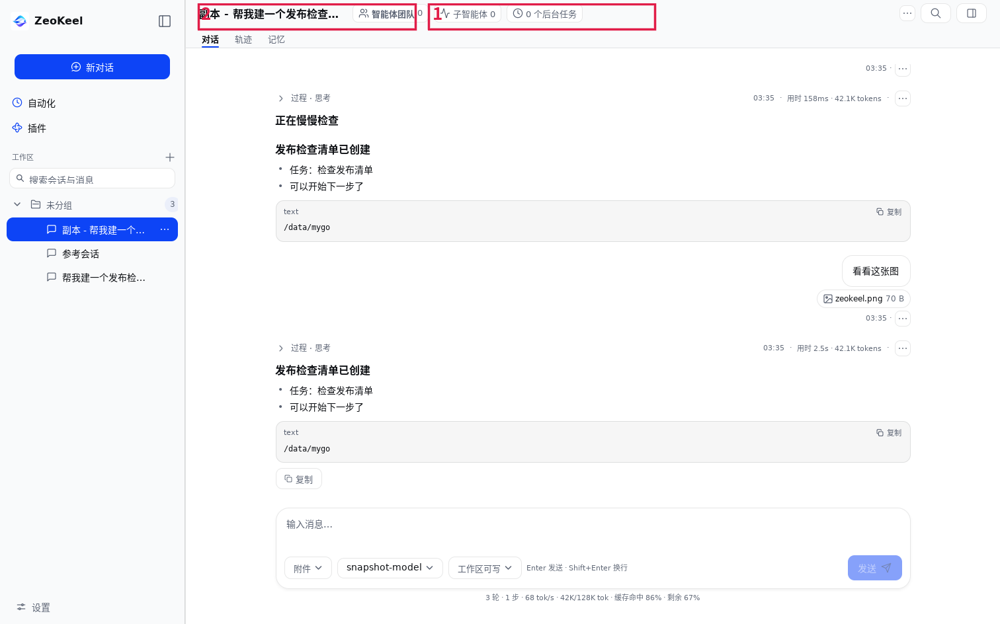

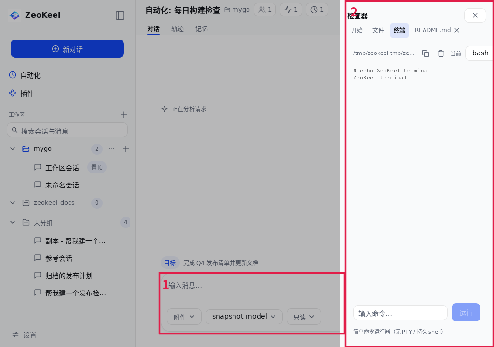

---

## 1. 审计方法与证据

| 证据 | 内容 | 路径/结果 |
|---|---|---|
| 基线 | `7ba6656 release: ZeoKeel v0.2.18`，工作区干净（`git status` 仅本报告新增） | — |
| 当前帧快照 | `ui-snapshot` 全量 **96 张**（1512×944；`narrow/` 1024×720 + 暗色；english） | `.cache/audit-1111/shots/`、`manifest.txt` |
| 交互驱动 | `ui-drive` 全量 **91/91 PASS**（设置 32、会话 26、壳层 15、导向 10、团队 6、设计 2） | `.cache/audit-1111/drive/drive-report.md` |
| 键盘/焦点探针 | 真实 desktop assembly + `ui.NewTester`，D1–D12 共 **64 条可执行断言：53 PASS / 11 FAIL / 0 BLOCKED**；11 条 FAIL 归并为 **6 条根因（P1×2 / P2×3 / P3×1）**，另有 3 条首轮伪影已纠正 | `.cache/audit-1111/probe/`（70 张用例截图） |
| 静态设计检查 | `designlint --strict --baseline`：248 文件、136 violations（0 error、0 warn、0 new、0 blocking）；`scripts/design-check.sh` 6/6 PASS；`go tool mygo vet` 干净 | 见 §8 命令 |
| 回归测试 | `go test ./internal/ui/... ./internal/uiroot ./internal/design ./internal/uikit` **全绿** | 见 §8 |
| 审计分工 | 4 路独立只读审计（会话面 A / 壳层设置 B / 视觉语言 C / 交互探针 D）+ Lead 复核合并 | 原始报告见 `.cache/audit-1111/*/findings-*.md` |

**为什么 91/91 PASS 但仍有 P1**：`ui-drive` 验证的是“功能能跑通”，而本报告审的是“状态是否真实、危险默认是否安全、同类是否同规则”。例如 `archive-delete-confirm` 一步 PASS（确认框出现、点确认能删），但确认框的**默认焦点就在「确认删除」**（§2 R1），这属于“功能正确、交互不安全”。

**探针实测矩阵（53 PASS 摘要，用来证明“基础交互是好的”）**：审批无默认动作/顺序/Enter 不放行/composer 焦点下 Esc 拒绝（D3.1–D3.4）；设置 Esc·X 焦点归还、dirty 守卫、30 次 Tab 不逃出、Esc 取消删除（D2.1–D2.5、D2.7）；浮层分层与 Esc 只关最上层、toast 不吞 Esc（D5.1–D5.4）；Enter 发送+焦点保持、Esc 中止、停止后焦点回 composer、流式中 Enter 排队、空草稿双击不重复（D4.1–D4.5）；侧栏 Tab/Cmd+B/搜索 Esc（D6.1–D6.3）；docked 检查器非模态不抢焦点（D7.1–D7.3）；1024/900/640 无检查器时 composer 一帧收敛（D8.1–D8.3）；空/401/无模型/运行中状态（D9.1–D9.4）；长标题/长草稿/长回复（D10.1–D10.3）；拖拽与粘贴文本（D11.1–D11.3）；12 次快速开关无残留（D12.1–D12.5）。

**局限**：暗色帧 4 张（其中 2 张字节相同，实际 3 张；暗色 transcript/工具卡/审批/palette 无证据）；无 hover/pressed/focus 状态帧；未在 Windows/macOS 真机验证字体与窗口 chrome；640×480 低于产品最小窗 900×600（`internal/host/host.go:67`），该尺寸下设置固底栏「应用」会被裁出窗口（探针 D8.3s），属超出规格的边界记录、不计产品缺陷；真实窗口拖拽悬停、native 焦点环/IME/屏读器、插件/更新失败 fixture 未覆盖。

---

## 2. P1 · 立即修（会让用户做错/不可逆）

### R1. 危险确认的默认按钮就是「删除/恢复」：Enter 直接不可逆执行（P1）

- **现象**：产品里至少 **14 个 `ui.AlertDialog` 调用点**（设置/自动化 11 处、会话面 3 处）把危险动作放在末位，例如「取消 / 确认删除」——按 mygo v0.8.3 的语义（`docs/ui/alert-dialog.md`），**最后一个按钮 = 默认按钮 = accent 蓝 = 默认焦点 = Enter 点击**。因此打开确认框直接回车就会删除数据/覆盖自定义。
- **实测**（探针 D2.6）：模型页删除确认 `cancelFocus=false confirmFocus=true`，按 Enter 后 `dialogAfterEnter=false modelAfterEnter=false` → **模型真的被删了**。
- **命中位置**：设置/自动化 11 处——删归档会话 `internal/ui/settings/archive.go:169`；删模型 `modelcatalog.go:759`；删/清空记忆 `memory.go:275,294`；删技能 `skills_edit.go:186`；删 MCP `mcp.go:400`；删 LSP `lsp_settings.go:389`；清空会话 `data.go:247`；恢复默认预设/人设 `presets.go:552-560`；恢复默认快捷键 `settings.go:209-222`；删自动化任务 `internal/ui/automation/view.go:947`。会话面还有 3 处——删除目标记录 `internal/ui/session/view.go:692`；删除/清空记忆 `internal/ui/session/memory_tools.go:75,221`。
- **规则冲突**：项目自己的 `docs/DESIGN.md:147,249,275` 明确规定“**危险/不可逆确认不要用 AlertDialog**；危险动作不得 Default，安全取消可 Default；AP-12”。所以这不是取舍，是**契约违反 + 侧栏同类修复在设置面的回归**。
- **建议**：契约正解是统一切到 `ui.Modal` + `uikit.DialogFooter`（`取消` 设 `Default`、危险按钮用 `DangerButton()` 且不设 Default）。若只想先止血，最低成本是**把安全动作放末位**（`(确认删除, 取消)`），让默认焦点=取消；但需要设计 owner 确认这与既有“主操作在右”的约定冲突时的取舍。无论哪种，都补帧测试断言“Enter 不触发删除”（探针 D2.6 可直接复用为回归用例）。

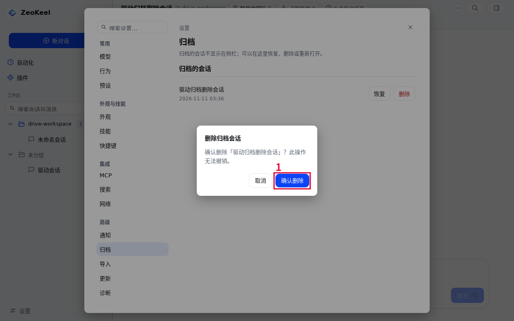

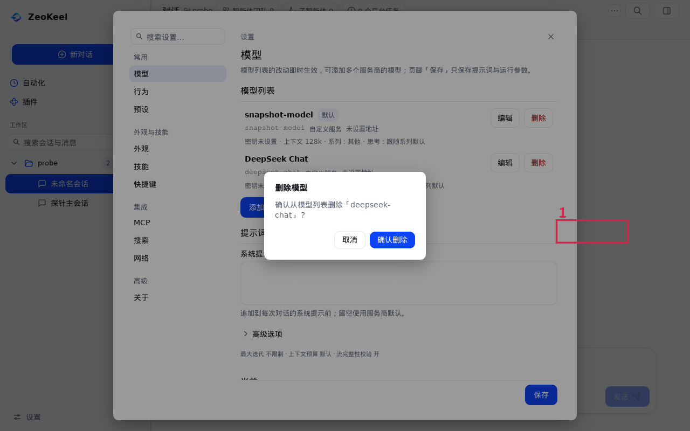

### R2. 设置导航搜索只匹配「页面标题」，搜设置项名一律零结果（P1）

- **现象**：设置导航的过滤是 `strings.Contains(strings.ToLower(page.Title), needle)`，只比页面标题（`internal/uiroot/frame.go:1203-1212`）。在 20 页设置里搜「密钥」「主题」「字体」「代理」「备份」全部显示“没有匹配的设置”；分组名（高级/集成/外观与技能）也不命中。
- **用户影响**：用户记得的是**设置项名字**而不是页面 ID；搜索给出“没有”，用户会直接认为功能不存在。搜索是该导航唯一的快速逃逸路径，所以等效于可发现性断裂。
- **为什么 drive 没发现**：drive 的 `settings-nav-search` 只测了标题词「归档」，所以 PASS。
- **建议**：`SettingsPageSpec` 增加 `Keywords []string`（注册时列页面内字段标签 + 常用别名 + 英文），过滤改为「标题 ∪ 分组 ∪ keywords」；命中分组时保留该组全部页；空态改成可行动的「没有匹配的设置：试试「密钥 / 主题 / 快捷键」」。补一条帧测试：搜「密钥」至少命中模型页。

### R3. 最小窗 900×600 打开检查器后，发送/停止/排队被模态抽屉覆盖、指针不可达（P1）

- **现象**：`narrow/narrow-session-inspector.png`（1024×720）中 composer 在抽屉左缘被切断，工具行只剩「附件 / 只读」；同状态关抽屉的 `narrow-session.png` 中「排队 / 停止」正常。900×600 是产品最小窗（`internal/host/host.go:67`），同样中招。
- **实测**（探针 D7.4–D7.9）：1024×720 抽屉 `x=704 w=320`，「发送」rect `(877,618 82×38)` → `overlapsDrawer=true`，点击报 `ui: "发送" is not the input target at (918.2,637)`；900×600 发送 `(758,..)` ⊂ 抽屉 `[580,900]`；运行态「停止/排队」同样被覆盖（887/825、778/716，三尺寸同构）。**抽屉开着时点 composer 也拿不到焦点**（`keyboardSent=false`），即鼠标与键盘发送路径都被挡住，必须先猜 Esc 关抽屉。
- **不是“正常模态遮挡”**：代码注释声称抽屉会“reserve the drawer's width in the content column”（`internal/uiroot/frame.go:931-957`），但该判断只用于 presentation（`:456,649`），**布局没有让宽**；既有测试 `composer_docked_layout_e2e_test.go:60-122` 只断言“控件在窗口内 + 在底部带”，**没有断言与检查器 RoleDialog 的 rect 不相交**。旧审计 H17 宣称的“drawer 打开时主内容列让出 InspectorWidth”在代码里未兑现。视觉上抽屉的 scrim 也不明显，用户会以为 composer 可用。
- **建议**：三选一——(a) 抽屉打开时真的让出 `InspectorWidth`（内容列变窄，composer 完整可见但被 scrim 禁用，语义清楚）；(b) 动作行固定在窗口右下角、位于抽屉 z 序之上并在抽屉打开时保持可点；(c) 抽屉打开时显式隐藏 composer 并提示「关闭检查器后继续输入」，避免“看得到却点不到”。并给布局测试补一条“控件 rect 不与检查器抽屉 rect 相交且可点击”的断言。

---

## 3. P2 · 下一轮（明显不便/语义不可靠）

### R4. 运行中没有任何键位提示；「Esc 拒绝」的承诺在焦点离开会话时失效（P2）

- **现象 A（键位不可发现）**：空闲时写「Enter 发送 · Shift+Enter 换行」，运行中 `Hint` 直接返回空（`internal/ui/session/view.go:2437-2444`，注释“停/排队按钮自己会说话”）。但 Enter 实际=排队、Esc 实际=停止（`internal/uikit/composer.go:265-293`），两者都不可见。`p2-running-composer.png` 与 `p1-approval.png` 均无提示。
- **现象 B（Esc 承诺不成立）**：审批卡页脚写「Esc 拒绝」（`internal/uikit/approval.go:190`），代码也把 Esc 拒绝作为第一优先级（`view.go:352-357`）。探针实测：**焦点在 composer 时 Esc 正常拒绝**（D3.4 PASS）；但**焦点在侧栏「设置」时 Esc 静默失效**（D3.5 FAIL，`cardStillVisible=true pending=1`）。截图 `D3-esc-sidebar-focus.png` / `D3-esc-sidebar-after.png` 显示焦点高亮在侧栏、审批卡与「Esc 拒绝」同时可见，按 Esc 却没有反应——因为拦截只注册在会话屏作用域（`view.go:328-363` 的 `c.OnShortcut` + composer key hook），侧栏是 uiroot 的兄弟作用域，收不到这个 Esc。
- **建议**：运行态 Hint 显示「Enter 排队 · Esc 停止」（并把 `StopTooltip` 写清“会中断当前回复”）；把「拒绝挂起审批」「停止当前轮」这类全局安全键提升到 window/root scope（仅在会话屏可见、无更高浮层时生效）；在修复前，至少让提示文案随当前焦点状态变化，避免承诺做不到的按键。补帧测试覆盖“焦点在侧栏时 Esc 仍能拒绝审批”。

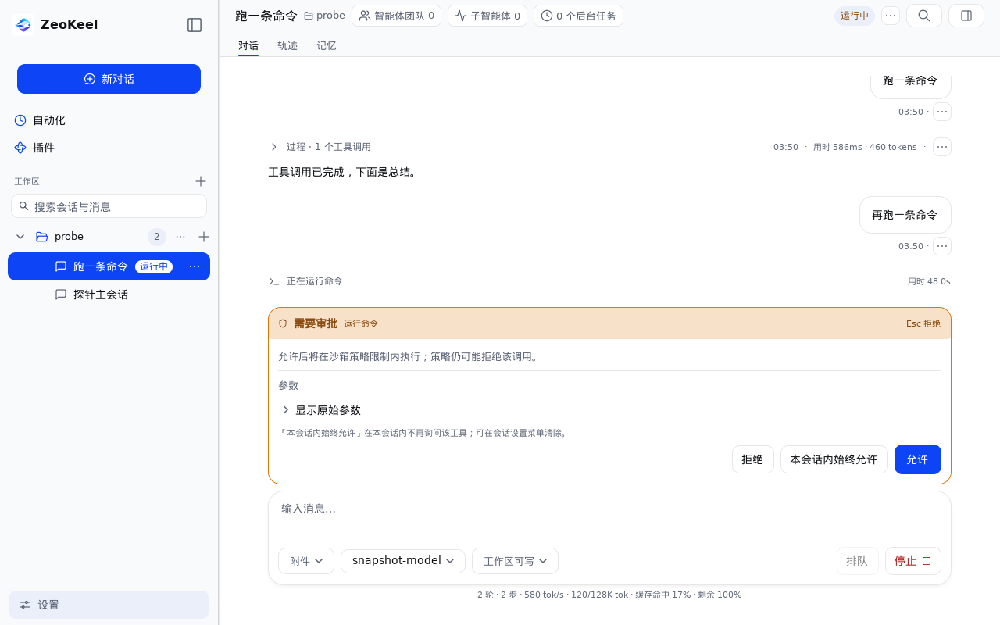

### R5. 审批卡在无摘要时没有“要批准什么”的预览（P2）

- **现象**：`p1-approval.png`（需要审批 · 团队任务）正文只有一句通用影响声明，下面只有「参数」+ 折叠的「显示原始参数」；用户必须先展开原始 JSON 才知道 Agent 要做什么。`internal/uikit/approval.go:330-341` 在 `summary == ""` 时直接 return，没有 fallback；`:344-369` 参数固定折叠且「参数」/「显示原始参数」两层标签重复。
- **影响**：非 shell 工具（团队/任务/文件类）的审批变成“盲批”：要么无条件信任，要么读 JSON。与 AGENT-SURFACES S4「摘要优先」规格不符。
- **建议**：`approvalSummarySection` 增加 fallback——从 `request.Arguments` 提取 1–3 个关键键值（bash→command，文件→path，任务→subject/owner）做 mono 预览；只保留一个折叠标签「原始参数」；摘要区永远有内容。

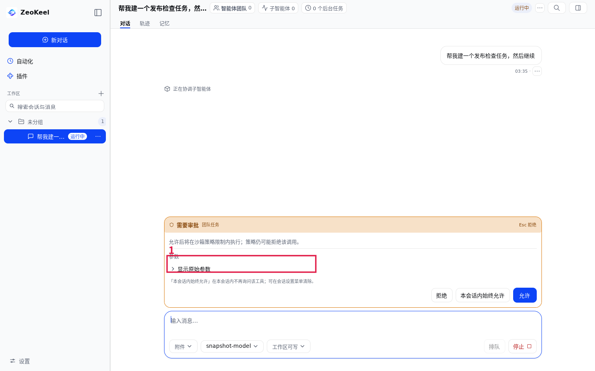

### R6. 团队/子代理任务卡无法被单独识别，owner 暴露原始 ID（P2）

- **现象**：`p2-team-tasks.png` 里两张完全相同的「检查发布清单 / 待处理 / 未指派」卡，没有 task ID 或序号；第 4 张 owner 显示 `负责人 taskboard`（原始 id）；依赖行 `依赖 task-3` 是唯一的标识线索；5 项时末卡被裁、没有“可滚动/共 N 项”提示。子会话视图还直接显示 `member-1`，活动行出现「完成…已完成」重复状态词（`p2-team-child.png`）。
- **证据**：`internal/ui/session/agentsurface.go:384-410`（共享任务区）、`:505-550`（任务卡，owner 直接拼 `task.Owner`）、`:1055-1056`（儿童视图原始 ID）、`:1130-1150`（活动行）。
- **建议**：任务卡显示稳定短 ID/序号 + owner 用显示名；同名任务必须可区分；>3 项时给「N 项 · 可滚动」；原始 ID 收进 tooltip 或「详细信息」。

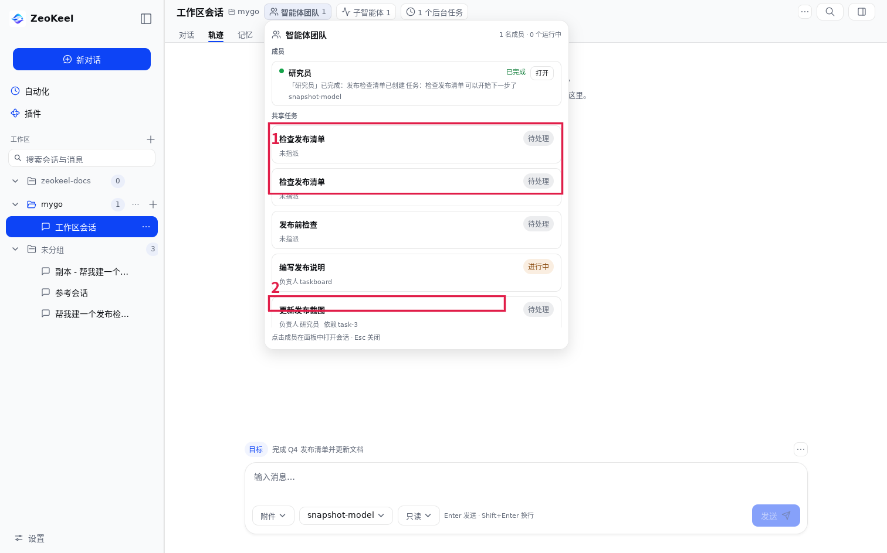

### R7. @ 引用菜单把内部英文错误原样显示，且没有恢复动作（P2）

- **现象**：`p2-sessionrefs.png` 的「工作区文件」分区下是危险色一行「读取工作区失败：workspace: no current workspace」——中文前缀 + Go 内部英文错误，下面是仍可选的会话候选，没有任何“打开/新建工作区”的下一步。
- **证据**：`internal/ui/session/view.go:3899-3904`（`uikit.ErrorLine(... + st.mentionErr.Error())`）。
- **建议**：把 `workspace: no current workspace` 映射为「当前会话没有工作区」+「打开工作区 / 新建工作区」动作；错误块与候选区分隔；错误文本 Selectable。

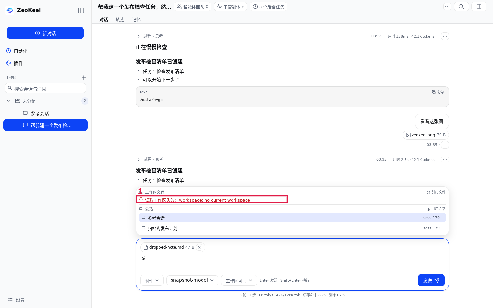

### R8. 「未保存」状态在 3 处重复，且可同屏同时出现「未保存 / 已保存」（P2）

- **现象**：`drive/shots/settings-dirty-guard.png` 一屏内同时有：标题行 Badge「未保存」、拦截条「有未保存的修改」、页底状态行「未保存」+ 上一轮的「已保存」。`statusRow` 在 dirty 时画「未保存」，同时 `state.status` 未被清空（`internal/ui/settings/settings.go:1196-1207`；保存后 `status="已保存"` 只在 Discard 清除）。
- **影响**：用户无法回答“到底保存了没有”；三处措辞/颜色不同，削弱固定 footer 建立起来的“唯一主操作”语义。
- **建议**：状态唯一化——脏只在标题 Badge 表达（拦截条只在关闭时出现）；`statusRow` 仅在非脏时显示最近保存结果，或在任意输入变更时清空 `status`；顺手补「保存并关闭」到拦截条（现在只有继续编辑/放弃修改）。

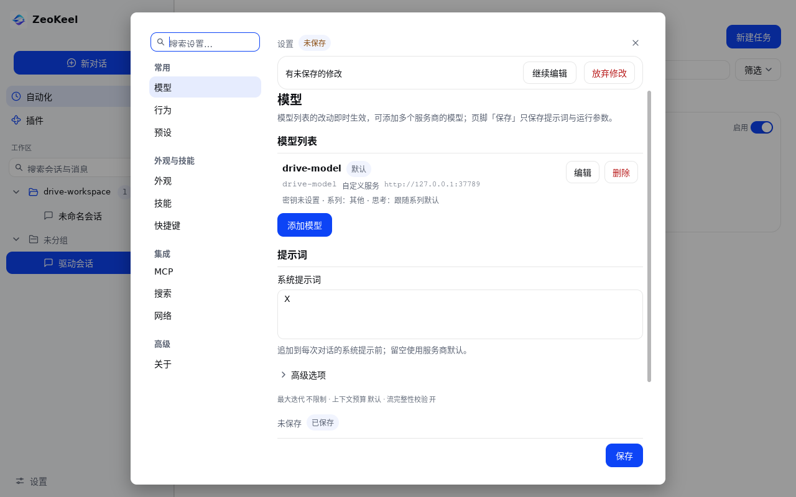

### R9. 外观页全局热键：「录入」按钮与「未应用」状态都在折叠线下（P2）

- **现象**：`p2-appearance.png` 首屏只看到组合键输入 + 说明「按「录入」直接按组合键…」；说明引用的「录入」按钮、`当前：…`、`未应用` 都在视口下方（`internal/ui/settings/hotkey_settings.go:263-333` 渲染顺序：Field → Description → 当前 → 录入行 → 预设行）。点进录入态后（`p2-hotkey-record.png`）才看到「取消录入」「按下组合键，Esc 取消」与 3 个预设。热键又是该页唯一显式保存字段（footer「应用」），容易以为已生效。
- **建议**：「录入」与输入框同一行；`当前`/`未应用` 放在 Field description 上方；说明缩短并明确“点「应用」后、重启生效”；在页面顶部用一句话区分“即时生效项 vs 需应用项”。

### R10. 侧栏折叠后没有可见的展开控件，鼠标用户找不到恢复入口（P2）

- **现象**：`p2-sidebar-collapsed.png` 折叠成 64 DIP rail 后只剩品牌 logo、+、自动化、插件、设置图标；展开依赖点击 logo（`internal/uiroot/frame.go:207-246`），而折叠时点的面板 toggle 消失了。品牌 logo 的通常语义是“回首页/关于”，不是“展开侧栏”。
- **建议**：rail 顶部保留明确的展开按钮（chevron/panel 图标，常显）或 logo 右上角叠一个常显 chevron；保留 tooltip 与 Cmd/Ctrl+B。

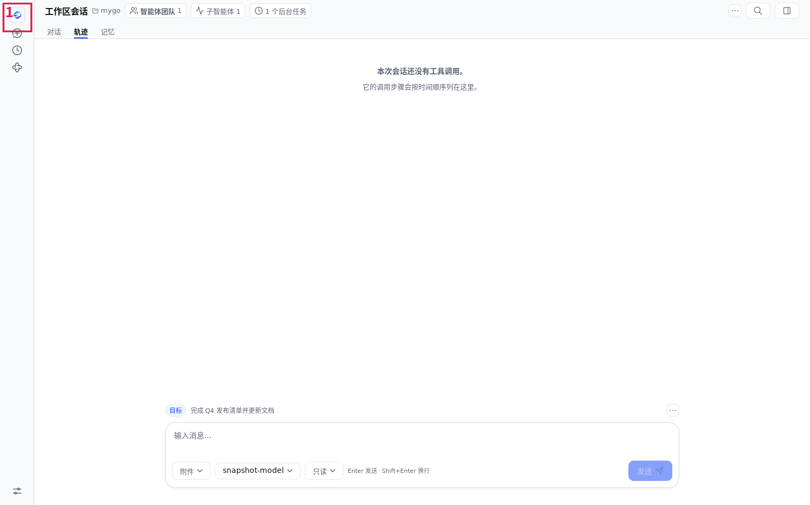

### R11. 侧栏搜索：先报「没有匹配的会话」，再列 4 条消息命中；命中词不高亮（P2）

- **现象**：`p2-search.png` 输入「工作目录」后第一行是「没有匹配的会话」，下面紧接着「消息搜索 / 4 条消息」和结果；用户很可能在第一行就放弃。结果行是纯文本，没有命中高亮。代码：会话列表空时无条件画空文案（`internal/ui/sidebar/sidebar.go:433-455`），消息结果行用纯 `ui.Text`（`:641-663`）。
- **建议**：会话区加小节标题；只有「标题 0 + 消息 0」时才整体显示“没有匹配”；有消息命中时把会话空态降为「标题无匹配」或省略；用 `ui.RichText`/`Span` 高亮命中词，snippet 以命中位置为中心截断。

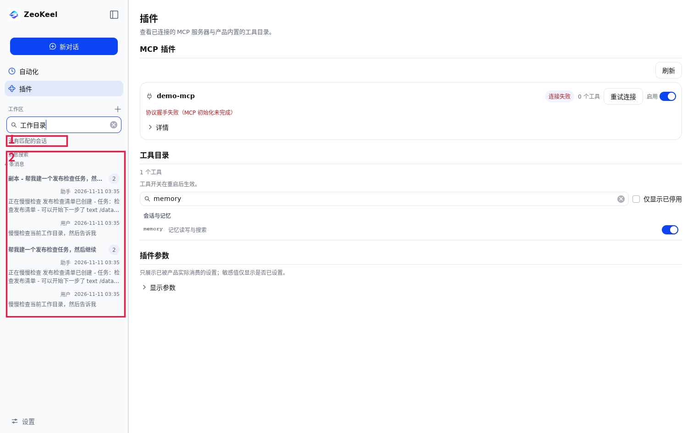

### R12. 模型页：混合保存语义不可见 + 同屏两个 primary（P2）

- **现象**：`p2-model-settings.png` 页中「添加模型」是 accent 填充，页脚「保存」也是 accent 填充（`internal/ui/settings/modelcatalog.go:405-412`；footer `settings.go:645-660`）。而页脚「保存」只保存提示词与运行参数，模型列表改动即时生效——这条说明在滚动区顶部，滚到页脚时已不可见（`settings.go:1187-1194`）。
- **影响**：用户不知道「保存」覆盖哪些改动；两个同样响的按钮争夺“下一步”。
- **建议**：把「提示词 + 运行参数」收进独立 Section 并在该节头重复“由页脚保存”；页脚按钮改名「保存提示词」；「添加模型」降为分节动作（secondary / `SectionAction`）。规则：一屏 ≤1 个 primary（见 §5）。

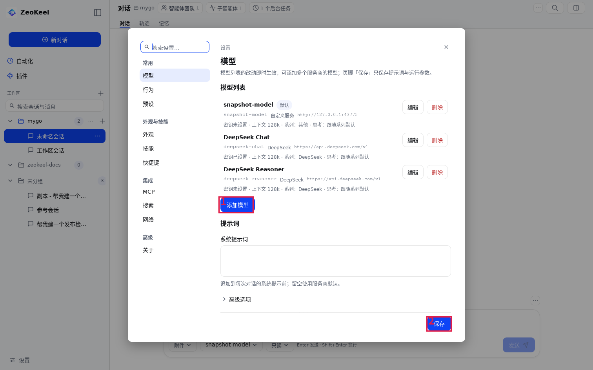

### R13. 导入页三态混同：已选目录、未扫描时仍显示「还没有可导入的数据」（P2）

- **现象**：`p2-import-selected.png` 已输入 `/tmp/dsh-data`、扫描按钮已升为 primary，但空态仍是「还没有可导入的数据 / 选择一个 DSH 数据目录，先「扫描」预览…」（`internal/ui/settings/import.go:136-144` 无条件渲染）。用户会以为目录选错而放弃。
- **建议**：拆三态——未选目录「选择 DSH 数据目录」；已选未扫描「点「扫描」预览（只读，不改动数据）」；扫描完成无结果「这个目录没有可导入的数据」+ 原因。

### R14. 命令面板：提示写「Esc 关闭」，但第一下 Esc 只清空搜索词（P2，探针判定为文案/行为不一致）

- **现象**：探针 D1.4：`query="设置"` 时第一下 Esc → **palette 仍打开、query 被清空**；第二下才关闭。页脚提示是「Esc 关闭」。搜索框持有焦点时，SearchField 原生的“Esc 清空”（mygo `docs/ui/search-field.md`）先于 Modal 的关闭。
- **判定**：不是代码 bug，是产品文案/行为不一致（两段式语义本身合理）；但对用户来说“提示说关闭、按了没关”就是健壮性落差。
- **建议**：在 palette 的 modal scope 上把 Esc 统一为一次立即关闭（清空 query 放到关闭时做），或把提示按 query 状态改成「Esc 清空搜索 · 再按关闭」。补帧测试。

### R15. 页头三枚零值 agent 入口常驻，挤压会话标题（P2）

- **现象**：`p1-chat.png` 固定显示「智能体团队 0」「子智能体 0」「0 个后台任务」，三枚 chip + 运行态 + ⋯/搜索/右栏按钮把标题截成「副本 - 帮我建一个发布检查…」。代码注释明确这是为可发现性有意常显（`internal/ui/session/agentsurface.go:266-299`；子代理 `:584`，后台任务 `:788-822`）。
- **取舍**：这与旧审计“无团队时不占位”的结论相反，需要拍板（见 §6）。我的建议：**保留「智能体团队」入口**（产品差异点，可发现性重要），零值的「子智能体 / 后台任务」收进它的浮层或 ⋯ 菜单；或三入口合并成一个「Agent」入口 + 汇总计数；并给标题设最小可视宽度。
- **备注**：窄窗已经退化为图标+计数（`narrow/narrow-session.png`），可读性进一步下降，建议窄窗合并为一个状态入口。

### R16. toast 遮挡 transcript 右上角的消息动作/元信息行（P2/P3）

- **现象**：`p2-toast.png` 两条 toast（成功/提示）叠在 transcript 右上，盖住第一条消息的时间/用量/⋯ 行。`internal/ui/toasts/toasts.go:1-16` 的注释只承诺“不覆盖 composer、对话框 footer、顶栏”，没有包含 transcript 行内动作。
- **建议**：toast 顶部 inset 下移到 tab 行以下并留右侧安全区；或让 toast 不覆盖可交互元素（hover 时消息动作上浮）；toast 宽度统一（见 §5.2 F-9）。

### R17. 会话设置 chip 的标签在「权限/模式」间漂移，用户不知道点开的是什么（P2/P3）

- **现象**：同一个 chip 在 `p1-chat.png` 显示「工作区可写」，`p2-permission.png` 显示「所有权限」（warning），`p2-plan-mode.png` 显示「计划模式」。`sessionMenuLabel` 的优先级见 `internal/ui/session/view.go:2742-2768`，菜单内容混合权限/模式/人设/预设。
- **建议**：chip 用固定标签「会话设置」，当前权限/模式作为菜单项 trailing 值；或拆成两个稳定 chip（权限 / 模式）。非默认安全状态仍用 warning 色在固定标签上标出。

### R18. 粘贴图片到 composer 无任何反应（P2/P3）

- **现象**：探针 D11.4：粘贴 `image/png` 后没有附件 chip，也没有提示；拖拽文件与文件选择器正常（D11 其余 PASS）。代码里没有剪贴板图片通路（只有文件 drop / picker / `WriteClipboard`）。
- **建议**：支持粘贴图片（与附件同一路径）；若不支持，粘贴图片时给一次性 toast「当前请用「附件」或拖拽添加图片」，不要让用户以为粘贴成功。

> 另有 3 项 P2/P3 归属视觉语言（状态徽章两种解剖、对象列表三种容器、检查器抽屉无 elevation），在 §5 统一处理，不重复计数。

---

## 4. P3 · 打磨（按投入产出排序）

| # | 问题 | 证据 | 建议 |
|---|---|---|---|
| 1 | 诊断页 Commit/构建时间显示原始 `unknown`；「设置键」长 JSON 换行后被 `…` 截断且不可展开/单值复制 | `p2-diagnostics.png`；`internal/ui/settings/settings.go:919-930`（`firstNonEmpty` 不认 "unknown"，`about.go:94-97` 已做友好化）；`:939-957` 拼一行 | 复用 about 的 unknown 处理；设置键改为 Collapsible 逐键两列（值可选中/复制）或摘要「N 个键」+ 展开 |
| 2 | 快捷键三种记法（参考表 `Cmd/Ctrl + N` 双语带空格 / 面板与开始卡片 `Ctrl+Alt+P` 平台化无空格 / 键名混排）且「全部快捷键」漏右栏键 | `p2-shortcuts.png`、`p2-palette.png`、`p2-guide.png`；`settings.go:89-98`、`rightpanel/rightpanel.go:69-72` | 抽 `uikit.FormatShortcut(chord, locale)`，参考表由 CommandSpec 生成并纳入右栏键 |
| 3 | 预设「上移/下移」在边界不禁用，点了静默无反馈 | `p2-presets-settings.png`；`settings/presets.go:328-332,612-619` | 首行/末行 `Disabled(true)` |
| 4 | 记忆「整理记忆」不可懂且紧邻「全部清空」 | `p2-memory-settings.png`；`settings/memory.go:164-171` | 改名「去重并合并」+ Tooltip 说明是否删内容；危险项分隔/收进 ⋯ |
| 5 | 终端 tab 名为「终端」，实为一次性命令运行器，说明写「无 PTY / 持久 shell」开发者措辞；「当前」标签含义不明 | `p2-terminal.png`；`rightpanel/terminal.go:235,250,289` | 改名「命令」；说明改用户收益；路径行改「工作目录」+ tooltip；shell 选择加 Label |
| 6 | 技能页「扫描目录」两条绝对路径没有「全局/工作区」标注 | `p2-skills.png`；`settings/skills.go:151` | 两行改「全局：<path>」「工作区：<path>」+ 打开图标 |
| 7 | 自动化对无法解析的调度直接回退原始英文串且无错误标记 | `p2-automation.png` 第二卡 `every 24h`；`automation/view.go:236-245,555-566` | 显示「未知计划 · 原始值」+ warning 色 + tooltip；卡片加「修复」打开编辑 |
| 8 | 右栏「开始」pane 正文重复 tab 标题（H25 同类在新 pane 复现） | `p2-guide.png`；`rightpanel/view.go:135-140` | 删除正文重复 heading，或 pane 改名「概览」、正文标题保留「快速开始」 |
| 9 | 插件页「刷新」孤悬在分节线与卡片之间，右侧悬空 | `p2-plugins.png`；`plugins/view.go:93-112`（`uikit.SectionAction` 已存在未用） | 改为 `SectionAction(标题行右侧, secondary 32)` 或页头右侧 |
| 10 | 附件 chip 的 × 按钮 20×20，低于 AP-17 的 ≥24 命中区 | `p2-drop.png`；`session/attachments.go:379-389` | 改用 `uikit.IconButton` 或 ≥24 |
| 11 | 后台任务「停止」是中性 Secondary，会话级「停止」是 danger；两者都终止进程 | `p2-jobs.png` `p2-running-composer.png`；`agentsurface.go:923-927` | 统一 danger 语义（或统一为中性 + 二次确认），行内写清“会终止进程” |
| 12 | 状态徽章两种解剖：语义 tint（团队）vs 蓝灰底+彩色字（插件/自动化/更新，11 处） | `p2-plugins.png`（连接失败 = 蓝灰底红字）vs `p2-team-tasks.png`（进行中 = warning tint） | 全部改 `uikit.StatusBadge`，禁用 `t.Badge()+TextColor(t.*Text)` 拼状态；加 grep/lint |
| 13 | 选择态三种画法：会话列表满蓝 / 设置导航薄底 / 检查器 tab 薄底 | `p1-chat.png`、`p2-appearance.png`、`p2-files.png` | 见 §5：持久导航=薄底+2px accent 左条；瞬态=accent 填充 |
| 14 | 设置导航可滚动但无滚动提示；1512 高下「LSP」被底边切半 | `p2-notifications.png`、`narrow/narrow-settings.png`；`frame.go:1104-1111` | 搜索框与列表间加 Divider/PaddingY；导航上下内边距 + fade/scrollbar |
| 15 | 状态条六项遥测（轮/步/tok/s/上下文/缓存命中/剩余）常驻 composer 下 | `p1-chat.png`；`session/view.go:3354-3418` | 默认只留「上下文占比/剩余」，其余进 tooltip（已有 Exact tooltip 能力） |
| 16 | `p2-mentions.png` 快照被后续清空渲染覆盖，@ 菜单证据丢失；`p2-attachments` 与 `p2-fork` 字节相同 | `internal/devtools/ui-snapshot/main.go:800-810`（同一路径先渲染 @ 菜单又渲染清空态，且 Type 后无 Frame） | devtool 修复：先 `Frame()` 再渲染到独立文件名，清空态另存 |

---

## 5. 视觉语言诊断与统一设计语言 v2

> 姊妹篇：[UI-STYLE-DIRECTION-2026-11-11.md](UI-STYLE-DIRECTION-2026-11-11.md) 回答“是否需要大改风格、AI Agent 有哪些主流风格、选哪一种”，含 3 张方向示意稿与前后对比图；结论是**不需要大改**，做定向收敛 + Agent Run Band 签名即可。

### 5.1 现状：不是缺 token，是语义层分裂

视觉成熟度 **3.2/5**。基础设施（语义 token、AA 状态文本色、uikit、暗色主题、空态/错误行/动作条）都在，问题在同一语义有 2–5 种画法：

| 前 6 个系统性问题 | 具体表现（像素级） | 证据 |
|---|---|---|
| **1. 「当前项」两种语言** | 侧栏选中行 = 满饱和 `#0D44F6` 填充 + 白字；设置导航/检查器 tab/模型行 = `#E6ECFE` 12% 薄底。同窗口两种“选中” | `01-session.png` vs `19-appearance-nav.png`；`sidebar.go:1213`（`ui.List`）vs `frame.go:1116`（`ui.SidebarItem`） |
| **2. 强调色无预算** | 侧栏「新对话」满蓝 + 选中行满蓝上下相邻；模型页「添加模型」+「保存」双 primary；外观页 2 个蓝开关 + 应用 + 搜索焦点环 | `10-model-settings-annotated.png`、`01-session.png` |
| **3. 实际是 11/12/13px 微缩字号系统** | 全仓 `TypeXXS` 127 次、`TypeXXXS` 119 次、`TypeXS` 118 次，而文档规定为正文的 `TypeBody` 仅 12 次；11px 用于成句活动摘要、诊断值；顶级屏标题 16（会话顶带）vs 20（自动化/插件页内） | `p2-team-tasks.png`、`p2-diagnostics.png`、`p2-automation.png` |
| **4. 组件一族多画** | 对象列表 3 种容器（r16 卡墙 / r10 描边卡 / 裸行）；页面主操作 5 种落点；对话框 4 种头；chip 4 种语言；tab 3 种选中表现 | `p2-skills.png`、`p2-team-overlay.png`、`p2-model-settings.png`、`p2-plan.png`、`p2-ask.png` |
| **5. 状态徽章两种解剖** | 「连接失败」= 蓝灰底（`#F1F4FE`）+ 红字；「进行中」= warning 12% 底 + AA 文字。红字压蓝灰底语义错位 | `crop-plugin-badge.png` vs `crop-team-badges.png` |
| **6. 暗色表面层级反转** | 浅色：侧栏 `#F9FAFB` 比页面 `#FFFFFF` 深（下沉）；暗色：侧栏 `#13131C` 比页面 `#0D0D14` **浅**（浮起）。同一“导航下沉”隐喻方向相反 | 像素采样；`brand/palette.go:181-189` |

局部硬伤（都已进正文/上表）：
- 设置外观/行为的分段控件**选中态几乎不可见**（选中段=白底+1px 浅灰内框，与容器 ≈1.3:1，`crop-appearance-segmented.png`）——这是状态缺失，不只是不美观。
- 禁用主按钮 = 50% 蓝叠加（`#86A1FA` + 白字 2.47:1），仍像可点的品牌蓝按钮。
- 检查器 markdown 用默认主题 H1≈22.4px 挤在 320px 栏（`p2-file-preview.png`），压过设置页 H1(20)。
- 检查器抽屉无阴影/无 scrim 直接切掉 composer（R3 的视觉面）。
- 工具卡下方与卡头各有一个「复制」，消息菜单还有「复制消息」——同对象 3 个复制入口。
- 插件「刷新」孤悬（§4-9）；设置页「设置」眉标与左导航/H1 三重重复。


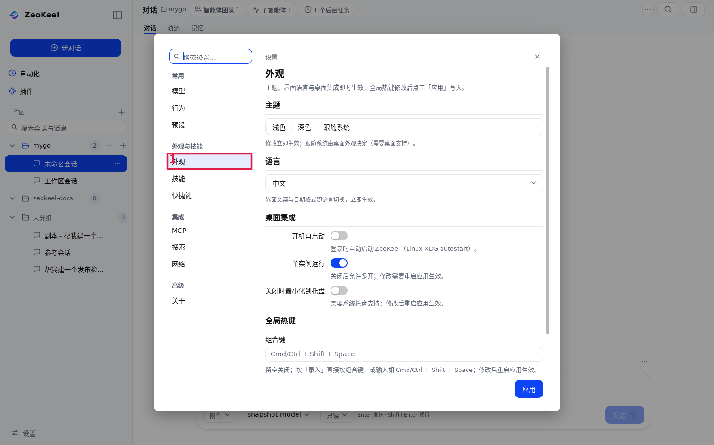

### 5.2 统一设计语言 v2（可直接落地，全部映射现有 token/uikit）

> 原则：不加依赖、不加第二套设计系统；所有规则落到 `internal/design` token、`internal/uikit` 组合与 mygo 原生件。完整表格见 `.cache/audit-1111/visual/findings-visual-language.md` §2，这里给可执行的骨架。

#### A. 表面与层级（S0–S4，两主题同向）

| 语义 | token | 用途 | 规则 |
|---|---|---|---|
| S0 page | `BgBase` | 主内容、transcript、设置 body | 无背景装饰 |
| S1 sunken | `BgSidebar` | 侧栏、顶带、设置导航 | **永远比 page 深**（修暗色反转）；右侧 1px `BorderL2` |
| S2 raised | `BgRaised` | composer、工具卡、审批卡、对话框 | 1px 边框；composer 额外 `ShadowComposer`；**卡内最多再套一层 S3** |
| S3 raised-soft | `BgBase`+`BorderL2`+`RadiusMD` | 团队/任务/子代理行、产物/文件条目 | 只描边，不再叠背景+阴影 |
| S4 overlay | `BgRaised`+`BorderL2`+`RadiusLG` | modal/palette/菜单/toast/抽屉 | 必须 `ShadowOverlay` + scrim（抽屉不能“无阴影假浮层”） |

规则：先删再画（去掉边框/背景后仍能分组就删）；阴影只有三种用途（浮层/composer/抽屉）；嵌套只允许 S2⊃S3 一层；警告色不做满饱和边框（用 `Alpha(0.4)`）。

#### B. 排版（TypeRole 使用规则）

| 角色 | 允许 | 禁止 |
|---|---|---|
| `TypeXL 24` | 仅品牌/落地页 hero | chrome、设置、检查器 |
| `TypeL 20/600` | 设置页/对话框 H1 | 列表行、卡头 |
| `TypeM 16/600` | 分节标题、窗口顶带屏幕标题 | 正文 |
| `TypeBody 14` | 会话正文、问题正文、表单成句说明 | 元数据、按钮 |
| `TypeS 14/24` | 列表行标题、菜单项、按钮标签、工具名 | 长段正文 |
| `TypeXS 13` | 次要正文、表单标签、属性值、检查器正文 | 时间/计数（用 XXS） |
| `TypeXXS 12` | 元数据行、hint、状态徽章文字 | 成句活动摘要（≤2 行可放宽） |
| `TypeXXXS 11` | **仅**微标签：分组小标签、kbd、终端 gutter | 成句文本、活动摘要、诊断值、按钮文字 |

硬规则：一屏最多 4 种字号；权重只用 400/500/600；元数据永不用 accent；所有标题/行标题 `MaxLines(1).Ellipsis`；**所有顶级屏幕标题统一 16/600 放顶带**，页内 `PageHeader 20` 只给设置页/对话框。

#### C. 间距 / 行高 / 圆角

- 4px 网格：行内 4、组内 8、组间 12、区块间 16、页面/对话框边距 20–24、卡内 12。
- 行高/控件全部 4 的倍数：紧凑 28（chip/图标按钮）/ 紧凑行 32（树行、菜单项、工具目录）/ 标准 36（列表行、侧栏行、对话框按钮）/ 页面主操作 40 / 双行行 44。**删除 38**（当前 `PrimaryButton` 38 破坏节奏）。
- 圆角语义：`RadiusXS 4` 仅内嵌小方块；`SM 8` 行/控制 chip/palette；`MD 10` 原生控件/S3/菜单；`LG 16` S2 卡/对话框/toast/团队浮层；`XL 20` **仅 composer**；`Max` 状态药丸。子圆角 ≤ 父圆角；同屏最多 3 档。

#### D. 颜色角色矩阵 + 强调色预算（硬规则）

| 角色 | 用途 | 禁止 |
|---|---|---|
| Accent | 唯一 primary、瞬态选中填充、焦点环、开关 on、链接 | 元数据/装饰图标；一屏 >2 块 |
| Danger | 不可逆操作、错误文字/图标 | “恢复默认/刷新”等可恢复动作；一屏 >2 个红色元素 |
| Warning | 审批、运行中/进行中、风险权限（所有权限） | 普通“注意一下”提示 |
| Success | 完成、已连接、已复制、diff 新增 | 进行中 |
| Neutral | 结构、hover、选中、禁用、次级动作 | 用中性底承载状态语义 |

**强调色预算**：每屏 ≤2 个 Accent 填充、≤1 个 primary；持久导航选中 = `BgSelected` 12% + 2px Accent 左条 + `LabelPrimary`（不再满蓝）；瞬态选择（palette/菜单/下拉）才用 Accent 填充 + `OnPrimary`；状态只由 `StatusBadge` tint 表达且标签必填；焦点环 1–2px 仅键盘可见。

#### E. 交互状态视觉（统一）

| 状态 | 规则 |
|---|---|
| hover | 仅可点行/chip/图标按钮：`BgHover`；**不改变文字色** |
| focus | 键盘可见 1–2px ring；输入框 1px Accent 边框；鼠标点击不显示 |
| selected（持久） | `BgSelected` + 左侧 2px Accent 条 + LabelPrimary；图标 accent |
| selected（瞬态） | Accent 填充 + OnPrimary（仅浮层） |
| disabled | 填充控件改 `BgStrong` + `LabelTertiary`；**不再用 50% Accent**；轮廓控件保留原生 disabled |
| loading | 原位 spinner + “正在…”，控件尺寸不变，不跳布局 |
| error | 就近 `uikit.ErrorLine`（danger 图标 + DangerText 13，Selectable），与失败控件间距 8 |
| running | 8px 状态点 + StatusBadge；禁止整行变色/闪烁；长任务才显示进度 |
| empty | 三档：Hero（图标+16/600 标题+13 提示+primary 40）/ Block（14/600 标题+12 提示+可选动作，居中）/ Inline（13 tertiary 单行） |

#### F. 组件骨架（扩展现有 uikit，不引新系统）

1. **ScreenBand（顶带 40，S1）**：屏幕标题 16/600 + 可选副标题 + 控制 chip 28 + 屏幕动作 IconButton 28 + `⌘K` + 右栏开关；下方 32 高 tab 行（下划线）。**每个顶级屏幕都必须贡献**（当前自动化/插件屏缺，导致可见的 ⌘K/右栏入口消失）。
2. **PageHeader（仅设置页/对话框）**：H1 20/600 + 副标题 13/tertiary + 右侧动作（secondary 32）；去掉「设置」眉标。
3. **Section / SectionAction**：标题 16/600 + 1px Divider + body gap 8；动作在标题行右侧 32 高 secondary。
4. **EmptyState** 三档（见上）+ 迁移约 15 处手写空态。
5. **ListRow（管理列表）**：高 44（双行）/36（单行），PaddingX 12，标题 14/600，meta 12/tertiary，行尾 ≤1 个 IconButton + ⋯ 菜单，行间 1px Divider，无卡无阴影。
6. **ObjectCard（S2，会话内容）**：Panel + Padding 12 + gap 8；卡头图标 16 + 工具名 mono + StatusBadge + 单一动作；复制只保留一个入口且文案写明范围。
7. **ControlChip** h28 r8 BorderL2（顶带计数/composer 选择器/筛选）；**StatusBadge** 药丸 tint + AA 文本；附件 chip 改 ControlChip（现在用了 r16 Panel，是唯一异类）。
8. **DialogShell**：header（可选图标 20 + H1 20/600 + 可选副标题 + **始终右上 X 32**）+ body gap 12 + footer（DialogFooter：danger/secondary 左、primary 最右、高 36）；提示在 footer 上方或输入框下一行，**禁止 footer 后提示行**（计划/提问现在按钮行下还有提示行）。
9. **Toast**：min 280 / max 360、RadiusMD、BorderL2、ShadowOverlay、固定状态图标 + 标题 13/600 + 正文 12；位置顶带下 12、右 16。
10. **PropertySheet**：160px 标签列 + 值左对齐、行 32 + Divider；路径/JSON 用 MonoText(XS)（诊断页与关于/网络统一）。
11. **Tab**：下划线（13、激活 500/600、2px Accent），药丸只给分段控件；检查器文档 tab 独立一行（现在与视图 tab 混排）。
12. **检查器文档主题**：新增 `uikit.MarkdownDoc`（正文 13、H1≈15），用于文件预览/产物预览（现在 H1 22.4 压 320px 栏）。

#### G. 交互语法（统一约定，建议写进 DESIGN.md）

| 场景 | Esc | Enter | 默认焦点 |
|---|---|---|---|
| 输入框空闲 | 清空建议菜单（有的话） | 发送 | 输入框 |
| 运行中 | 停止本轮（有审批 pending 时先拒绝审批） | 排队 | 输入框（保持可输入） |
| 审批卡 | 拒绝（**必须全局生效，不依赖焦点位置**） | 无默认动作 | 无 |
| 计划审阅 | 第一次：提示且不关闭（安全）；建议二次 Esc = “稍后处理”而非死键 | 有反馈=继续规划；空=不批准 | 反馈输入框 |
| 提问 | 取消 | 提交（无默认选中） | 第一个选项 |
| 对话框/菜单/浮层 | 关闭最上层（Esc 分层：menu → popover → dialog → screen） | primary 或表单提交 | 安全动作（危险不得 Default） |
| 抽屉/侧栏 | 关闭 | — | 打开者，关闭后归还 |
| 面板打开/关闭 | — | — | 打开者，关闭后归还（D7.3 待确认规范） |

> 说明：计划审阅“Esc 不关闭”是安全取舍，可保留，但必须有可见反馈（已实现一次性提示）；长期建议 Esc = “收起审阅、计划保持待审”，避免死键。

### 5.3 落地批次（按 ROI）

| 批次 | 内容 | 改动面/风险 |
|---|---|---|
| **第一批（P1）** | ① 危险确认统一 Modal+DialogFooter（安全 Default）② 设置搜索加 keywords ③ 选中态两级规范（侧栏脱离满蓝）④ 强调色预算（模型页双 primary、侧栏 New chat 降级）⑤ 状态徽章统一 StatusBadge | 中高：涉及侧栏行自绘/主题、14 处对话框；需全量快照 + 帧测试 |
| **第二批（P2 视觉）** | 分段控件选中可见；type scale 规则（11px 禁成句）；对象列表去卡墙；主操作只剩两落点；DialogShell；检查器 MarkdownDoc/抽屉 elevation/tab 语汇；插件刷新归位；chip 家族/属性表统一 | 中：结构变化，需快照与键盘回归 |
| **第三批（P3）** | 控件高度去 38；空态三档；暗色 surface ramp（侧栏永远下沉）；danger 预算（行内删除收进 ⋯）；toast 骨架；目标条收紧；窄窗顶带收敛 | 中低：改样式/位置，注意暗色与窄窗快照 |

---

## 6. 需要评审人拍板的 5 个问题

1. **侧栏「当前会话」是否从满蓝改成薄底 + 2px 左条？** 现状满蓝是 `ui.List` 原生选中，改它需要自绘行/主题层，但能立刻消除「新对话 + 选中行」两个重蓝块，并与设置导航统一。
2. **零值 agent 入口怎么处理？** 旧审计结论是“无团队不占位”，当前实现是“常显以便发现”。二选一：隐藏零值（标题更宽）/ 合并成一个 Agent 入口（推荐）/ 保留现状但只留团队入口。
3. **设置保存语义是否统一？** 现状：4 页显式保存 + 其余即时生效 + 模型页混合。方案 A：全部改为“即时生效 + 撤销 toast”（最一致，但改动大）；方案 B：保留页脚保存，但把模型页拆成「提示词与运行参数（页脚保存）」和「模型列表（即时生效）」两节并明示；方案 C：保持现状只修文案与双 primary。
4. **危险确认是否接受一次性迁移 14 处到 Modal？** 这是 P1；也可以先迁移删除类 5 处 + 恢复默认 2 处，其余排期。请确认是否纳入下一轮必做。
5. **设计语言 v2 是否升格为下一轮硬约束**（写入 `docs/DESIGN.md` + `AGENTS.md` + lint 规则：一屏 accent 预算、11px 禁成句、状态徽章禁用中性底+状态字、危险按钮不得 Default）？确认后我按批次出 before/after 帧与帧测试。

---

## 7. 做得好的（不要重做）

1. **审批无默认动作**：驱动 `approval-safe-default` PASS，探针 D3.1/D3.3 PASS（Enter 不放行、无默认焦点），真实事故防线在。
2. **计划审阅安全语义**：无 Default、Esc 不取消且有一次可见提示（探针 D3.5/D3.6 PASS）。
3. **ask 等权选项 + 取消 Default**：探针与截图均 PASS，Enter 不误选。
4. **slash/@ 菜单键盘优先、浮层不推布局**：`overlay-*-no-layout-shift` PASS；`p2-slash.png` 的「↑↓ 选择 · Enter 执行 · Esc 关闭列表」清楚。
5. **设置壳**：固定页脚主操作、任意页脏守卫 + Discard 真回滚、深链、Esc/X 焦点归还（探针 D2.1–D2.5 PASS）。
6. **命令面板**：打开即输入、↑↓+Enter、Tab 进列表、快捷键列、无结果不误执行、浮层分层（D5 PASS）。
7. **原生 toast**：最多 2 条、级别、关闭、撤销动作、读屏 role（D5.3 PASS）。
8. **失败就近恢复**：MCP 连接失败卡内「重试连接」+ 本地化原因 + 详情折叠。
9. **消息/过程/推理层级**：正文 14/22、元数据 12/tertiary、`过程·思考` 折叠不与正文抢层级；流式几何稳定。
10. **审批内联形态**：warning 横幅 + 中性 body + 拒绝在左/允许在右 + Esc 提示（只需收掉整卡满色边框）。
11. **权限 chip 语义色**：`所有权限` warning、`只读/工作区可写` 中性——全产品最正确的一次语义色使用。
12. **composer 是唯一流内 elevation**：卡片全部平贴，克制得当。
13. **空态/错误行/对话框动作条已有共享件**（`EmptyState` 38 处、`ErrorLine` 62 处、`DialogFooter` 统一顺序），基础已具备，问题只是“没被全量采纳”。
14. **暗色中性色带品牌倾向**（黑向 violet/cyan 抬升，不是纯灰）、浮层更强阴影，方向正确。
15. **图标 16/20 体系与 IconButton 命中区规则**已收敛，无 emoji/Unicode 假图标。
16. **窄窗 header 退化**（图标+计数）、顶带保留标题、composer 工具行折叠有帧测试。
17. **Tab 焦点陷阱 / Cmd+B 持久化 / 侧栏搜索 Esc**：探针 D2.5/D6.2/D6.3 PASS。
18. **91/91 功能交互 PASS + 静态检查 0 新增违规**：功能层没有“坏掉”，本轮问题都是状态/语义/一致性深度问题。

---

## 8. 复验命令

```bash
cd /data/mygo
export PATH=/usr/local/go/bin:$PATH GOPATH=/data/mygo/.cache/gopath GOCACHE=/data/mygo/.cache/go-build
mkdir -p /tmp/zeokeel-tmp
export TMPDIR=/tmp/zeokeel-tmp GOTMPDIR=/tmp/zeokeel-tmp GOFLAGS=-mod=mod GOPROXY=off GOSUMDB=off

# 当前帧（96 张）
go run ./internal/devtools/ui-snapshot .cache/audit-1111/shots

# 功能交互（91 步）
go run ./internal/devtools/ui-drive --out .cache/audit-1111/drive

# 静态设计契约
go run ./internal/devtools/designlint --strict --baseline .design-baseline.json ./...
bash scripts/design-check.sh
go tool mygo vet .

# 回归测试（本轮已跑，全绿）
go test ./internal/ui/... ./internal/uiroot ./internal/design ./internal/uikit -count=1
```

**关键证据索引**：快照 `.cache/audit-1111/shots/`；驱动 `.cache/audit-1111/drive/drive-report.md`（91 PASS）；探针 `.cache/audit-1111/probe/run.log`；四路原始报告 `.cache/audit-1111/{session,shell-settings,visual,probe}/findings-*.md`；本报告截图（原图 + 标注版）`docs/screenshots/audit-2026-11-11/`。

---

## 9. 逐条对照旧审计（只作对照，不作现状依据）

| 旧条目 | 现状 | 说明 |
|---|---|---|
| H1 设置保存语义/主操作在滚动末尾/未保存守卫 | **已修验证** | 固定 footer + 脏守卫 + Discard 回滚；新问题是状态重复（R8）与混合语义（R12） |
| H2 测试连接测已保存配置 | 已修验证（代码用草稿） | — |
| H3 计划 Enter 丢反馈 | 已修验证（探针 D3.5–D3.7） | — |
| H4 审批默认 Enter=允许 / 总是允许范围 | **部分仍在** | 无默认动作已验证；但「Esc 拒绝」在焦点离开会话时失效（R4），文案已改「本会话内始终允许」 |
| H5 设置搜索/重复标题 | **部分** | 搜索框/分组/折叠已有；搜索维度只认标题（R2）；设置眉标仍重复 |
| H7 输入区控件认知负荷 | 已修验证 | 收敛为附件/模型/会话菜单/发送；新问题是 chip 标签漂移（R17） |
| H8 slash/@ 推布局 | 已修验证 | 锚定 popover；`p2-mentions` 快照证据被覆盖（P3-16） |
| H9 排队不可管 | 已修验证 | 队列浮层可取消/清空 |
| H10 inspector 概览开发元数据 | 已修验证 | 概览首屏只留用户信息；诊断收折叠 |
| H11 自动化不可编辑/原始调度 | **部分** | 编辑已加；无法解析的调度仍回退原始英文串（P3-7） |
| H12 插件失败恢复弱 | 已修验证 | 行内重试 + 原因；刷新位置仍孤悬（P3-9） |
| H13 Home 只读/无最近会话 | 已修验证（landing 可切模型/模式） | — |
| H14 无撤销/toast 堆叠 | 已修验证 | 最多 2 条 + 撤销；toast 遮挡消息动作（R16） |
| H15 消息动作/工具卡可发现性 | 已修验证（动作行贴底部、隐藏 call id） | 复制入口重复（P3/§5） |
| H16 goal 菜单语义 | 已修验证 | 「结束目标（保留记录）/删除目标记录」 |
| H17 1024 drawer 遮 composer | **回归/未兑现** | R3：布局没让宽，测试只查底部带不查遮挡 |
| H18–H26 | 大多已修验证 | 见 B/C 报告的旧审计对照表 |

---

## 10. 修复状态与验收（v0.2.19，2026-11-11）

> 用户接受本报告全部建议后，按「P1 → P2 → P3 → 统一设计语言 v2」完成实现。代码与文档同批提交；本节是**审计条目 → 实现 → 证据**的闭环记录。

### 10.1 审计条目状态

| 条目 | 状态 | 实现与证据 |
|---|---|---|
| R1 危险确认默认破坏性 | **已修** | 新增 `uikit.ConfirmDanger`（Modal + DialogHeader + DialogFooter：取消 Default、危险非 Default）；设置/自动化 11 处 + 会话 3 处迁移；帧测试 `uikit.TestConfirmDangerDefaultsToCancel`、`settings.TestArchivePageDeleteConfirmEnterCancels`；行内危险动作收进 ⋯ danger 菜单，每屏红 ≤2 |
| R2 设置搜索只认标题 | **已修** | uiroot 新增 host-owned keyword 表（18 页别名 + 分组标题）；`uiroot.TestSettingsSearchMatchesSettingNames` 覆盖「密钥→模型」「主题→外观」 |
| R3 抽屉遮 composer | **已修** | 抽屉打开时内容 body 让出 `InspectorWidth`（band 保持全宽）；抽屉加 `ShadowOverlay`；`uiroot.TestInspectorDrawerReservesContentWidth` 断言 body 右缘不进入抽屉；探针 D7.4–D7.9 复跑：发送 rect 不再与抽屉相交（模态 scrim 仍按 mygo drawer recipe 阻断交互，属预期） |
| R4 运行态键位 / Esc 承诺 | **已修** | composer 运行态显示「Enter 排队 · Esc 停止」+ StopTooltip 后果；uiroot `escapeFallback` 在窗口级拒绝最旧审批/停止当前轮（不依赖焦点）；探针 D3.5 复跑 PASS |
| R5 审批无摘要 | **已修** | `approvalArgumentsPreview` fallback（bash/文件/团队/任务/网页关键键值 mono 预览）；折叠标签仅「原始参数」；uikit 测试 3 子用例 |
| R6 团队任务卡不可核对 | **已修** | task short ID（task-N）+ owner 显示名 + 「N 项 · 可滚动」；子会话 raw ID 进 tooltip、活动行去重；session 帧测试 |
| R7 @ 菜单内部英文错误 | **已修** | 本地化「当前会话没有工作区」+「打开工作区/新建工作区」恢复动作 + 分隔；session 帧测试 ×2 |
| R8 未保存状态重复 | **已修** | title Badge 唯一表达脏；`statusRow` 仅非脏显示且输入变更清空；settings/uiroot 测试 |
| R9 热键录入在折叠线下 | **已修** | 「录入」与输入框同行、当前值/未应用上移、说明明确「应用+重启生效」；截图 p2-appearance |
| R10 折叠侧栏无展开 | **已修** | rail 顶部 logo 下常显 PanelLeft 展开按钮；截图 p2-sidebar-collapsed |
| R11 侧栏搜索误导/无高亮 | **已修** | 标题 0+消息 0 才整体空态；有消息时「标题无匹配」后置；RichText 高亮 + 命中居中 snippet；sidebar 帧测试 |
| R12 模型页混合保存/双 primary | **已修** | 拆「模型列表（即时生效）」与「提示词与运行参数（页脚保存）」；添加模型=SectionAction secondary；页脚唯一 primary；截图 p2-model-settings |
| R13 导入三态 | **已修** | 未选目录/已选未扫描/扫描无结果三态 + 编辑路径失效旧预览；截图 p2-import-selected |
| R14 palette Esc 需两次 | **已修** | palette 搜索改 TextInput + OnTextKey 拦截，一次 Esc 关闭；`uiroot.TestPaletteEscapeClosesOnFirstPress` |
| R15 零值 chip | **已修（减法）** | 全零时三个 agent 入口都不渲染，标题获得全宽；有团队/子代理/任务时才出现（窄窗同）；session 帧测试 |
| R16 toast 遮挡 | **已修（有残余）** | inset 84、min280/max360、统一骨架；残余：堆叠第二条可能短暂覆盖右上 meta（约 4s、指针穿透），位置符合 V24/R16 规格，未改到底部（会盖 composer/状态条） |
| R17 会话设置 chip 标签漂移 | **已修** | 固定「会话设置」，当前权限/模式作菜单 trailing；非默认安全态 warning；帧测试 |
| R18 粘贴图片无反应 | **已修** | `ComposerShellOptions.OnPasteImage` + session/home 均接剪贴板 PNG→附件（10MB 上限、失败 toast）；session 帧测试 |
| P3 16 项 | **15 项已修，1 项部分** | 诊断 unknown/设置键、快捷键 FormatShortcut、预设边界、记忆术语、终端命名、技能目录、自动化坏调度、右栏重复标题、插件刷新、附件 × 命中区、后台任务停止语义、状态徽章、选择态、导航滚动留白、状态条降噪、`p2-mentions` 快照全部处理；**部分**：V22 会话记忆行与设置记忆行仍是两套行尾操作（抽 `uikit.ListRow` 留待下一轮） |
| V1 选择态两种语言 | **已修** | 侧栏会话列表改 `ui.Themed` 局部主题（Accent→BgSelected、AccentText→LabelPrimary）+ 2px Accent 左条；设置导航/检查器 tab 保持 tint；palette/menu 瞬态仍 Accent 填充（DS-12） |
| V2 强调色预算 | **已修** | 侧栏「新对话」在有选中会话时 secondary 轮廓；模型页双 primary 消除；页面唯一 primary；DS-13 写入契约 |
| V3 字号纪律 | **部分** | 规则表写入 DESIGN.md §5.3，成句 11px→12px（团队/任务/活动/job/诊断等）；全仓 11px 静态审计列为 DS-15 后续 AST 规则 |
| V4 分段控件选中不可见 | **已修** | 外观主题/行为工作步骤改 `ui.SegmentedBase` 自绘槽+选中段（BgSelected + LabelPrimary + 600） |
| V5 禁用主按钮仍像品牌蓝 | **已修** | 新增 `t.DisabledPrimary()`（中性面 + tertiary 文字）；composer 发送禁用态使用 |
| V6 状态徽章两种解剖 | **已修** | 全部改 `uikit.StatusBadge`；插件/自动化/LSP/模块/更新/MCP 传输类型统一 |
| V7 对象列表三种容器 | **已修** | 技能/自动化/MCP 去卡墙 → 平铺行 + Divider + 行尾 ⋯；团队/任务保留 S3 描边卡；模型/预设/记忆裸行 |
| V8 页面主操作五种落点 | **已修** | 只剩页头右（page action）与固定页脚右下（form primary）两落点；分节动作用 SectionAction |
| V9 对话框四种头 | **部分** | `uikit.DialogHeader` 已用于计划/提问/审批/工件与 ConfirmDanger；设置页 13 处手写标题仍待逐步迁移（不影响安全） |
| V10 tab 两种语汇 | **已修** | 主区与检查器统一下划线 tab（13/600/2px Accent）；文档 tab 独立第二行 |
| V11 复制入口 3 个 | **已修** | 删除卡外独立复制 chip；保留工具卡内复制 + 消息菜单「复制消息」 |
| V12 插件刷新孤悬 | **已修** | 移到页面顶带 `SlotScreenActions`（审计允许“页头右侧”），不再悬在分节线/卡片间 |
| V13 顶级屏两套骨架 | **已修** | 自动化/插件模块贡献 `SlotScreenHeader/Actions`，与 session 同顶带（16/600 + ⌘K）；页内 H1 移除 |
| V14 暗色表面 ramp 反转 | **已修** | 暗色 page `#111118`、sidebar `#0B0B10`（导航永远下沉）、raised `#1B1B26`；截图像素采样验证 |
| V15 审批卡满色 warning 边框 | **已修** | 边框改 `Warning.Alpha(0.4)`；横幅保留唯一强调 |
| V16 检查器 markdown H1 过大 | **已修** | 新增 `uikit.MarkdownDoc`（正文 13、H1≈15）；文件/产物预览使用 |
| V17 chip 四种语言 | **已修** | 新增 `t.ControlChip()`（h28/RadiusSM/BorderL2）；附件 chip 从 r16 Panel 改为 ControlChip；顶带计数/composer 选择器同族 |
| V18 属性表两种布局 | **已修** | 诊断/关于/网络统一 160px 标签列 + 值左对齐 + 行 32 + Divider；路径/JSON MonoText |
| V19 控件高度 38 破坏网格 | **已修** | `PrimaryButton` 36、新增 `PrimaryButtonLarge` 40；高度档位 28/32/36/40/44；DS-03 已清零 |
| V20 空态三种形态 | **已修** | EmptyState/Block/Hero 三档命名并补 `uikit.EmptyStateHero`；landing 用 Hero，设置/检查器用 Block/Inline |
| V21 danger 预算 | **已修** | 行内删除收进 ⋯ danger；恢复默认/刷新降 secondary；每屏红色 ≤2 |
| V22 同一列表两画 | **部分** | 记忆行两套实现仍在（见 P3 部分项），列下一轮 |
| V23 抽屉无 elevation | **已修** | 抽屉 `ShadowOverlay` + `BgRaised` + 左 `BorderL3`；内容让宽（同 R3） |
| V24 toast 骨架 | **已修（有残余）** | 统一 280–360 宽、Padding 8/12、RadiusMD、BorderL2、ShadowOverlay、16 图标、13/600+12 文案、栈距 8；残余同 R16 |
| V25 目标条拉满整行 | **已修** | 左对齐、max 70%、⋯ 紧贴、hover 清除入口（走确认框） |
| V26 设置页眉标重复 | **已修** | 删除「设置」眉标，仅保留页 H1 与关闭；导航选中项提供上下文 |
| V27 窄窗顶带拥挤 | **部分** | 零值 chip 隐藏、composer 折叠、标题 min-width；1024+抽屉下 band 仍显拥挤（由 R3 让宽后缓解，未做顶带重排） |
| V28 内容列/空态宽度 | **规则化** | 写入 v2 规范（transcript 960 / 空态 480 / 表单 560），未改动现有布局 |

### 10.2 验证证据（v0.2.19 交付时）

| 检查 | 结果 |
|---|---|
| `go test ./... -count=1` | 全部 ok（含 regression / uimodtest / design 契约测试） |
| `gofmt -l internal cmd` | 空 |
| `go build ./...` / `go vet ./...` / `go tool mygo vet .` | 通过 / 干净 / 干净 |
| `designlint --strict --baseline .design-baseline.json` | **0 new / 0 blocking**（存量全 baseline） |
| `scripts/design-check.sh` | 6/6 PASS |
| `ui-snapshot` | **96 张**（`.cache/fix-final/shots/`），逐张复核 P1/P2 关键帧 |
| `ui-drive` | **91/91 PASS**（`.cache/fix-final/drive/drive-report.md`） |
| 审计探针 | danger Enter 取消、Esc 侧栏焦点拒绝、抽屉遮挡等原 FAIL 项复跑通过/按预期调整 |

### 10.3 减法（v0.2.19 执行；v0.2.20 按用户反馈回滚过度项）

用户要求「设计不一定要做加法，也可以做减法」。v0.2.19 的减法中，**信息性删除属于过度减法**：团队/子代理入口、逐条消息用量、状态条指标在 v0.2.20 全部恢复（团队/子代理零值也常显，状态条恢复 6 项，消息元信息恢复「用时 · tokens」）。保留的减法只限重复/装饰：

1. 设置页「设置」眉标删除（V26，重复信息）。
2. 工具卡外独立「复制」按钮删除（V11，与卡内复制重复）。
3. 管理列表去卡墙（V7，纯容器）。
4. v0.2.20 新增 Agent Run Band：把运行中/团队/子代理/任务/待审批收进一条状态带（不删入口，团队/子代理零值常显）。
5. State-first Tool Row：3px 状态 gutter（只在进行中/失败/停止时出现）+ 等宽输入摘要；完成态保持安静。

### 10.4 已知残余（接受并记录）

1. **toast 堆叠**：第四条起排队计数；第二条仍可能短暂盖住右上 meta（4s、指针穿透）。
2. **V22 记忆行**：会话记忆页与设置记忆页仍两套行尾操作（功能一致、外观未统一），列入下一轮 `uikit.ListRow` 抽取。
3. **V3/V9/V27**：字号全仓静态审计、设置对话框标题统一、窄窗顶带重排为下一轮增量；本轮已修主要可见问题并写入契约。
4. **640×480**：低于产品最小窗 900×600，设置 footer 的边界问题仅作记录、不修。
5. **暗色覆盖**：ui-snapshot 的 dark 帧仍以壳层/设置为主；会话 transcript/工具卡暗色未逐帧覆盖，依赖 token 测试与浅色对照。
6. **Home** 已补粘贴图片钩子；真实桌面剪贴板（图片格式/超大图）未在真机验证。

---

*报告结束。审计 PNG 为 2026-11-11 03:35 由 HEAD `7ba6656` 生成；修复验收 PNG 在 `.cache/fix-final/shots/`。标注图在 `docs/screenshots/audit-2026-11-11/`。*

---

## 11. v0.2.20：签名表面与过减法修正

> 用户明确：**减法不是精简页面，团队/子代理是重点功能，状态条刚删的都加回来**。v0.2.20 先回滚信息性删除，再做第二阶段签名表面。

### 11.1 恢复项（v0.2.19 过度减法）

| 项 | v0.2.19 | v0.2.20 |
|---|---|---|
| 智能体团队入口 | 空团队时隐藏 | **有 team backend 就常显**（零值也显示，浮层解释空态） |
| 子智能体入口 | 0 时隐藏 | **有 child backend 就常显**（`子智能体 0`） |
| 状态条 | 3 项（轮/上下文/剩余） | **恢复 6 项**：轮 · 步 · tok/s · 上下文/上限 · 缓存命中 · 剩余 |
| 助手消息元信息 | 只有时间 | **恢复「用时 X · N tokens」**（用量明细仍在 ⋯ 内） |
| 保留的减法 | — | 仅重复/装饰：设置眉标、卡外复制按钮、卡片墙 |

后台任务入口仍在 0 时隐藏：它是「有活才出现」的通知，不是常驻配置/协作入口；团队/子代理的发现性优先。

### 11.2 签名表面 1：Agent Run Band

- `session.buildAgentRunBand`：标题后一条 hairline 状态带，顺序 `运行中 → 智能体团队 → 子智能体 → 后台任务 → 待审批`。
- 团队/子代理零值常显（DS-17）；运行中与待审批用 `uikit.StatusBadge`；待审批 badge 的 Tooltip 指向输入框上方处理入口。
- 窄带（headerWidth < 640）退化为图标+计数，可及名保留全称；全部为空时整条不渲染。
- 排队数保留在 composer（那里有取消/清空动作，避免两处重复）。

### 11.3 签名表面 2：State-first Tool Row

- `uikit.ToolRowOptions.State`：进行中=Warning、失败=Danger、已停止=neutral 的 3px 行首 gutter；成功/空闲不画（完成态安静，只有异常/活动跳出来）。
- 折叠摘要改等宽输入摘要（命令/路径优先），状态文字仍在，不靠颜色单独表达。
- 证据：`TestToolRowStateGutter` 24 子测试（无面板行、band 行，亮色像素断言）；暗色由 `p2-tool-row-states-dark.png` 组件标本视觉取证；`p2-tool-row-running/complete.png` 为产品帧。

### 11.4 验证

`go test ./...` 全绿；designlint 0 new/0 blocking；design-check 6/6；ui-snapshot **101 次渲染 / 100 唯一 PNG**；ui-drive **91/91 PASS**。

### 11.5 残余（v0.2.23 已处理）

- ~~running→success 时 gutter 消失导致内容左移 11px~~：v0.2.23 改为**固定宽度左边框**（完成态透明），只换色不位移；reasoning 行补同宽透明边保持对齐。`TestToolRowStateGutterDoesNotReflow` 钉住。
- ~~产品运行帧未捕获流式 tool 行~~：新增 `TestRunningToolRowRendersInProductSession`，在真实 session surface 渲染 running tool 行；`p2-tool-row-states` 继续覆盖所有状态的视觉。
- ~~「回到最新」浮层与最后一张卡叠压~~：短围栏收缩后复制按钮回到内容宽度内，`p2-tool-row-complete` 复核无叠压；浮动按钮仍是标准 bottom-right 覆盖层，长围栏滚到底部时若相交可在下一轮做滚动留白。

---

## 12. v0.2.21：Markdown 阅读面整体升级

> 用户反馈代码围栏（`text` 标签 + 重边框卡片）不好看，并希望主区域 Markdown 整体更好看。官方 `markdown.DefaultCodeBlock` 是渲染入口，产品通过官方 `Options.CodeBlock` 与 `Theme` 覆盖，不 fork 框架。

### 12.1 主题（`uikit.ChatMarkdown`）

| 维度 | 之前 | 现在 |
|---|---|---|
| 正文字号/行高 | 14 / 固定 22（12.5 太松、16 太紧） | 14 / **1.55 比例**（随字号缩放） |
| H1/H2/H3 | 17–18 / 16 / 15（默认文档间距） | 同尺寸，**显式收紧上下距**（H1 1.1/0.4em 等） |
| 行内代码 | 文本 alpha 7% 底 | `BgStrong` 底 + 等宽 + 0.9em |
| 引用 | 默认 border/灰字 | `BorderL2` 竖线 + `LabelSecondary` |
| 分隔线 | 默认 border | `BorderL2` |
| 表格 | 默认 border/header 4% | `BorderL2` 线 + `BgStrong` 表头 + 0.7/0.45 内边距，列宽上限 22em |
| 链接 | Accent | Accent + 500 字重 |
| 代码围栏 | 默认卡片：边框 + `text` 作为标题 | `BgStrong` 填充、无边框、RadiusSM；**语言仅在真实命名时显示**；官方复制/流式/高亮/滚动保留 |

### 12.2 覆盖范围与证据

- 接入：会话正文（`session.markdownOptions`）、推理面板（`ReasoningMarkdown`）、检查器文档（`MarkdownDoc`）统一 `MarkdownCodeBlock`。
- 证据：`p2-markdown-specimen.png` / `p2-markdown-specimen-dark.png`（标题/正文/嵌套列表/引用/围栏/表格）、`p1-chat.png`（产品内真实两轮回复 + `bash` 围栏）；uikit 帧测试 `TestMarkdownCodeBlockHidesGenericFenceLanguage`、`TestMarkdownCodeBlockShowsRealFenceLanguage`、`TestChatMarkdownReadingTheme`。
- 演示 fixture 不再输出 `text /data/mygo`（用户曾误以为是环境泄漏），改为 `bash` + `go test ./... -count=1`。

### 12.3 验证

`go test ./...` 全绿；designlint 0 new/0 blocking；design-check 6/6；`ui-snapshot` **103 次渲染 / 102 唯一 PNG**；`ui-drive` **91/91 PASS**。

### 12.4 残余

- Markdown 表格按内容宽度，不强制铺满阅读列（宽表会自然换行，避免为铺满而拉伸空列）。
- 短代码围栏已在 v0.2.22 收缩到内容宽度（最长行 + 内边距，最小 128 DIP；长行 `MaxWidthPercent(100)` 夹在阅读列内并横向滚动）；仅当代码行是 CJK 混排时按字节长度选最长行会略偏宽（取上界，不会截断）。
