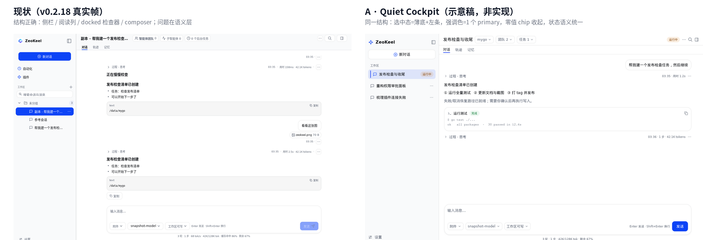
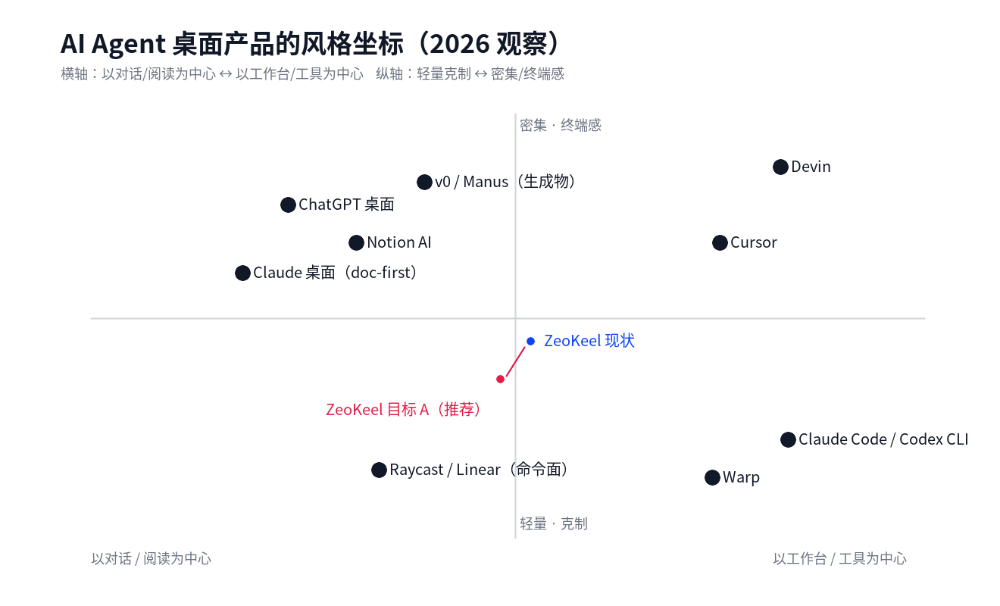
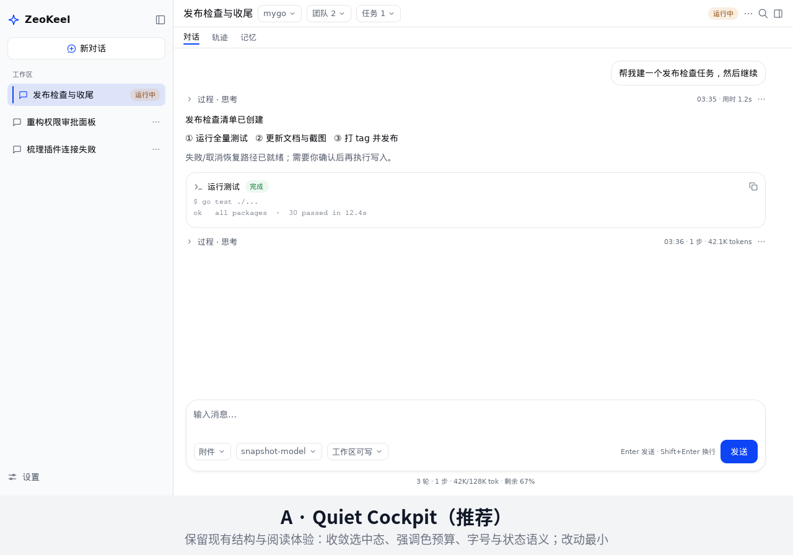
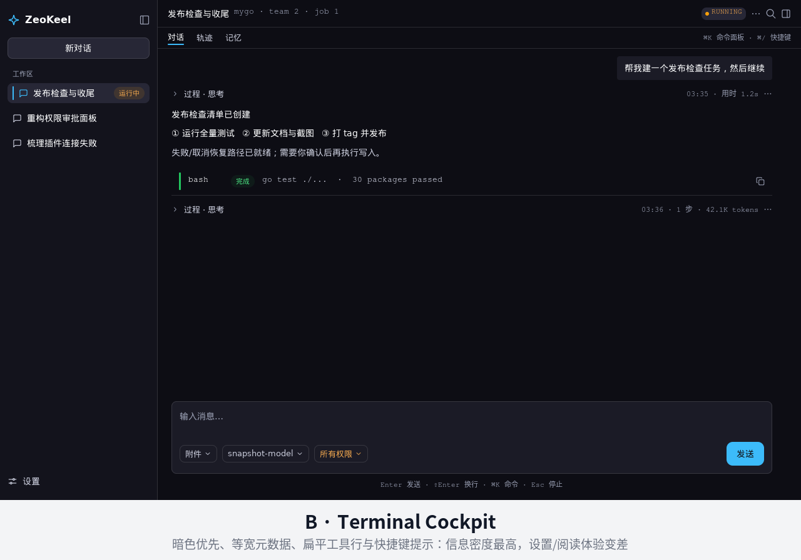
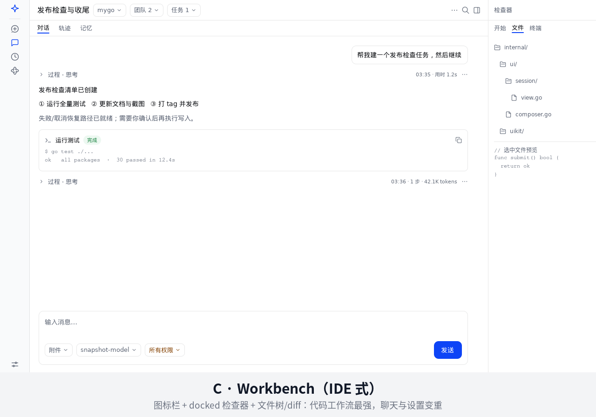
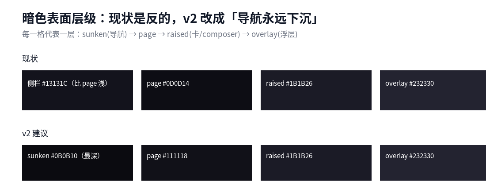

# ZeoKeel 风格方向评审（2026-11-11）

> 与 [UI-AUDIT-2026-11-11.md](UI-AUDIT-2026-11-11.md) 配套：那份报告回答“哪里不健壮/不统一”，这份回答“**要不要大改风格、AI Agent 适合什么风格、ZeoKeel 该选哪一种**”。
> 配图说明：`before-after-a.png`、三张方向图是**用 mygo + 产品 design token 渲染的示意稿**（`.cache/audit-1111/style/`），用来评审风格方向，不是逐像素实现稿；其余为当前产品真实帧。
>
> **落地状态（v0.2.19）**：用户已拍板 **A · Quiet Cockpit**；Phase 0/1（安全默认、抽屉让宽、搜索 keywords、选中态两级、强调色预算、状态徽章、字号/度量、暗色 ramp、去 38、组件骨架）已随 v0.2.19 落地（见 [审计报告 §10](UI-AUDIT-2026-11-11.md)）。Phase 2 的完整 **Agent Run Band** 与 **State-first Tool Row** 尚未实现；本轮按用户「做减法」的要求先删掉了零值 agent 入口与逐轮 usage 元信息（用量进 ⋯），并做了运行态键位提示、状态徽章统一与工具卡单一复制入口，剩余部分列为下一轮签名表面。

---

## 0. 直接回答

**不需要大改风格。** 建议做 **一次“定向收敛” + 升级 1 个签名表面**，不做 rebrand、不换信息架构、不做整站重排：

| 判断 | 结论 |
|---|---|
| 信息架构（侧栏 → 阅读列 → docked 检查器 → composer） | **保留**。这是 2026 年 AI Agent 桌面产品的主流正确结构（Devin/Cursor/Claude Code 都是“过程可见 + 可干预”） |
| 品牌与原生感（mygo 原生控件、品牌蓝/暗色 token） | **保留**。不引入 webview/新设计系统；不追渐变、玻璃、卡片墙 |
| 需要改的 | **语义层**（选中态/状态徽章/主操作/字号/密度）+ **3 个 P1 交互** + **1 个签名（Agent Run Band）** |
| 预期收益 | 约 **80% 的“更好看/更专业”** 来自语义收敛；剩余 20% 才需要视觉表现升级 |

**“大改”意味着什么、为什么现在不该做**：

1. **成本/风险**：20 个设置页、4 类会话浮层、右栏 4 个 pane、96 张快照、91 步交互驱动、`uiroot` 布局帧测试、`DESIGN.md` 硬约束都会一起被掀动；一次大改必然带出新一轮键盘/焦点/回归问题。
2. **收益错位**：现有界面“每块单看还行、拼起来主次不清”的根因是**同一语义有 2–5 种画法**（见审计报告 §5.1），不是结构错。先收敛语义，收益最大、风险最小。
3. **用户与场景**：ZeoKeel 的用户是开发者/知识工作者，日常在 900–1512 宽桌面上长时间阅读、审批、看 diff。**安静、可读、状态可信**比“视觉记忆力”更重要。
4. **身份一致性**：品牌层只有 8 个 logo hex + 27 个语义色，暗色方向已经有自己的中性色倾向（黑向 violet/cyan 抬升）。大改会把已有的品牌资产推倒。
5. **可验证性**：收敛可以在每批改动后用 before/after 帧 + 帧测试验证；大改只能一次性评审，回归定位成本高。

**什么时候才值得大改**：换目标用户（如从开发者转向运营）、换产品隐喻（从“对话+工作台”转向“画布/看板”）、或品牌升级。当前三条都不成立。

---

## 1. AI Agent 产品现在有哪几种主流风格

> 参考：Kanopy Labs 对 Claude Code / Devin / Cursor / v0 的 agentic UI 模式总结（过程可见、计划可编辑、工具透明、人类检查点、可回滚）[1]；2026 AI agent 界面案例盘点 [2]；以及 CLI/TUI 复兴的讨论 [3]。外部产品只提炼模式，不做像素照搬。

| # | 风格族 | 代表 | 视觉特征 | 强项 | 代价 | 对 ZeoKeel 适配 |
|---|---|---|---|---|---|---|
| 1 | **对话优先 / 极简** | ChatGPT 桌面、Claude 桌面 | 居中阅读列、低 chrome、少颜色、元数据极弱 | 上手最快、内容聚焦 | 多步/多工具过程被藏起来；长任务不可核对 | ★★★☆ 适合“问答”，不适合“运行视图” |
| 2 | **文档 / 阅读优先** | Claude、Notion AI | 编辑排版、暖中性色、正文层级强 | 长文阅读、写作体验好 | 工具/运行态表达弱 | ★★★★ 适合 transcript 与 markdown，需补运行层 |
| 3 | **终端原生 / CLI 优先** | Claude Code、Codex CLI、Warp | 等宽字体、暗色优先、高密度行、状态 gutter、键位提示常显 | 开发者信任、过程透明、键盘效率 | 设置/阅读/新手体验差；品牌感弱 | ★★★★ 适合工具卡/日志/终端/inspector 局部，不适合全站 |
| 4 | **IDE / 工作台** | Cursor、Copilot、Zed、Devin | 多面板、tab、diff、文件树、docked inspector、深色 | 代码工作流最强、可干预点清楚 | 聊天/设置变重；信息噪声大 | ★★★★ 适合右栏文件/diff/终端，不适合作为主聊天壳 |
| 5 | **命令面 / 启动器** | Raycast、Linear | 一个搜索框 + 瞬态浮层、键盘优先、精致明暗 | 快、可学习、低打扰 | 不适合承载长过程与历史 | ★★★ 作为 palette/命令层已有；可强化 |
| 6 | **生成物 / 画布** | v0、Manus、Artifacts | 生成即预览、卡片/画布、产物优先 | 产出型任务体验好 | 对“过程/审批/日志”支撑弱；容易 dashboard 化 | ★★☆ 仅适合 artifact 预览局部 |
| 7 | **Agent 监控 / 仪表盘** | LangSmith 类 | 指标卡、时间线、表格 | 运维/可观测 | 把日常使用变成看报表；与“客户端”气质冲突 | ★☆ 不推荐 |

**结论**：AI Agent 没有“唯一正确风格”，但有一个共同底线——**过程可见、状态可信、可干预、可恢复**（[1] 的五种模式）。风格只是把这四件事画得安静还是画得响。ZeoKeel 现在的位置（对话 + 工作台之间）是对的，缺的是“运行层”的表达与一致性，而不是换一种风格。

---

## 2. 三个候选方向（同一会话屏，同一套 token 渲染）

### A · Quiet Cockpit（推荐）

- **一句话**：像一间安静的驾驶舱——仪表在，但不喧哗。
- **视觉规则**：浅色优先（暗色同构）；侧栏比页面深（sunken）；选中行 = `BgSelected` 12% + 2px Accent 左条；「新对话」降为轮廓 secondary；一屏 ≤1 个 primary；状态只用 semantic tint 徽章；正文 14 / 元数据 12 / 11 仅微标签；圆角 10（控件）/16（卡）/20（composer）。
- **优点**：改动面最小（主要是 token 使用 + 少量布局）；阅读/审批/设置都受益；和现有 96 张帧可以逐屏对比；不会带出新的键盘/焦点问题。
- **代价**：视觉“记忆点”弱；需要靠“运行层”与微交互建立性格（见 §4）。
- **改动面**：`internal/design/components.go`、`internal/ui/sidebar`、`internal/uiroot/frame.go` 设置导航、`internal/ui/settings/*`、状态徽章统一；不换版式。

### B · Terminal Cockpit

- **一句话**：把“过程”做成仪表，密度优先。
- **视觉规则**：暗色优先；元数据/工具名/输出全等宽；工具行扁平（状态 gutter + 名称 + 输出，无卡片）；行高 32；圆角 6；键位提示常显；状态点 + 大写标签。
- **优点**：开发者信任感、长任务可核对性最强；和 Claude Code/Codex CLI 的心智模型一致。
- **代价**：设置、长文阅读、新手体验明显变差；浅色模式难做得同样有味道；品牌感弱。
- **改动面**：大面积改工具栏/transcript/工具卡/设置表单；不建议全站。

### C · Workbench（IDE 式）

- **一句话**：把 Agent 放进 IDE，文件和 diff 是一等公民。
- **视觉规则**：默认 64px 图标栏；docked 检查器常开（文件/终端/开始）；tab + 文件树；mono 代码；圆角 8；浅灰 chrome。
- **优点**：文件/diff/终端工作流最强；与 Cursor/Zed 用户习惯一致；也最接近当前产品的右栏能力。
- **代价**：聊天/设置被压窄；屏幕小于 1200 时主列过窄；需要更多布局状态（panel 宽度/折叠）。
- **改动面**：`uiroot` 分栏 + 默认 rail + 检查器常开；改动/回归面大。

### 方向对比

| 维度 | A Quiet Cockpit | B Terminal Cockpit | C Workbench |
|---|---|---|---|
| 阅读/长文 | ★★★★★ | ★★☆ | ★★★ |
| 工具/过程可核对 | ★★★★ | ★★★★★ | ★★★★★ |
| 设置/日常效率 | ★★★★★ | ★★☆ | ★★★ |
| 键盘效率 | ★★★★ | ★★★★★ | ★★★★ |
| 新手可理解 | ★★★★★ | ★★★ | ★★★ |
| 品牌记忆点 | ★★★（靠运行层） | ★★★★（性格强） | ★★★★ |
| 改动成本/风险 | **低** | 高 | 中高 |
| 适合 ZeoKeel | **主壳推荐** | 局部推荐 | 局部/未来 |

---

## 3. 推荐：A 为主，借 B 的“深度”，保留 C 的“工作台”

**“Quiet cockpit with developer depth”**：主壳用 A，让阅读/审批/设置安静；把 B 的密度与等宽只放到“过程”相关表面；把 C 的文件/终端/diff 留在右栏，但不把主聊天变成 IDE。

| 区域 | 采用 | 具体 |
|---|---|---|
| 侧栏 / 顶带 / 设置 / 对话框 | **A** | 选中态两级、强调色预算、统一状态徽章、字号纪律 |
| transcript 正文 / markdown | **A** | 14/22 正文、12 元数据、11 仅微标签 |
| 工具卡 / 命令输出 / 日志 / 终端 | **B 局部** | 等宽、状态 gutter、输入摘要优先、失败默认展开 |
| 右栏 文件/变更/终端 | **C 局部** | 保持 docked + tab + 文件树/diff；不做常开主面板 |
| 命令面板 / 快捷操作 | **B+E** | 键盘优先、快捷键列、瞬态浮层（已有，强化即可） |
| 审批/计划/提问 | **A + 安全语义** | 卡片安静，但状态/后果/默认焦点必须最强 |

### 3 个低成本的“签名表面”（让 A 不显得平）

1. **Agent Run Band（顶带运行条）**：把「运行中 + 团队 N + 子代理 N + 任务 N + 审批 N + 排队 N」收进**一条**运行状态带；全部为零时收起（只留标题）。这同时解决审计里的“零值 chip 挤压标题”“运行态不可见”“三处状态重复”。
2. **State-first Tool Row**：工具行左侧 3px 状态 gutter + 等宽工具名 + 语义徽章 + 一行输入摘要；点开是完整输入/输出。借用 B 的过程可见性，但仍是 A 的安静表面。
3. **Quiet Selection**：持久导航 = `BgSelected` + 2px Accent 左条；只有 palette/菜单的瞬态选择用 Accent 填充。一个规则同时修掉“两种选中语言”和“侧栏两个重蓝块”。

这三条都不改信息架构，只改“状态怎么画”，是 A 方案的性格来源。

---

## 4. 风格规则差异（可直接落到 token/组件）

| 规则 | 现状 | A（推荐） | B | C |
|---|---|---|---|---|
| 侧栏 vs 页面 | 浅色深/暗色浅（反转） | 导航永远下沉 | 侧栏≈页面（暗色） | 图标栏≈页面 |
| 选中态 | 满蓝 vs 薄底混用 | 薄底 + 2px 左条（持久）；Accent 填充仅瞬态 | 薄底 + accent 文字 | 薄底 + 左条 |
| 每屏 primary | 经常 2 个 | **≤1** | ≤1（更少填充按钮） | ≤1 |
| 状态徽章 | 两种解剖 | 统一 `StatusBadge` semantic tint | 状态点 + 大写标签 | 统一 tint |
| 元数据字体 | 11/12/13 混用 | 12（成句最低）/11 只微标签 | 全等宽 12 | 12 + mono（路径/代码） |
| 工具卡 | r16 卡 + 复制重复 | S2 卡 + 单一复制入口 | 扁平行 + 状态 gutter | 小卡 r8 + diff |
| 行高 | 32/36/38 混用 | 28/32/36/40/44（去 38） | 28/32 | 28/32/36 |
| 阴影 | composer + 浮层 | 同（不加新） | 几乎无阴影 | 仅浮层 |
| 强调色预算 | 2–3 块 | ≤2 填充 / ≤1 primary | 1 个 accent（其余状态点） | ≤2 |

**禁区（三方向都不做）**：暗色-only、渐变/玻璃拟态、卡片墙、仪表盘指标、给每个 section 加框、装饰性 agent 头像/emoji、把“运行中”做成全屏动效。

---

## 5. 落地路线（与审计报告的 P1/P2 对齐）

| 阶段 | 内容 | 预估 | 验证 |
|---|---|---|---|
| **Phase 0（先止血，1–2 天）** | 危险确认默认安全（14 处）；窄窗抽屉遮挡 composer；设置搜索 keywords；运行态键位提示 + Esc 作用域 | 小 | 帧测试 + 探针复跑（D2.6/D3.5/D7.x） |
| **Phase 1（A 主壳，3–5 天）** | 选中态两级；强调色预算；状态徽章统一；字号纪律（11px 禁成句）；暗色 surface ramp；去 38 行高 | 中 | 96 张快照 before/after + `designlint` + 帧测试 |
| **Phase 2（签名表面，2–3 天）** | Agent Run Band；State-first Tool Row；零值入口收起；运行态键位常显 | 中 | 新快照 + 交互驱动 + 键盘探针 |
| **Phase 3（局部 B/C，按需）** | 检查器 markdown 13px；文件/diff 工作台化；终端 mono 化；命令面板快捷键统一 | 低–中 | 右栏帧 + 窄窗/暗色 |

> 如果只做 Phase 0 + Phase 1，界面就会从“每块还行但拼起来不清”变成“安静、统一、可信”；Phase 2 才决定它像不像一款有性格的 Agent 客户端。

---

## 6. 已拍板：A · Quiet Cockpit（2026-11-11）

用户选择 **A · Quiet Cockpit**，并接受 A+B 局部（过程面保留开发者密度）。Phase 0/1 已落地；Phase 2 的 Run Band 与 State-first Tool Row 作为下一轮签名表面。当时列出的选项如下（保留作决策记录）：

1. **A · Quiet Cockpit（推荐）**：保留结构，收敛语义 + Agent Run Band；改动最小、风险最低。
2. **A + B 局部**：A 为主壳，过程面（工具/日志/终端）更终端化；性格更强，工作量中。
3. **B · Terminal Cockpit**：整体转暗色/等宽/高密度；开发者向最强，但设置与阅读体验要重做。
4. **C · Workbench**：主界面工作台化（rail + 常开检查器 + 文件树）；代码工作流最强，聊天被压窄。

如果你选 1 或 2，我可以先按 Phase 0 + Phase 1 出 before/after 帧和帧测试，再评审 Phase 2 的 Run Band 细节。

---

## 7. 参考

1. Kanopy Labs, *Agentic UI Patterns: Designing Interfaces for AI Agent Products*（任务进度、计划可编辑、工具透明、人类检查点、生成式 UI；Claude Code / Devin / Cursor / v0 的取舍）— https://kanopylabs.com/blog/agentic-ui-patterns-designing-ai-agent-interfaces
2. AYDesign, *Best AI agent interface design examples in 2026* — https://www.aydesign.ai/blog/best-ai-agent-interfaces-2026
3. InfoQ, *Building a More Appealing CLI for Agentic LLMs — learnings from Textual*（终端/TUI 的再度流行与信息密度）— https://www.infoq.com/podcasts/learnings-from-building-textual-framework/

> 外部资料只用于提炼风格族与交互模式；本报告的配图为本地渲染示意，不引用外部产品截图。
