# ZeoKeel 原生视觉方向（v0.1，2026-11-05）

> 状态：已定方向，逐屏实施中。依据：[ADR 0001 退役像素对齐](../decisions/0001-retire-dsh-pixel-parity.md)、[ADR 0002 品牌主题基础](../decisions/0002-brand-theme-foundation.md)。
> 目标：**ZeoKeel = DSH 桌面替代/迁移器 + 独立品牌产品**。功能对齐 DSH；视觉与交互由 ZeoKeel 自己设计，回归 mygo 原生能力（`ui.Theme` + 原生控件 + 系统字体/度量），不再以任何外部页面的像素为验收标准。

---

## 1. 设计原则

| # | 原则 | 含义 |
| --- | --- | --- |
| P1 | **原生优先** | 能用 mygo 原生控件（Button/PrimaryButton/TextArea/Select/MenuButton/Tabs/Collapsible/List/Toast/Tooltip…）就不手搓；控件行为（键盘、焦点、a11y、IME、DPI）随控件免费获得 |
| P2 | **令牌说话** | 尺寸/间距/圆角/字号一律走 `brand` 与 `design` 令牌、`Theme.Space/Rem/Radius`；不在业务代码里写 DSH 的魔法像素值（877/909/28/52…） |
| P3 | **层次靠结构** | 用表面色、边框、留白和字号建立层级，不靠阴影堆叠/装饰动效；动效只保留有语义的（流式、进行中、布局过渡） |
| P4 | **桌面惯例** | 屏幕是桌面窗口，不是浏览器页面：操作常显或焦点可见、文本可选、菜单可发现、系统通知/窗口状态后续补齐（UX 报告 §7 的 P0/P1 清单） |
| P5 | **品牌克制** | 品牌蓝/青/紫只用在强调、焦点、选中和少量图形标；大面积中性色保证 AI 内容可读 |
| P6 | **中文优先** | 默认中文界面；系统字体栈含 PingFang/微软雅黑；文案口语化、无 DSH 产品文案 |

## 2. 品牌基础（来自 ADR 0002）

- 主色（浅色）：`#0D44F6`（logo 渐变主蓝）；hover `#0946EF`；pressed `#0B38CA`。
- 主色（深色）：`#3CBBFA`；hover `#2ECCFB`；pressed `#37E7FE`。
- 中性：背景 `#FFFFFF`、侧栏 `#F9FAFB`、表面 `#F1F3F5`、文字 `#0F1115` / 次要 / 三级；深色以 `#18181B` 系夜色为底。
- 度量：`Radius=10`、`Spacing=4`、`FontSize=14`、系统字体栈（`brand.SystemFont`）。
- 状态色：语义色（成功/警告/危险），不来自 logo。

## 3. Home 屏（第一个原生重构屏）

### 3.1 信息结构（自上而下）

```
┌ Sidebar（保留现有功能，下一步原生化） ┐ ┌ 主区 ────────────────────────────┐
│ ZeoKeel 字标 + 折叠               │ │ 顶栏：空白（可选轻量右侧面板开关）    │
│ New Session（原生主按钮）          │ │                                   │
│ Plugins / Automation（原生导航行）  │ │        ZEoKeel 图形标 + 字标        │
│ Workspaces 列表                   │ │        “今天想构建什么？”（tagline） │
│ …                                │ │   ┌ composer 卡片（原生控件） ┐      │
│ More                             │ │   │ 工作区/模式 chip 行          │      │
└──────────────────────────────────┘ │   │ 多行输入（TextArea）        │      │
                                     │   │ + 权限 模型      发送按钮   │      │
                                     │   └──────────────────────────┘      │
                                     │   最近会话/工作区（可选，空态提示）     │
                                     └───────────────────────────────────┘
```

### 3.2 与现状的差异（重点）

| 项 | 现状（DSH 复刻） | 新方向 |
| --- | --- | --- |
| Hero 文案 | `Into the Unknown` + `Preview` 徽章（DSH 产品文案） | ZeoKeel 字标/图形标 + 自有 tagline（如「今天想构建什么？」/「把想法交给 ZeoKeel」）；删除 Preview 徽章 |
| 鲸鱼图标 | DSH 图形标 | ZeoKeel 图形标（`logo/` 资产，`ui.Image`/`ui.SVG`） |
| 布局宽度 | homeStackWidth 909 / composer 877（DSH 像素） | `min(720, 内容宽 - 80)` 之类的内容列；composer 宽 = 内容列宽，内边距走 `Theme.Space(4)` |
| Composer 卡片 | 手调 28px 圆角、双层阴影、52px 输入行 | `Column` + `Theme.Surface` + `Radius(10)` + `Border(1, Border)` + 单层轻阴影；输入用 `ui.TextArea`（原生占位/多行/IME/撤销） |
| chips | 手搓无框文字 + chevron，模型显示 `1017 High` | 用 `ui.Select`（或 `ui.MenuButton` + 自定义触发样式）承载工作区/权限/模型；模型只显示名称（如 `DeepSeek-V4.1-Flash`），上下文/档位移到 tooltip |
| 发送按钮 | 手绘圆形 ↑，禁用色 `#B2C7F4`（DSH 色） | mygo 原生 `ui.PrimaryButton`（「发送」/图标），或 `ui.Button` + accent 填充；禁用态由控件自身处理 |
| 字体/字号 | DSH type scale 14/22、26px hero | `ui.Theme`：正文 14、标题 `t.Rem(2)`，字重 600；全系统字体 |
| 动效 | DSH 13 个时长/5 条曲线、装饰性延展 | mygo 原生 transition（菜单/焦点/布局），保留流式与进行中语义动效 |

### 3.3 实现约束

- 保留功能：工作区选择/新建、权限菜单、模型菜单、`/` 命令、`@` 提及、附件 chips、发送创建会话、Cmd+K/Cmd+N、右侧栏开关、i18n（en/zh）。
- 交互与 a11y 不回退：所有控件有 `Label`/`Role`/`Focusable`；键盘可达；空 composer 发送禁用；错误可见。
- 所有颜色/间距/圆角来自 `internal/brand` + `design.Tokens`，不再新增 DSH 采样色。
- 产出 headless 截图（1600×1000，浅色+深色）供评审；`go test ./internal/shell` 保持绿。

### 3.4 实现记录（2026-11-05，Home 第一轮，已完成）

本轮把 3.2 的方向落到 `internal/shell/home.go` + `home_live_menus.go`，截图见 `preview/`：

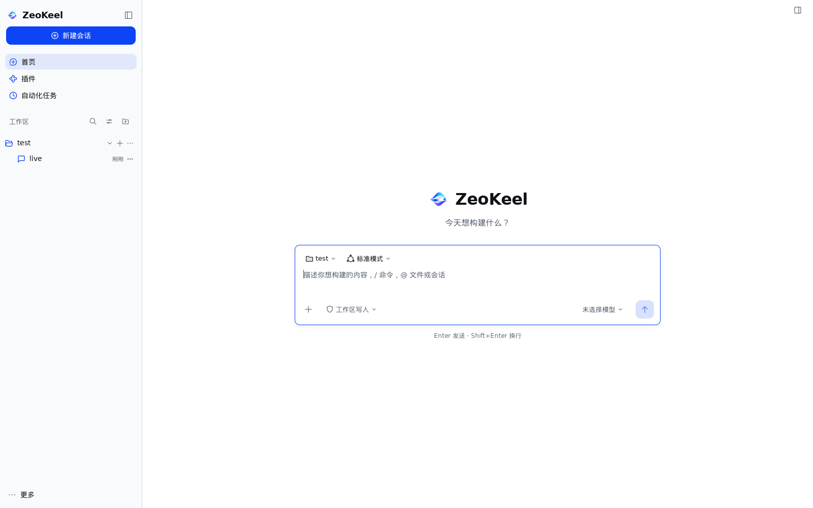

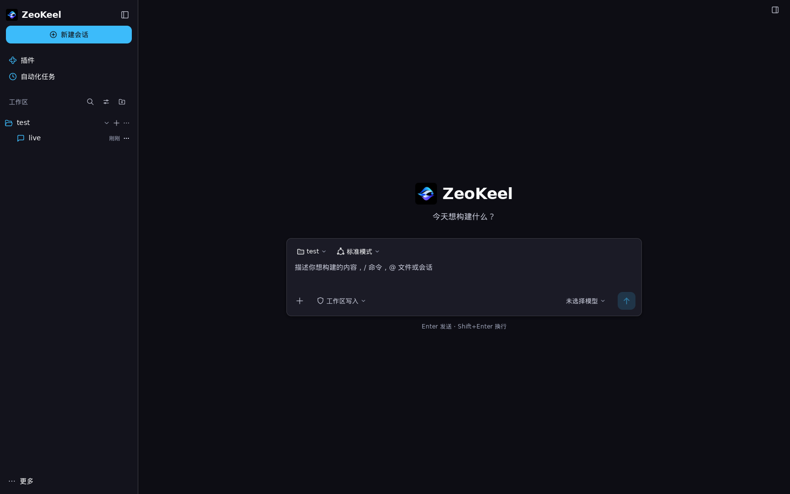

**落地要点（与上方方向一致，记录取舍）**

| 项 | 实现 |
| --- | --- |
| Hero | `mark` 品牌图形标 44×44 + `ZeoKeel` 字标 `homeWordmarkRem = 2.25rem`（≈31.5px，600）+ 自有 tagline（i18n `home.tagline`：「今天想构建什么？」/"What will you build today?"）；删除 `home.hero_title`（Into the Unknown）、`home.preview`（Preview 徽章）与 DSH 鲸鱼图标 |
| 布局 | 内容列 `min(720, 主区宽-80)` = `theme.Space(180)` / `theme.Space(20)`；全部间距/尺寸/圆角走 `Theme.Space/Rem` 与 `design` 网格；删除 909/877 等固定像素 |
| Composer | 一个 `design.Tokens.Panel` 卡片（`Theme.Radius=10`、`BorderL2` 1px、单层轻阴影、`Space(3)` 内边距），内部用原生 `ui.TextArea`（原生占位/多行/IME/撤销/焦点），输入框自身边框关闭、由卡片承载 hover/焦点态 accent 边框 |
| Chips | 工作区/模式/权限/模型仍保留手搓 trigger + Popover（菜单承载路径、描述、新增动作等 `Select` 无法表达的产品内容，符合 3.2 允许项），视觉统一重绘为品牌 ghost chip：28 DIP 高、`RadiusSM`、品牌 hover 底色、`Theme` 文字色 |
| 发送 | 原生 `ui.ButtonBase`（原生焦点/Enter/Space/禁用语义）+ 品牌 accent 填充/圆角；禁用态为品牌 accent 低透明度填充（`sendIdleFill`，Home 与 Session 共用，旧 DSH 浅蓝已删除） |
| 附加控件 | 加号、右侧栏开关改用 `ui.ButtonBase` + 品牌 hover；菜单行高度/宽度/图标尺寸改为 `Theme.Space` 派生 |
| 截图测试 | `TestRenderHomeNativePreview`（`home_live_test.go`）用 `ui.Render(app.View,1600,1000,1)` 生成浅/深两张，写入本目录 `preview/`，可复现 |
| 测试 | `go test -count=1 ./internal/shell` 全绿；`TestHomeBrandHero` 钉住品牌文案与无 DSH hero；`TestHomeComposerInputFillsRow` 改为断言输入填满卡片（不再绑定 877 旧几何） |

**遗留（下一阶段）**

1. Session composer 与 Home composer 已完成视觉统一（`composer_native.go` 的共享卡片/输入/发送 helper）；Home 里仍保留一份等价的本地实现，可在下一次编辑 home.go 时收敛到共享文件。
2. Sidebar / 字标行 / 其它屏仍是旧视觉，按 §5 逐屏原生化。
3. 权限/模型/工作区 trigger 目前是「品牌化的手搓层」；若后续把菜单简化为纯文字选项，可换成 `ui.Select`/`ui.MenuButton` 拿全键盘/弹出行为。
4. Home 竖向节奏在 900×600 最小窗口与右侧栏打开时需目视复核（占位/行高会在下一轮密度调整中再评估）。

## 4. Session 屏（第二个原生重构屏，pilot 2）

Session 是第二个 pilot 屏（2026-11-05 完成视觉重构），目标是验证「Home 的品牌 composer/令牌体系能否在消息流屏复用」，并把 Session 从 DSH 复刻视觉切换到 ZeoKeel 品牌视觉。

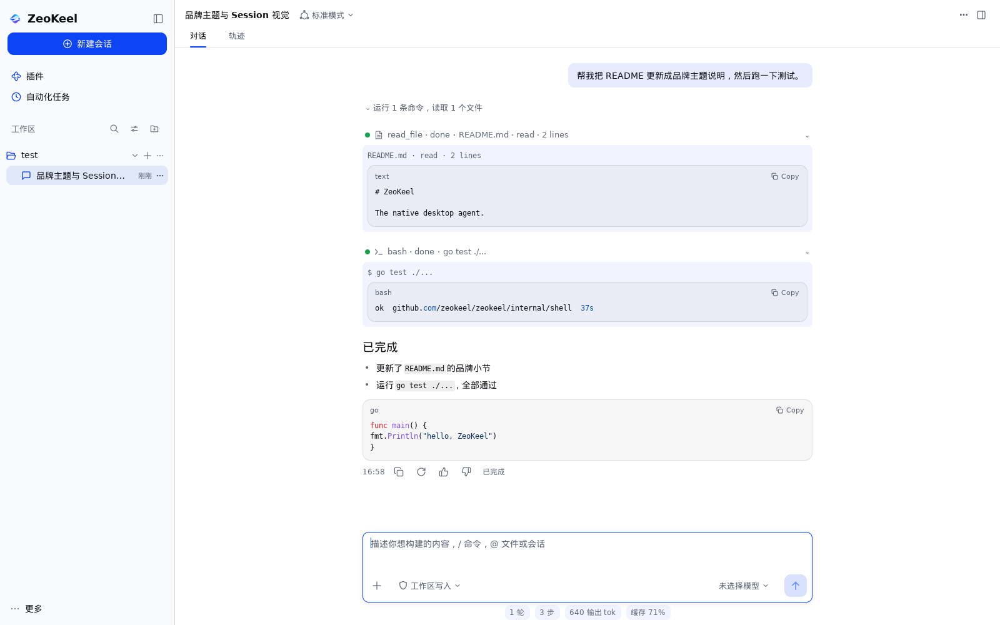

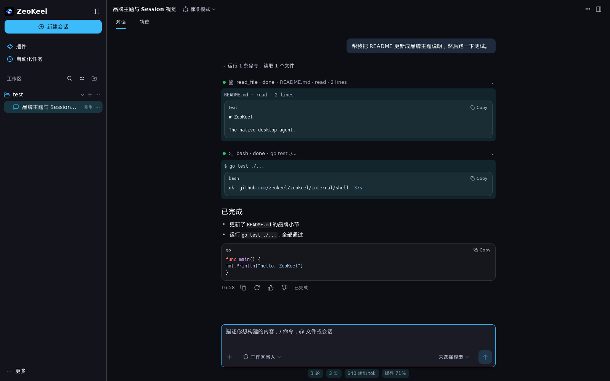

### 4.1 落地要点

| 项 | 实现 |
| --- | --- |
| Header | 品牌 header：标题（`TypeBody` 600）+ 模式 chip（复用 `homeChip`）+ 运行/等待/失败相位标签 + More/右侧栏动作（`ButtonBase` ghost）；Chat/Trajectory tabs 改为轻量品牌 tab：`LabelPrimary/Secondary` + 2 DIP accent 底条，仍用 `TabsBase` 保留 RoleTabList/方向键/Checked |
| 布局 | 删除 `sessHeaderH=76`、`sessGutter`、`877/845/98` 等固定像素：transcript 与 composer 共用品牌列 `sessColumnW = sessComposerW = 180 × Space1`（720 DIPs），header 高度由内容与 28 DIP tab 行（`sessTabsH = 7 × Space1`）决定；窄窗/停靠面板由 layout.go 的共享 clamp 处理 |
| Composer | 与 Home 共用 `composer_native.go`：`brandComposerCard`（Panel、`Radius=10`、单层轻阴影、Space 网格内边距）+ `brandComposerInput`（原生 `ui.TextArea`，卡片承载 hover/焦点 accent 边框）+ `brandIconButton` + `brandSendButton`；`/` 命令、`@` 提及、附件 chips、Enter/Shift+Enter、审批卡位置全部保留 |
| 发送/停止 | 原生 `ButtonBase` + accent 填充（运行中为 Stop 方块图标，仍可访问 "Stop"）；空 draft 时禁用并用品牌 accent 低透明度 idle 填充（`sendIdleFill`，Home/Session 统一，删掉旧 DSH `#B2C7F4` 采样与浅蓝禁用态） |
| 消息流 | 用户消息为品牌 tint 气泡（accent 10% over Surface、`Radius=10`、最大 82% 列宽）；助手消息用 mygo `ui/markdown` 渲染（`markdown.Stream` 流式、`markdown.View` 完成；见 §13），底部动作条改为时间 + ghost Copy/Retry/反馈 + 完成摘要；工具卡改为 ghost 可点击行 + 品牌 tint 详情块，状态点/图标尺寸全部走 `Theme.Space` 与语义色。**顺序（2026-11-05 对齐 DSH）**：每回合按记录 Seq 合并——用户消息 → 该回合过程块（摘要行 + 工具卡，插在首个工具调用的记录位置）→ 本回合 assistant 回答/最终回答及其完成行 → 下一回合；多回合不再把工具累积到会话尾部 |
| 截图测试 | `TestRenderSessionNativePreview`（`session_live_test.go`）用 live fixture + 一条完成回合的 snapshot（用户气泡、该回合过程块（摘要行 + 两个工具卡）、Markdown 最终回答与完成行、usage）渲染 1600×1000 浅/深两张到本目录 `preview/`，可复现；预览呈现「用户 → 过程块 → 回答 → 完成行」的新顺序 |

### 4.1.1 消息流顺序（2026-11-05 修正）

`liveTranscript` 不再固定「全部消息 → 运行指示 → 会话级工具块」。数据层给 `state.Message` 增加 `Seq`（消息首次出现时的快照序号），与 `ToolState.StartedSeq` 共用同一条快照 Seq 轴；重开会话时两者恢复为 store 事件 seq（`internal/session/history.go` 的事件重放）。视图据此按回合归并：

- 回合边界 = user 消息的 `Seq`；工具归入「最后一个 `Seq <= StartedSeq` 的 user 消息」所在回合（首条 user 消息之前的工具归入前置块）。
- 回合内：assistant 消息按 `Seq` 排序；连续工具聚成一个**过程块**（若中间夹了 assistant 消息则拆块），过程块插在它首个调用的 seq 位置；过程块 = 摘要行（只统计该块工具，不再会话累计）+ 该块的工具卡（按 `StartedSeq` 升序、同 seq 用 CallID 兜底，取代旧的 CallID 字符串排序）。
- 完成行/页脚仍是 assistant 消息内部的 `liveMessageActions`，因此最终回答与其完成行位于过程块之后；运行中 `workingIndicator` 在最后，artifacts/LastError 仍在 transcript 之后。
- 降级：手工构造的 snapshot（`Message.Seq` 全 0）回退旧布局「全部消息 → 运行指示 → 会话级工具块」，既有 fixture 不受影响。过程块的折叠状态按块（首条 CallID）独立记忆，多回合各自展开/收起。

### 4.2 保留与不回退

- 功能：`/` 命令、`@` 提及、附件 chips、Enter/Shift+Enter、排队/中断发送、停止按钮、审批卡（Allow/Always/Deny）、plan review/question/artifact 卡、Todo/Team 面板、右侧栏、Trajectory、usage footer、主题/语言切换。
- a11y：所有控件保留 Label/Role/Focusable；Tab 键盘可达（含 Chat/Trajectory 方向键）、空 composer 的 Send 不可聚焦、所有原生控件自带焦点语义。

### 4.3 遗留

1. ~~**Markdown 渲染仍为自研**（`internal/shell/markdown.go`，628 行）~~ **已完成（2026-11-05，§13）**：自研解析器删除，助手消息改用 mygo `ui/markdown`（流式/表格/任务列表/代码高亮+复制/选中复制随库获得）；工具卡详情文本仍为纯文本（见 §13 遗留）。
2. Trajectory 屏内部行视觉仍是旧样式（本轮只品牌化了 Chat/Trajectory tab 行，trajectory.go 其余部分未动）。
3. Home 的 composer 仍有一份本地实现（未改成共享 `composer_native.go`）；`homeSendIdle` 旧常量待清理。
4. 后续逐屏继续：Sidebar → Settings/Plugins/Automation（见 §5）。

## 7. Plugins / Automation 屏（第三批，2026-11-05 完成）

Plugins 与 Automation 是两个"列表页"屏，本轮把它们的 DSH 复刻视觉换成 ZeoKeel 品牌布局：同一套页面列、页头、卡片列表与原生控件；功能保持不变。

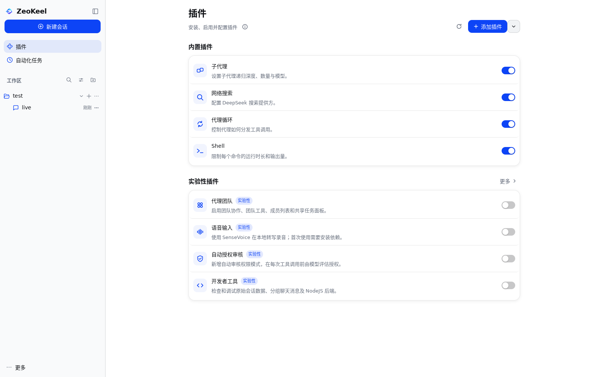

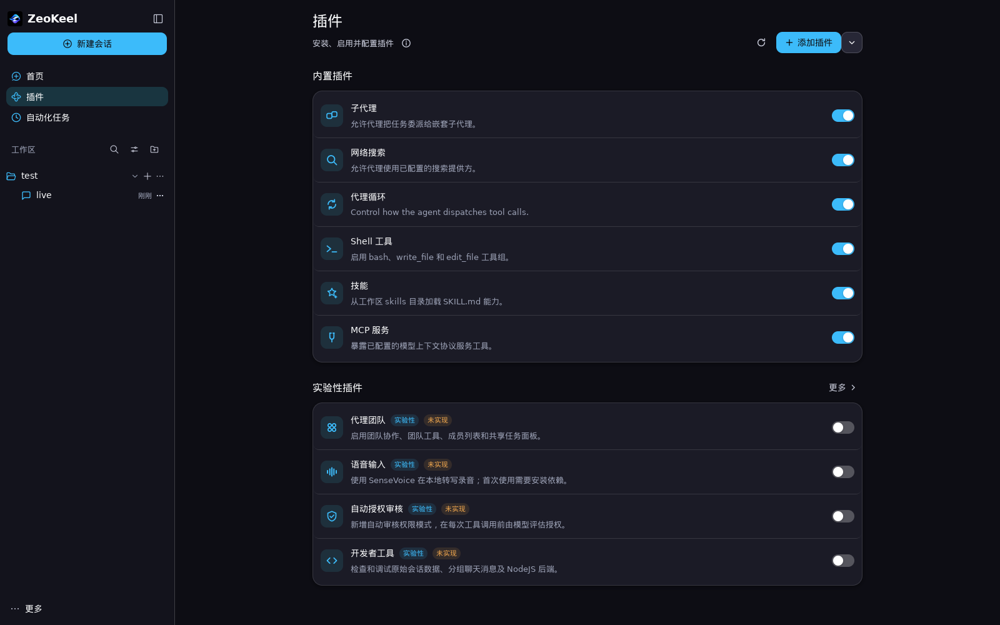

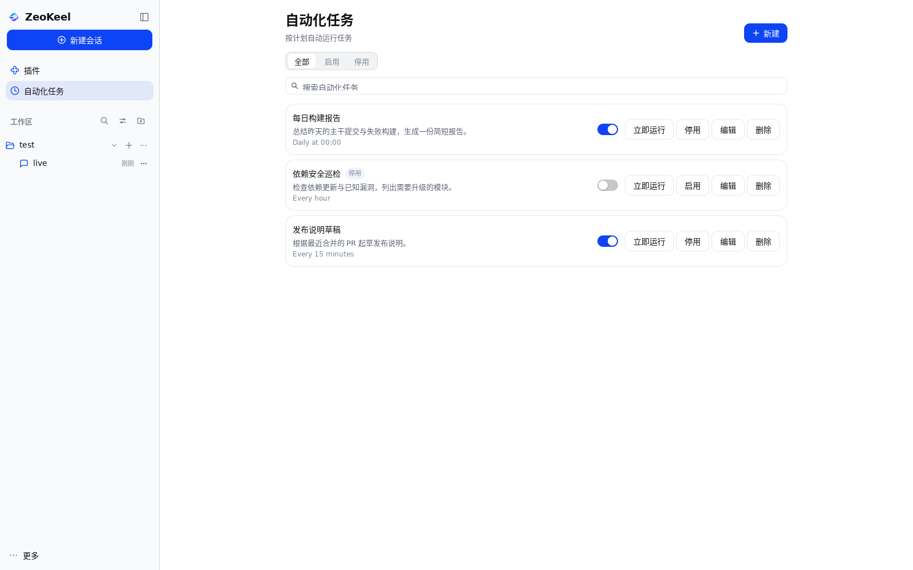

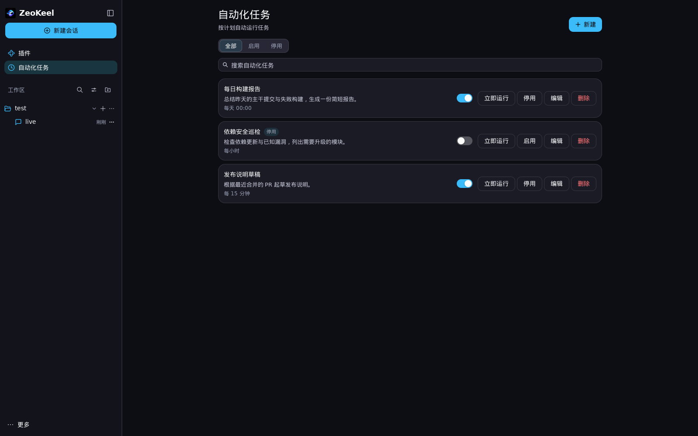

### 7.1 落地要点

| 项 | 实现 |
| --- | --- |
| 页面列 | 两页共用 `nativePageColumn`（Plugins/Automation 各自 `220 units × Space1 = 880 DIP` 上限），窄窗/停靠右侧栏时按 `contentWidth - 96` clamp；删除 DSH 的 960 固定列与 8px 滚动条 gutter |
| 页头 | 标题 `TypeXL`/600 + 一行说明 `TypeXS`；Plugins 右侧为原生 Refresh（`ButtonBase` ghost + 品牌图标）与 Add plugin（原生 `PrimaryButton` + plus，附一个同样的内置策略菜单箭头）；Automation 右侧为原生 `PrimaryButton`「新建」 |
| Plugins 列表 | 两个分区（Built-in / Experimental，`TypeM`/600 标题）各一张品牌卡片（`BgRaised` + `BorderL2` + `RadiusLG` + 单层轻阴影）；行高由内容与 `Space(3)` 内边距决定（删除固定 66 行高），图标改为 36×36 品牌 tint 方块 + 20 DIP 单色 line-art（currentColor，`Accent`），删除 50×50 图标砖与 DSH 采样色（`#ADB2B8`/`#6E7278` 等）与彩色 SVG |
| 行开关 | 统一换成 mygo 原生 `ui.Switch`（品牌主题 accent，键盘/焦点/动画/无障碍随控件免费）；Automation 行、Plugins 行、Settings 内 Built-in plugins 行共用 `pluginSwitchLive`，保留 `Enable <name>` 可访问名与持久化行为 |
| Automation 列表 | 标题 `TypeXL`/600 + 原生新建按钮；筛选 `All/Enabled/Inactive` 改为原生 `SegmentedBase`（一个 focus group，方向键/Home 可用）；搜索改用原生 `SearchField`（magnifier/清空/IME 随控件）；任务行是品牌卡片：标题 + 提示词摘要 + 计划/下次运行（`Describe`/`next`/`last`）+ 原生 Switch + 原生 `ui.Button` 行操作（立即运行/停用/编辑/删除），窄列自动换行（保留 304 DIP 页面列可用性）；空态用品牌图标 + 原生新建按钮 |
| 弹层 | About plugins / Add plugin / 实验性 More / 详情编辑 / 数据目录弹层保留全部文案与行为，视觉改为 Modal + `Theme` 字体/间距/圆角；详情编辑主操作改用原生 `PrimaryButton`；数据目录弹层高亮色由 DSH 蓝采样改为品牌 accent tint |
| 截图测试 | `TestRenderPluginsNativePreview`（`plugins_ui_test.go`）与 `TestRenderAutomationNativePreview`（`automation_ui_test.go`）用 live fixture 渲染 1600×1000 浅/深各一张到本目录 `preview/`，可复现；Automation 预览预置三条不同状态任务 |

### 7.2 保留与不回退

- Plugins：Built-in + Experimental 分组与持久化开关、`View <name>` 打开详情、Configure 详情编辑器（字段/校验/Save/Cancel/Toast）、About plugins、Add plugin 内置策略说明、实验性 More 列表与开关原因提示、Refresh（重载设置与 Toast）、空搜索/滚动/窄窗可达。
- Automation：标题与 New、All/Enabled/Inactive 筛选、搜索（标题/提示词/cron）、任务行启用开关、立即运行、编辑、停用/启用、删除、计划与下次/上次运行展示、空态、新建/编辑弹层（标题/提示词/计划/启用、cron 校验、保存/取消）。
- a11y：保留全部 `Label`/`Role`/`Focusable`；原生 Switch/Button/Segmented/SearchField 自带键盘与焦点；`TestPluginsTabReachability` / `TestAutomationTabReachability` 通过；Automation 筛选可用方向键与 Home 在组内移动。
- 测试：`plugins_ui_test.go`、`plugin_details_test.go`、`automation_ui_test.go` 行为断言保留；仅更新 "Built-in plugins" 分区标题文案断言（分区标题与 Settings 用词统一）。`TestPluginSwitchRendersOnAndOffState` 的旧手搓开关像素断言需由 Lead 在集成时更新（原生开关颜色由主题决定）。

### 7.3 遗留

1. 行列表仍是 `ui.Row`/`ui.Column` 组合而非 `ui.List`（Table 虚拟化）：两页行数固定且很少，原生 Switch/Segmented/SearchField 已接管交互控件；若未来插件/任务数量级增大，可换 `ui.List` 虚拟化。
2. Settings > Built-in plugins 的 `pluginToggleRow` 视觉仍沿用旧版（设置页由并行任务重构中，本轮只把其中的开关切换为原生 Switch，避免与其改动冲突）。
3. Automation 行在 304 DIP 宽列下单行内容较紧，后续可评估把"计划/下次运行"折叠为 tooltip。

## 8. Settings 屏（第四批，2026-11-05 完成）

> 交互形态仍是应用内 overlay/modal（独立设置窗口是 P1，见 §5）；本轮只重做品牌视觉与控件层，保留全部设置项与行为。

### 8.1 信息结构（自上而下）

```
┌ 设置面板（居中、响应式 720–880 × 适配高度，Radius=10） ─────────────────────────┐
│ 导航列（BgSidebar + 右 1 BorderL2，200 DIP）  │ 页面列（BgRaised）                  │
│  设置（TypeM/600）                           │ 顶栏（右对齐）：打开配置文件 · 关闭 · X │
│  通用 / 模型 / 记忆 / 内置插件 / 代理预设 / 关于 │ ┌ 页面标题（TypeL/600）+ 一行说明 ──┐ │
│  选中：BgHover tint + Accent 图标 + 500 字重   │ │ 分组卡片（BgStrong/Border/Radius10）│ │
│                                              │ │  行：标题+说明 / 右侧原生控件       │ │
└──────────────────────────────────────────────┴───────────────────────────────────────┘
```

### 8.2 落地要点

| 项 | 实现 |
| --- | --- |
| 面板 | `settingsPanelSize` 由 `Theme.Space` 派生：宽 `min(880, window-2×32)`、高 `min(760, window-2×32)`，900×600 最小窗内收；删除 800×800 固定面板与 28px 半径，改用品牌 `Radius=10` + 1px `BorderL2` + 单层轻阴影 |
| 导航 | 宽 `min(200, 面板宽/3)`（删除 188px 固定值），`BgSidebar` 底 + 右侧分隔线；选中项 `BgHover` tint + `Accent` 图标 + 500 字重；`ui.ButtonBase` 提供 hover/press/焦点环/键盘激活 |
| 分组卡片 | `settingsSection`：`TypeXXS/600` 分区标签 + `BgStrong` 卡片（1px `BorderL2`、`Radius 10`）；`settingsRow` 行内距 `Space(2)`、水平 `Space(4)`、`MinHeight Space(11)`，行分隔线 `BorderL2`，最后一行去线；删除固定 44px 行高、54px header、188px nav 等 DSH 像素 |
| 原生控件 | `ui.Switch`（Show coding view、disabled 的 Upload session log）；`ui.Select`（Language / Work details / Collapse / Send behavior / Performance & usage，弹出/方向键/Enter/Escape/焦点随控件）；`Form` + `Field` + `ui.TextInput`（Models 编辑弹层，标签右对齐原生表单）；`ui.ButtonBase`（导航/主题卡/动作/字号步进/关闭）与 `ui.PrimaryButton`（Add model、Save） |
| 字号 | `settingsText` 走 `design` 类型刻度（14 基准）；控件字体随 `Theme.Font`（系统字体栈）；字号控件是品牌 pill（可展开 popover）+ 紧凑步进列 + sliders 更多设置 |
| 主题卡 | 三张品牌卡：`BgRaised` + `BorderL2`，选中 `Accent.Alpha(0.08)` 填充 + 2px `Accent` 边；保留 `RoleRadio`/`Checked`/`Focusable` 无障碍语义 |
| 子页 | Models：`TypeL/600` 标题 + 原生 PrimaryButton「Add model」+ 模型卡片（原生按钮 编辑/删除/设为默认，默认徽章 accent tint）；弹层用原生 Form。Memory：品牌标题 + 原生 Refresh/危险色 Clear all + 备注卡片（危险色 Delete）。Built-in plugins / Agent presets / About 复用同一页头与分组容器（内容由并行任务继续品牌化） |
| 截图测试 | `TestRenderSettingsNativePreview`（`settings_ui_test.go`）用 live fixture 渲染 1600×1000、中文（产品默认语言）浅/深各一张到本目录 `preview/`：`settings-native-light.png`、`settings-native-dark.png`，可复现 |

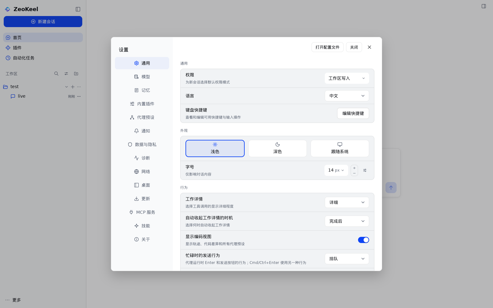

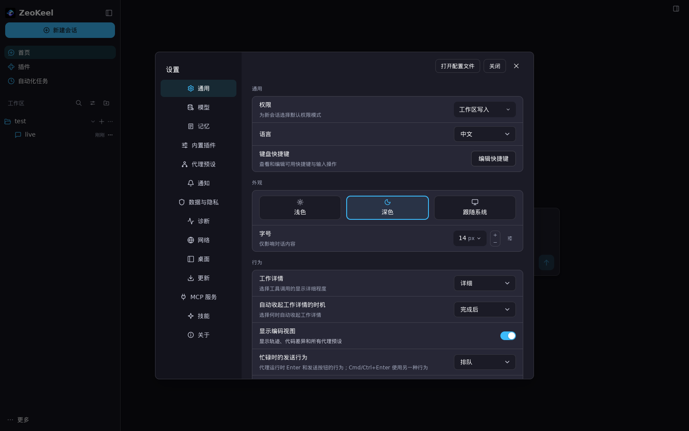

### 8.3 保留与不回退

- 全部设置项与持久化行为保留：权限（含 Auto review 及其说明）、语言、外观（Light/Dark/System）、字号（14/16 与步进）、Work details、自动收起时机、Show coding view（联动 Agent presets 导航与 Session 的 Trajectory）、快捷键编辑器（搜索/重绑/恢复默认）、发送行为、性能与用量、Upload session log（本版本 disabled，点击不持久化）、Models CRUD/默认、Memory（列表/删除/清空/刷新/工作区隔离）、Built-in plugins、Agent presets、About。
- a11y / 键盘：控件保留 `Label`/`Role`/`Focusable`；原生 Switch/Select 自带键盘、焦点环与展开语义；权限菜单保留选项描述（原生 Select 不能渲染多行描述，见 8.4）；`TestSettingsTabReachability`、`TestPopoverAnchorsExposeExpanded`、`TestModelActionsKeyboardReachable` 通过。
- 滚动 / 窄窗：body 内 `ui.Scroll` + 令牌内边距，900×600 下最后一行（Upload session log）可滚动到达；header/nav/关闭控件不越界。
- 测试：`settings_ui_test.go`、`models_ui_test.go`、`memory_ui_test.go` 行为断言全部保留；视觉断言改为品牌面板/主题语义（例如暗色面板改为取 nav 表面像素而不是 DSH 固定坐标）；新增 `TestSettingsNativeControls` 覆盖原生 Select/Switch 的持久化与面板响应式。

### 8.4 遗留 / 取舍

1. 独立设置窗口是 P1（本轮保持应用内 overlay，符合任务范围）。
2. 权限选择器保留品牌化自定义 popover：原生 `Select` 无法渲染 Auto review 的多行描述，而该描述是 Home/Session 权限菜单共用的产品资产（`TestAutoReviewUISelectorOption`）。
3. 设置导航保留逐项按钮而非 `ui.Sidebar`：原生 Sidebar 是单一 Tab focus group（roving focus），会回退现有"每个导航项 Tab 可达"的 a11y 验收（`TestSettingsTabReachability`）；若后续接受 roving focus 可迁移。
4. 字号步进保留自绘 `ButtonBase` 步进列：`14 px` 需作为可展开 popover 的无障碍节点（`TestPopoverAnchorsExposeExpanded`），原生 `Stepper` 只有 spin button 语义，无法承载该 A11y/展开断言。
5. Built-in plugins / Agent presets / About 的页面内部视觉由 Plugins/Automation 并行任务继续；本轮统一了它们所在的页头、滚动容器与共享 helper（`settingsText`/`settingsFillColor`/`settingsControlColor`）。

## 9. Sidebar（第五批，2026-11-05 完成）

侧栏从 1,232 行的「手搓 DSH 行」换成原生 `ui.Sidebar`：选择、方向键/Home/End/首字母、焦点环、滚动、树的无障碍语义由控件提供；工作区→会话树、行内动作、菜单、拖拽、hover 卡、折叠 rail 全部保留并品牌化。截图见 `preview/`：

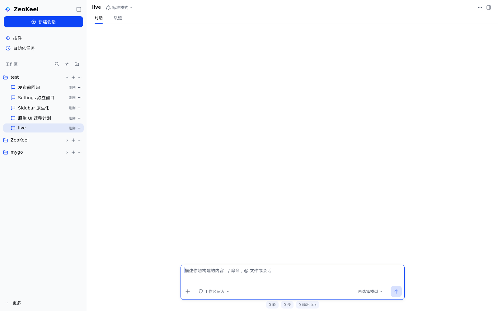

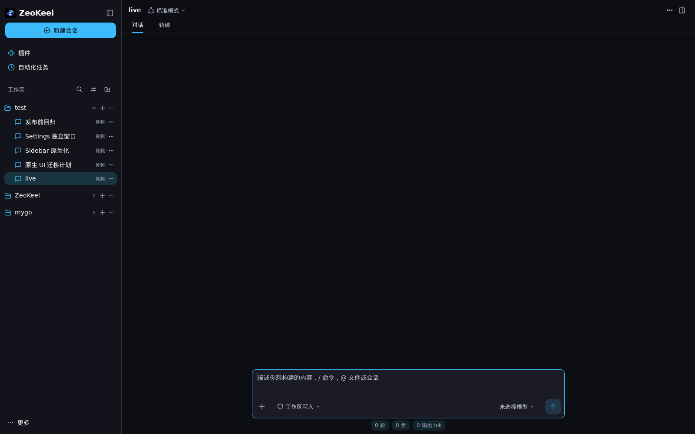

### 9.1 实现要点

| 项 | 实现 |
| --- | --- |
| 结构 | 面板 = 品牌行（`mark` 24 + `ZeoKeel` 字标 `Rem(1.25)`/600 + 折叠按钮）+ 品牌主按钮「新建会话」+ **原生 `ui.Sidebar`**（导航项 + Workspaces 标题行 + 工作区树）+ More 账户页脚；全部间距/尺寸/圆角来自 `Theme.Space/Rem/Radius`，删掉 60/252/38/36/34/32/28/14/10 等手调像素 |
| 选择模型 | 一个 id 空间 `nav:plugins` / `nav:automation` / `ws:<id>` / `s:<id>`；每帧由屏幕重算 canonical choice（`sidebarCanonicalSelection`），`Sidebar.Changed()` 后由 `sidebarChoice` 转成导航再复位。因此高亮跟随「当前屏幕/当前会话」，而点击/方向键都只写一次选择 |
| 导航 | 插件、自动化任务为原生 `SidebarItem`；选中态、hover、方向键与首字母查找免费 |
| Workspaces 标题行 | 原生 Sidebar 的 section 标题不能带动作，故用一条品牌化行：`工作区` 标签 + 三个原生 `ButtonBase`（搜索/视图选项/添加工作区），保留原 Popover 挂载与全部 i18n 标签 |
| 工作区行 | `SidebarItem` + `Children` 组合出「展开/折叠 chevron、＋新会话、⋯工作区菜单」三个**常显**原生按钮（P4：桌面操作不 hover-only，且键盘可 Tab 到）；行仍是拖拽源/落点、右键菜单、hover 卡、`Expanded` 语义 |
| 会话行 | `SidebarItem` + 缩进（`Space(6)`，按深度叠加）：消息图标、标题、相对时间、运行中 accent 点、`⋯` 会话菜单（原生按钮 + `PopoverMenuButton`）；拖拽排序、右键菜单、`Session actions for …` 可访问名保留 |
| 展开/折叠 | chevron 按钮切换并持久化（`ui.workspace_collapsed`）；**点击**当前工作区行仍可折叠（保留旧手势），键盘选择只确保展开，避免方向键把列表收起；`Workspace Tree` 模式下子工作区按深度缩进 |
| 保留行为 | 切换/新建工作区、按工作区/树/单列表分组、归档过滤、搜索入口与内联搜索、视图选项、添加/重命名/删除工作区、新建会话、置顶/归档/重命名/删除会话、复制标题/ID、拖拽排序与菜单里 Move up/down、More 账户菜单、Cmd/Ctrl+B 折叠 rail（图标 rail 重建为原生 ButtonBase + `Theme.Space`） |
| 测试 | 既有 `workspaces_test`/`sidebar_hover_test`/`chrome_test`/`interaction_test`/a11y Tab 可达性/`home_live_test` 折叠/`menus_test` 全部保留并通过；新增 `TestSidebarNativeSelection`（选中行品牌 tint）、`TestSidebarNativeDisclosure`（chevron 折叠/展开）、`TestSidebarNativeKeyboardNavigation`（Tab 到 Sidebar 后方向键驱动导航）、`TestSidebarNativeGroupingModes`（三种分组模式）、`TestRenderSidebarNativePreview`（浅/深截图，可复现） |

### 9.2 取舍（为什么不是照抄 `SidebarSection`）

1. **工作区不是 `SidebarSection`**：`ui.SidebarSection` 的标题只负责展开/折叠，无法承载「＋新会话 / ⋯工作区菜单」两个行内动作，也无法承担「点击切换工作区」。改为 `SidebarItem` + `Children` 组合原生控件，保住全部行为；层级用缩进表达。
2. **a11y 树是扁平 item 列表**：`Sidebar` 只把它见过的 `SidebarItem` 作为 level 1 项上报（section 会提供 level 2）。工作区/会话用缩进 + `Expanded`/`Label`（"New session in …"/"Workspace actions for …"）表达关系；若以后需要真正的嵌套树语义，`ui.Tree` 是候选，但它没有选择模型与多动作行（已评估）。
3. **键盘方向键 = 选择即导航**（Mail/Finder 式）：这是 mygo Sidebar 的语义，也是桌面源列表惯例；为避免「按方向键收起当前工作区」，工作区行的折叠只由点击/chevron 触发。
4. **会话行的 `⋯` 仍是文本字形**：产品与既有测试以此定位会话菜单；工作区行用图标（chevron/＋/⋯）更接近原生。两者都是原生 `ButtonBase`，a11y/焦点一致。
5. **hover 卡保留**：它是信息性 affordance（路径/创建时间/复制路径），不是操作；「操作」已全部从 hover-only 改为常显。

### 9.3 遗留

1. 内联搜索的输入行与结果行仍在 `session_search.go`（手搓行/固定 36/256 像素，不在本轮写范围）；后续可换原生 `SearchField`/`List`，约 60 行。
2. 折叠 rail 的截图未单独产出（`chrome_test` 覆盖行为）；如评审需要可加一张 `sidebar-rail-*.png`。
3. Sidebar 的树是视觉缩进而非 a11y 嵌套（见 9.2-2）；如需屏幕阅读器读出层级，可在后续把工作区/会话分组成 section 或换 `Tree`。

## 12. 系统偏好与高 DPI（P0-2，2026-11-05）

> 目标：跟随桌面无障碍偏好（`ui.Preferences`：TextScale / HighContrast / ReduceMotion），并验证 2x DPI。实现见 `internal/shell/preferences.go`，测试见 `preferences_test.go`。

### 12.1 合并规则（重要）

| 偏好 | 规则 | 落点 |
| --- | --- | --- |
| `TextScale` | 主题基准字号 = `brand.FontSize(14) × clamp(scale, 0.5…2)` 并四舍五入到整 DIP；**会话正文** = 应用内字号设置（14/16）× 同一 scale，行高（24/28）按同比例缩放；**品牌 type scale** = `design.Tokens.TextScale`（v1.1），`Tokens.Font/Text/TextMuted` 的 size 与 line 同比例缩放、字重不变（1.0 与旧值逐值一致）。缩放对应用内设置是相乘关系（系统放大仍生效）。剩余显式 `.FontSize` 见 §12.5 / known-limitations §2。 | `shellTheme` / `themeTokens`（注入 `TextScale`）/ `ConversationFontSize` / `ConversationLineHeight` |
| `HighContrast` | mygo 的 `Theme.follow` 只作用于默认主题；shell 用 `SetTheme` 设置品牌主题后由 `shellTheme` 复刻同一增强：`Border` 向 `Text` 混合 0.45、`TextMuted` 混合 0.4、`Focus` 不透明、`Scrollbar` alpha×1.6、滚动条加宽到 8 DIP。屏幕绘制用的 `design.Tokens` 同步增强：`BorderL2` +0.45 / `BorderL3` +0.6 / `LabelSecondary` +0.4 / `LabelTertiary` +0.3（向主文字色混合），浅/深色都朝更高对比方向。 | 同上 + `shellTokensForPreferences` |
| `ReduceMotion` | 全局：`View` 顶部（`syncShellPreferences`）读偏好后调用 `Context.DisableAnimations()`，本帧所有 transition/`Animate` 立即到位；mygo 的 transition/`Animate` 本身也遵循该偏好。既有 Session 流式淡入的显式 `ReduceMotion` 检查保留；`Loop`/spinner 等语义"进行中"动效不受影响（mygo 语义）。 | `app.go` View 顶部 + `syncShellPreferences` |
| `Accent`（系统强调色） | **不采纳**：ZeoKeel 品牌蓝/青是品牌识别的一部分，且品牌 `AccentText` 对比度已由 ADR 0002 色板校验（light 6.6:1 / dark 8.7:1）。记录为有意取舍。 | `shellTheme` 注释 + 测试 |

### 12.2 高 DPI（2x）

- 2x DPI 冒烟：`ui.Render(app.View, 1600, 1000, 2)` 输出 **3200×2000** 物理像素；`preferences_test.go` 的 `TestHighDPIRenderSmoke` 对 Home / Session 断言尺寸、采样色彩数（非空帧）并用 `ui.Tester.SetScale(2)` 断言关键控件仍在窗口内。
- mygo 原生按 DIP 布局、按 scale 栅格化；品牌 UI 全部是文本 + SVG（无位图资产），2x 无重采样问题；4 DIP 网格保证 2x 下仍是整数设备像素。
- headless 测试默认 scale=1；需要 2x 的测试用 `ui.Render(..., 2)` 或 `Tester.SetScale(2)`，不新增共享 helper（`livetest_helpers_test.go` 未改）。

### 12.3 滚动条策略（调研 + 最小实现）

- mygo v0.7.4：滚动条是**悬浮指示器**（指针在容器上时显示，6 DIP 宽，`Theme.Scrollbar` 着色），没有"常显/系统偏好"抽象——`ui.Preferences` 不含滚动条偏好；按容器可用 `Element.Scrollbars(false)` 关闭，`ScrollbarInsets` 调整位置。
- shell 策略（本轮）：保持原生悬浮滚动条，不做常显 gutter；HighContrast 下加宽到 8 DIP + thumb alpha×1.6（`scrollbarPolicyForPreferences`），满足可发现性最小增强。`shellScrollbarPolicy` 结构记录 `Overlay/Width/Contrasted`，供后续平台偏好接入。
- 下一轮（需屏幕 owner 配合）：若 mygo 增加"总是显示滚动条"平台偏好，接入 `scrollbarPolicyForPreferences` 并设置 `Theme.ScrollbarWidth`/常显；对纯手势容器（如转录区）评估 `Scrollbars(false)`，避免与自定义滚动提示重复。

### 12.4 遗留

1. 品牌 type scale 的固定档位（markdown 标题/列表、元数据）未随 TextScale 缩放：需要 `design` 包导出可缩放的 type 辅助（当前任务写范围不含 `internal/design`）。下一轮建议由 design owner 提供 `design.TypeMetricsScaled(role, scale)`。
2. 系统 Accent 不采纳（品牌取舍，见 12.1）；若未来提供"跟随系统强调色"开关，可在设置页加选项后复用 `shellTheme`。
3. 滚动条常显/平台偏好尚未实现（12.3），只做了 HighContrast 最小增强。
4. `ui.Preferences.ReduceTransparency`（原生文档有，`ui.Preferences` 结构无）未接入；窗口材质后续随桌面壳 P1 处理。

### 12.5 TextScale 扩展到 design 类型系统（v1.1，2026-11-05 完成）

- **机制**：`design.Tokens` 新增 `TextScale`（默认 1.0），`Tokens.Metrics(role)` 返回 `size/line × scale`（字重不变），`Font/Text/TextMuted` 全部走它；`Tokens.Scale(v)` 供"文字变大、控件高度也要变大"的少数度量使用。`themeTokens` 每帧把 `shellTextScale(prefs)` 写入 tokens，因此 Home/Session/Settings 等走 `t.Font(design.TypeX)` 的品牌文字随系统文字缩放。1.0x 下 `TextScale=1`，`Metrics` 与 `TypeMetrics` 逐值相等（像素/行为不变）。
- **显式字号审计与转换（本轮 21 处）**：
  - Home（3）：composer hint 12/18 → `TypeXXS`；工作区/模式 chip 文字 13/20 → `TypeXS`（chip 高度/内边距用 `Tokens.Scale` 同比放大）。
  - Session（5）：header 模式 chip 13/20 → `TypeXS`（header 行高同比）；working indicator 12/18 → `TypeXXS`（行高同比）；审批卡 12/18、13/20、12/18 → `TypeXXS/TypeXS/TypeXXS`。
  - Settings（13）：`settings_ui.go` 内 13 处 `settingsText(...)` 改用本地 `settingsTypeText`（走 `t.Font(role)`），覆盖设置标题/分组标签/选择器/说明/字号控件等；选项弹层行高使用 `Tokens.Scale` 同比放大。
- **保持固定（有意）**：图标/像素微调（如 turn 徽标 8px、`+`/`−` 步进按钮 16px）、自定义行高的错误/相位小字（11/16、12 无固定行高，转换会改变 1.0 像素）、会话正文（`ConversationFontSize/LineHeight` 已单独缩放）、Home 字标（`Theme.Rem` 已随基座字号缩放）。其余屏幕的显式字号（余 169 处 `.FontSize`）与 `settingsText/nativeText` 等 helper 内的固定档位留给后续 v1.2，见 known-limitations §2。
- **验证**：`preferences_test.go` 新增 `TestTextScaleScalesDesignTypeRoles`（1.0 与 `TypeMetrics` 相等、Home chip 28 DIP；1.5x 时 `TypeBody=21/33`、chip 42 DIP、Home/Session/Settings 关键控件仍在窗口内）；`style_test.go` 覆盖 1.0/1.25/1.5/2.0 等比、层级与未设置时按 1.0。1.5x 手检（Home/Session/Settings 临时渲染）无裁切。

## 13. Markdown 渲染：迁移到 mygo `ui/markdown`（2026-11-05 完成）

自研 Markdown 解析器（`internal/shell/markdown.go`，628 行：块解析 + 内联 spans + 各类元素渲染）已删除，改为对 mygo 官方 `ui/markdown` 的 106 行薄封装（`markdown.go`）。净变化：实现 **-522 行**，测试 +70 行，合计 **-452 行**；助手消息的流式/表格/任务列表/代码高亮与复制/选中复制随库获得。

### 12.1 能力对照

| 能力 | 迁移前（自研） | 迁移后（`ui/markdown`） |
| --- | --- | --- |
| 标题/段落/粗斜体/行内代码/链接/有序无序列表/引用/分隔线 | 自研解析与渲染 | CommonMark 对等（标题层级、列表 marker、引用条等由库 Theme 控制） |
| 代码块 | 纯文本 panel（无高亮、无复制） | **语法高亮**（`editor` tokenizer）+ 语言标签 + **Copy code 按钮** |
| 表格 | 把源码原样当段落显示 | **GFM 表格**（表头/单元格/边框） |
| 任务列表 | 源码文本 | **checkbox 任务列表** |
| 删除线/自动链接/脚注/数学 | 不支持 | 解析支持（`parser.Default` = GFM + 脚注 + 数学；数学无渲染 hook 时显示 TeX 源） |
| 流式 | 每帧全量重解析 | `markdown.Stream` 增量解析（只解析新增文本、heal 半截语法），完成后 `markdown.View` 原位接管 |
| 选中/复制 | 纯文本不可选 | 文本可选中，右键菜单复制（文本/HTML/Markdown） |
| 图片 | 不显示 | 显示 alt 文本（未接 `Options.LoadImage`，不发起网络/IO） |
| 原始 HTML | 源码文本显示 | 源码文本显示（未接 `Options.HTML`，内容不丢） |

### 12.2 实现要点

- 调用点：`session_live.go` 的助手消息按 `streaming` 选择 `markdown.Stream` / `markdown.View`（同一消息位置，解析状态延续）；`plan_ui.go` 等静态 Markdown 继续走 `markdownBlocks`（内部为 `markdown.View`），调用签名不变。
- 配置：每个 App 一份缓存的 `markdown.Options`（`markdownStyles` 包级 map，键为 `*App`，与其它 UI 状态 map 同模式）；只在**明暗主题或会话字号变化**时重建。`Theme` 由 `markdown.DefaultTheme(品牌 ui.Theme)` 派生，套用会话字号（14/16）与既有行高节奏（24/28），代码字体沿用 `monoFont`（SF Mono 栈）。
- 动效：`Reveal = {Unit: AtOnce, Fade: -1}`。Session 已有整条消息的流式淡入上移（`streamShown`/`design.StreamFrom`），关闭库的逐词 reveal 以避免双动画，保持迁移前节奏与 motion 测试意图。
- 安全/降级：不设 `OnLink`/`LoadImage`/`Math`/`HTML` hook；未知语法与 HTML 显示源码，内容不丢、错误输入不崩（测试覆盖）。

### 12.3 测试与预览

- `markdown_test.go` 重写/更新：标题/强调/列表/引用/行内代码/链接、表格单元格、任务列表、代码块语言标签+Copy、原始 HTML 源码、流式→完成切换、畸形内联保留字符、未闭合围栏保留内容、段落行高。命令：`go test -run 'TestMarkdown|TestUsage|TestTool' ./internal/shell`。
- 回归：Plan 卡片 Markdown、Session live/流式/motion（settle 一致性、流式帧）、窄窗 transcript 不溢出等定向测试通过。
- 预览：`ZEOKEEL_UPDATE_PREVIEWS=1 go test -run 'TestRenderSessionNativePreview' ./internal/shell` 重新生成 `preview/session-native-{light,dark}.png` 并已 `read_image` 自检。

### 12.4 遗留

1. 工具卡详情文本仍为纯文本（command/file/search 用 mono，其余普通字，`MaxLines(10)` 截断）——工具输出可能极大且不保证是 Markdown，迁移需要配套截断/裁剪策略，记入后续。
2. 工具卡结果中的代码没有 Copy 按钮（迁移前也没有），随工具卡原生化再评估。
3. 图片只显示 alt 文本；需要展示工具/消息内图片时接 `Options.LoadImage`。
4. 数学公式无渲染 hook（显示 TeX 源）；会话文本选择未跨消息共享（`ShareSelection=false`），与桌面交互 P0"文本可选+右键"项一起做更合适。

## 14. 剩余面板（第六批，2026-11-05 完成）

本轮收尾四组面板/面：Trajectory 屏内部行、内联会话搜索 + 搜索弹层、todo/team/plan 侧面板。

### 14.1 落地要点

| 区域 | 实现 |
| --- | --- |
| Trajectory | 居中品牌列（`Space(225)`=900 DIP，按主区宽 clamp）；时间轨 `Space(14)` + 事件色点 + 本地化标签 + `×count` pill；每行 `ButtonBase` ghost（hover tint、键盘可达）；raw payload 展开为 `BgHover` 圆角 mono 块；标题 + 条数 pill |
| 内联搜索 | 原生 `TextInputBase` + 搜索图标 + 常驻品牌清除按钮（**取舍**：mygo `SearchField` 只在 query 非空时生成清除按钮，无法满足常驻的 `Clear search` 标签、a11y 与回归测试；输入本身仍是原生文本控件，保留键盘/Esc/Enter）；结果行 ghost `ButtonBase`、当前会话 `BgHover`、archived 用 muted pill |
| 搜索弹层 | 品牌面板（`RadiusLG`、单层阴影、`Space(145)` 宽）；原生 `SearchField`（Enter 打开 / Esc 关闭 / ↑↓ 选择不变）；筛选 chips 品牌描边 + 选中 accent tint；结果行 accent 选中条 + ghost 归档按钮 |
| View options | 品牌 popover：`Space(67)` 宽、28 DIP 菜单项、可聚焦 checkable 行（RoleMenuItemCheckBox 不变） |
| todo 面板 | `BgSidebar` inspector 面板（`Space(68)` 宽、左分隔线）；header + 计数 pill + 细分进度条；状态 mark：空环 / in-progress accent 点 / completed success ✓；完成项删除线 |
| team 面板 | 同 inspector 面板；成员为 `BgRaised` 卡片 + 状态点 + 名称/状态 + 任务；目标 banner 品牌 tint + **全宽**进度条（删除固定 240px），完成态 success |
| plan | ~~header 计划模式 toggle~~ **（2026-11-05 对齐 DSH：header 不再有复选框；入口改为 `/plan` 命令 + composer 计划徽章（仅激活时显示，点击或 `/plan off` 退出）；plan 模式为软引导（`plan:policy` + `present` "Plan" + 审阅卡），不拦截工具——需要强制只读时同时选「只读」权限，见 [ADR 0008](../../decisions/0008-plan-mode-soft-alignment.md)）**；plan review 卡宽 = 品牌 composer 列；Approve 沿用品牌 primary，Exit 改 ghost 按钮；question card / artifacts 卡同批品牌化（composer 列宽、tint 卡、`FillWidth` 左对齐） |
| 通用 | 删除固定像素与采样色，全部改 `Theme.Space/Rem/Radius` 与 brand 语义色；无新增 i18n key（复用现有 key）；键盘导航/Esc/方向键/Enter、勾选/折叠/滚动/窄窗、a11y Label/Role/Focusable 全部保留 |

### 14.2 截图

`TestRenderTrajectoryNativePreview` → [preview/trajectory-native-light.png](preview/trajectory-native-light.png) / [preview/trajectory-native-dark.png](preview/trajectory-native-dark.png)。预览走 `previewDir(t)`：普通测试/CI 写 `t.TempDir()`，只有 `ZEOKEEL_UPDATE_PREVIEWS=1` 才写 `docs/design/preview`；已 `read_image` 自检（1600×1000，中文默认，事件含 tool_start 展开态）。

### 14.3 遗留

1. 右侧栏（Files/Terminal/Start）品牌化仍在其独立任务；Home/Session composer 收敛到 `composer_native.go` 仍待办。
2. ~~Trajectory 事件很多时仍是普通 `Scroll`（未虚拟化，与迁移前一致）~~ **已完成（v1.1，2026-11-05，§16.1）**：`ui.List` 虚拟化，只构建可视行。
3. 搜索高亮目前是行选中（accent 条 + `BgHover`），标题内命中字符的逐字符高亮未做（store 查询只返回会话，逐字符高亮需额外匹配策略与 XSS 无关的纯文本 span 拼接）。

## 15. 右侧栏（Files / Terminal / Start，第七批，2026-11-05 完成）

右侧栏从「手搓 720px DSH 面板」换成品牌 inspector 列：响应式宽度 + 可拖拽边界、原生的 header 控件、品牌化的 Tabs / Files / 文件预览 / Terminal / Start / 空态 / Session Log。功能与 a11y 不回退，Split/Fullscreen 的原生 `SplitPercent` 拖拽与最大化行为原样保留。

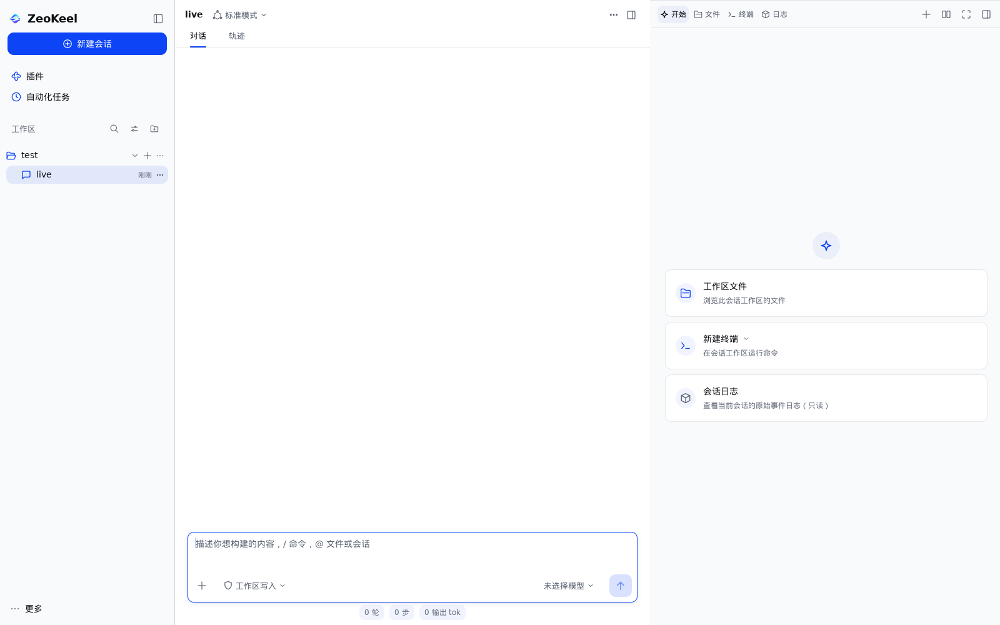

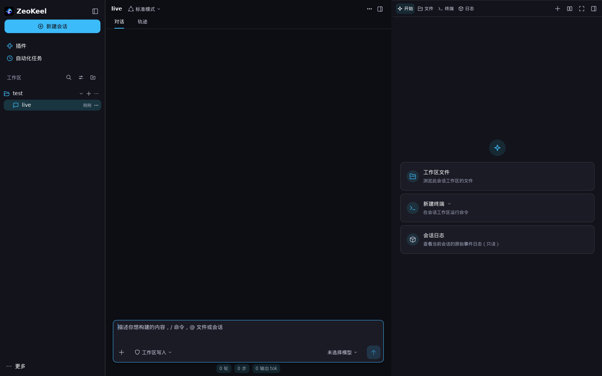

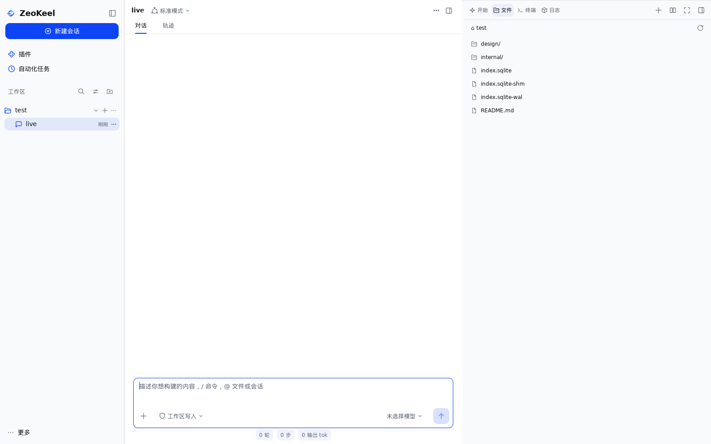

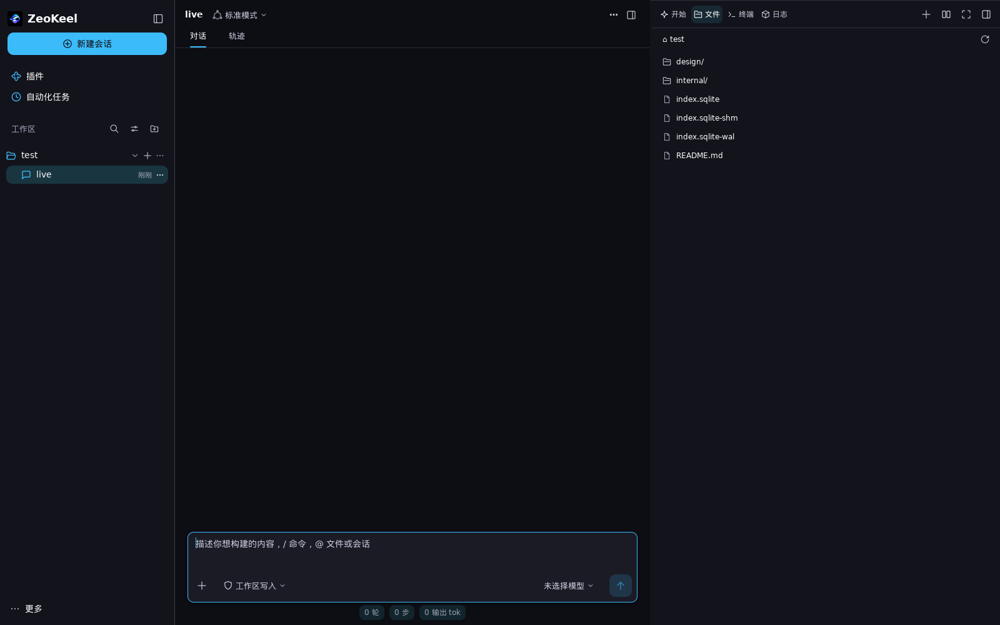

### 15.1 落地要点

| 项 | 实现 |
| --- | --- |
| 宽度 | 删除固定 720：停靠宽度 = 用户拖拽值，否则 `min(560, 主区 45%)`（`rightSidebarW`=560 品牌令牌 + `rightPanelShare`=45%），始终给背后屏幕留 `minMainW`(400)、不低于 `minRightPanelW`(220)；1600 宽窗口 560（主区 760），1200/1366 变窄，900×600 最小窗仍 220。`contentWidth` 与 Split/Fullscreen 逻辑共用同一 helper，`chrome_test` 的宽度断言继续成立 |
| 可拖拽 | 面板左缘 4 DIP 的 `RoleSplitter` 抓取条（`CursorResizeEW`，hover/focus/drag 时显示 accent 边）：原生 `Element.Dragged()` 拖动改宽，`←/→` 键盘步进 `Space(4)`；宽度状态按 `*App` 键存在 `rightPanelStates`（App 在 app.go，本任务不拥有），内存态与左侧栏折叠一致。Split 模式沿用 app.go 的 `SplitPercent` 分隔条，不重复加抓取条 |
| Header | New tab / Split / Fullscreen / Collapse 全部换成原生 `ButtonBase`（焦点环、Enter/Space、Tooltip、pressed）；激活态用 `BgHover` + `Accent` 图标；控件尺寸 `Space(7)`（窄面板 `Space(6)`），header 高 `Space(11)`、底分隔线；Threshold 用令牌：<520 收成图标 tabs、<320 用紧凑控件 |
| Tabs | 仍是 `TabsBase`（RoleTabList/方向键/选中语义不变），品牌化为 28 DIP 高、`RadiusSM`、`BgHover` 选中底、`LabelPrimary/Secondary` 文字；窄面板只留图标但保留可访问名 |
| Files | 面包屑改为原生 `ButtonBase` 段 + 固定 Reload 按钮，保留窄面板折叠（"Hidden path segments" ellipsis 菜单）与 24 DIP 目标；目录/文件行是原生 `ButtonBase`（品牌 line 图标，目录名保留 `/` 后缀）；预览页 = 面包屑 + 尺寸元数据行 + 原生 Close 控件 + 双向滚动文本，截断/超行提示沿用 `WarningText` |
| Terminal | 工作目录 + `Choose shell` 原生菜单按钮 + Clear；输出用 `MonoFontStack`；输入行原生 `TextInput` + 品牌 `PrimaryButton` Run / 危险色 Stop；"no PTY" 提示保留 |
| Start | 品牌 Start 页：居中圆形图形标 + 三张 `BgRaised` 引导卡（图标盘 + 标题 + 描述，整卡 `ButtonBase`），删除 DSH 采样色 `#FFBC4D`，文件夹/终端用 `Accent`、日志用 `LabelSecondary`；New terminal 卡的 Choose shell 仍是独立原生菜单按钮 |
| Session Log | header = 图标 + 标题 + 原生 `Badge("Read-only")`；事件行 = 序号/时间 + 类型 + 有界 payload 预览；空态/错误用品牌空态 |
| 空态 | `rightEmpty` 品牌化：`BgHover` 圆形图标盘 + `LabelTertiary` 说明，Files/Terminal/Session Log 复用 |
| 视觉 | 面板底 `BgSidebar` + 左 1px `BorderL2`；所有间距/尺寸/圆角来自 `Theme.Space/Rem/Radius`；删除 720/44/34/28/24/196 等手调像素与采样色 |

### 15.2 保留与不回退

- 功能：Start 默认页与卡片跳转、Files 目录导航/面包屑/预览/256KB 截断/超长行限制/Reload/错误态、Terminal 运行/清空/Stop/Choose shell 持久化、Session Log 只读事件、New tab 菜单、Split/Fullscreen/折叠、Cmd/Ctrl+P 与 Ctrl+` 快捷键、More 菜单不受影响。
- a11y/键盘：header 控件均为原生 ButtonBase（Tab/Enter/Space/焦点环）；Tabs 保留 TabsBase 语义；抓取条是 `RoleSplitter` + 键盘左右；文件行/面包屑/空态标签保留 `Label`。
- 测试：`right_sidebar_test.go`、`right_sidebar_screens_test.go`、`start_tab_test.go`、`chrome_test.go` 的原断言全部保留并通过；`responsive_panels_test.go` 的面包屑折叠与 Reload 锚定在 900×600 下仍成立（见 15.3-1 的宽度冲突说明）。

### 15.3 遗留 / 已知冲突

1. **`responsive_panels_test.go:117 TestAutomationActionsRemainUsableWithDockedPanel` 与新的响应式宽度冲突**：该测试把 Automation 页列右界硬编码为 `632`（前提是 1200/1366 宽窗口下主区恰好 400），而本任务的品牌宽度在这些窗口给出主区 506/526，页列居中后 action 跑到 x≈583..687。测试不在本任务写范围，需由 owner 改成按实际 `contentWidth`/面板 rect 计算，或确认接受新几何。
2. 抓取条的宽度状态是内存态（不持久化，与左侧栏折叠一致）；如需记住面板宽度，可写入 `ui.right_panel_width` settings row。
3. Terminal 仍是简单命令运行器（无 PTY/persistent shell），视觉品牌化未改变执行模型。
4. Files 分支折叠菜单在极窄（<220）时不出现（面板本身有最小宽度保证）。

## 16. 剩余路线（2026-11-05 第三轮后更新）

已完成：Home、Session、Sidebar、Settings、Plugins、Automation、Trajectory、内联搜索/todo/team/plan 面板、右侧栏、工具卡内容、窗口状态（ADR 0003；原生菜单栏已退役，ADR 0006）、系统通知（ADR 0004）、设置独立窗口（ADR 0005）、系统偏好与 2x DPI（§12）、Markdown 迁移（§13）、a11y/键盘（§18）、Chat 记录序渲染（§4.1.1）、死代码清理与渲染基准（[perf.md](perf.md)）。

剩余（优先来自独立设计评审 [review-round3.md](review-round3.md)）：

1. ~~**UX P0**~~ **已完成（2026-11-05 第四轮，见 STATUS 阶段 6）**：破坏性操作确认 + Danger（Automation/Memory）；浅色三级文字 `#646C7A` 四组表面 ≥4.5:1；深色字标改用 `logo-dark.svg` 派生 2x 位图。
2. P1 细节：所有窗口均无菜单栏（原生窗口菜单栏已退役，ADR 0006）、窗口间几何联动、滚动位置持久化；通知动作按钮/退出后点击；TextScale 已覆盖 design 类型系统（§12.5），其余约 169 处显式字号留 v1.2。
3. 预览/回归：预览无状态覆盖（空态/错误/加载/窄窗）；已提供 opt-in 视觉回归（`scripts/visual-check.sh` + `TestVisualRegression`，CI 未强制，跨机器字体/时钟原因）。
4. a11y/真机：VoiceOver/Narrator/Orca 人工复核、拖拽键盘等价、IME/高 DPI 真机矩阵。
5. 性能：~~Trajectory 未虚拟化~~ **已完成（v1.1，2026-11-05，§16.1）**：1000 事件稳态帧 22.7ms → 3.12ms（见 [perf.md](perf.md) §8）。

### 16.1 Trajectory 虚拟化（v1.1，2026-11-05 完成）

`internal/shell/trajectory.go` 的事件列表从「`ui.Scroll` + 一次性构建全部事件行」换成 mygo `ui.List` 虚拟列表：

- **只构建可视行**：每帧由 List 构建视口内的行（+2 行 overscan），1000 事件 trace 与 20 事件 trace 的帧成本相同量级；标题的「N 条记录 · M 个事件」仍按全量数据计数。
- **状态按事件 id**：`ListState.Key` = 事件序号（`trajectoryEntry.Seq`），展开 raw 的 `liveUIState.expandedRaw[seq]` 与滚动锚点跟随事件而不是行号；事件追加到末尾时，用户正在看的行不会跳动。
- **交互/视觉不变**：每行仍是原来的 `trajectoryRow`（时间轨、事件色点、本地化标签、×count pill、点击/Enter/Space 展开、raw mono 块、`Label` a11y 名称）；行间距用行内 `Space(0.5)` 预留，hover 表面与旧 `Column.Gap` 一致；`ListState.Label` 让辅助技术把行读成列表项。
- **滚动/跟随语义**：`FollowEnd=false`，与旧 Scroll 一致——打开时在最早事件、随用户滚动保持位置，不随流式新事件自动跳到底部（Chat transcript 才跟随末尾）。
- **测试**：`trajectory_test.go` 新增 3 个针对性测试——1200 行 trace 只构建可视窗口（尾部行在 `ScrollToEnd` 前不可见、`ListState.Visible()` 有界）、点击展开/重开按事件 id 保留/Enter 折叠/聚焦与 a11y/滚轮滚动、`ScrollToEnd` 正确跳转；预览 `TestRenderTrajectoryNativePreview` 不变。
- **基准**：见 [perf.md §8](perf.md)：1000 事件 trace 稳态帧 1600×1000 从 22.7ms 降到 3.12ms（约 7×），`ui.Render` 冷渲染从 128.8ms 降到 42.6ms（约 3×），分配从 17.5k→10.7k allocs/帧。

## 17. 工具卡内容原生化（第八批，2026-11-05 完成）

工具卡详情从纯文本（MaxLines 10、无 Copy）改为按内容类型使用 mygo 的 Markdown/代码能力，与消息正文同一套主题、字号与代码字体。

### 17.1 能力对照

| 结果类型 | 之前 | 现在 |
| --- | --- | --- |
| shell/命令输出 | 纯文本 mono，MaxLines 10 | `markdown.View` 代码块：语言标签（bash）+ 语法高亮 + **Copy** 按钮；40 行封顶 + 「显示全部 N 行」展开 |
| 文件内容 / 搜索输出 | 纯文本 mono | 代码块（text 语言标签 + Copy + 高亮） |
| 普通文本 / Markdown（web、question、generic） | 纯文本 | `markdown.View`：标题/列表/加粗/行内代码/表格等与消息正文一致 |
| 图片结果（read_image 等） | 只显示「W×H」文本 | `ui.Image`（经 markdown 的 LoadImage 从工作区加载）；加载中/失败显示 alt 描述，不空白 |
| 错误结果 | 红色文字嵌在普通行里 | 品牌 danger 面板：错误标签 + mono 输出 + 「复制错误」+ 行数上限/展开 |
| 长结果 | 一律截断且无展开 | 折叠上限 `toolResultMaxLines=40`，可「显示全部 / 折叠结果」，避免超大输出每帧布局 |

保留：折叠/展开动画、运行中状态点/脉冲、args/result 分区、6+ 工具变体的摘要行、duration 行；a11y（Label/Role/Focusable、代码块 RoleGroup/Label、复制按钮标签）不回退。

### 17.2 实现要点

- `toolcards.go` 按工具 kind 分派结果渲染；`a.markdownBlocks`（markdown.go 的薄封装）复用消息正文的缓存 `markdown.Options`，主题/字号/代码字体/行高一致。
- `markdown.go`：`Options.LoadImage = markdown.FileImages(workspaceRoot)`，消息与工具结果图片都从工作区加载；缓存把 workspace root 纳入重建条件，切换工作区后从新根解析。
- 长结果展开状态放在 `toolcards.go` 的 per-App `toolResultStates`（与其它 UI 状态 map 同模式）；「显示全部/折叠结果」控件渲染在长结果 header（代码块之前），在长输出前即可见可点。
- 错误面板用品牌 danger 语义色（`t.Danger` 低透明度 over surface），复制走 `c.WriteClipboard` + toast。
- 行数封顶在 `truncateToolResult`：默认 40 行，展开后显示全文；渲染前截断而非 CSS 裁剪，避免超大输出参与每帧布局。

### 17.3 预览

- [preview/toolcard-native-light.png](preview/toolcard-native-light.png) / [preview/toolcard-native-dark.png](preview/toolcard-native-dark.png)：`TestRenderToolCardNativePreview`（展开的 bash / Markdown / 图片 / 错误四张卡；图片经 LoadImage 真实加载）。
- Session 预览已重生成：`preview/session-native-{light,dark}.png`（工具卡显示代码块 + Copy；2026-11-05 顺序修正后过程块位于该回合最终回答之前）。
- 全部走 `previewDir(t)`：普通测试/CI 写临时目录，只有 `ZEOKEEL_UPDATE_PREVIEWS=1` 才写 `docs/design/preview`。

### 17.4 遗留

1. Markdown 内置标签（Copy / Copy code、图片占位）由 mygo 的 l10n 按 UI locale 输出；headless 测试/中文界面下可能仍是英文 "Copy"，接窗口 locale 属于框架/窗口层事项。
2. 代码块语言映射目前 shell→bash、文件/搜索→text；可按工具名或文件扩展名细化为 go/py 等。
3. 图片以外的富媒体（PDF/HTML）未展示；超大输出除行数封顶外未虚拟化（超长单行由代码块横向滚动承载）。

## 18. a11y 与键盘（P1 收尾，2026-11-05 完成）

> 实现：`internal/shell/workspaces.go`（树语义/行内动作）、新增 `internal/shell/a11y_native_test.go`；右栏抓取条与 chrome.go 已有名称/角色，未改动。测试：`go test -run 'TestA11y|TestKeyboard|TestTab' ./internal/shell`。

### 18.1 侧栏树结构（屏幕阅读器视图）

```
Tree "Sidebar"
├─ TreeItem "Plugins"            level 1
├─ TreeItem "Automation tasks"   level 1
├─ TreeItem "test"  (workspace)  level 1  Expanded=true
│   ├─ TreeItem "live"           level 2
│   └─ TreeItem "second chat"    level 2
└─ TreeItem "parent-ws"          level 1
    └─ TreeItem "child-ws"       level 2   (Workspace Tree 分组)
        └─ TreeItem "child conversation"  level 3
```

- mygo `ui.Sidebar` 对 a11y 是一个 `RoleTree`，其 `SidebarItem` 是**叶子**（名字取自内容 innerText）。原实现把所有 item 平铺且 `Level` 全为 1，屏幕阅读器读不出工作区 → 会话层级；行内按钮放在 item 内部时也**不会**进入 a11y 树。
- 修复：`sidebarWorkspaceRow` / `sidebarSessionRow` 用 `.Level(n)` 标注层级（工作区 = 嵌套深度+1，其会话 = 深度+2）；item 名称来自内容文本（工作区名 / 会话标题），不再把行内动作名拼接进名字。
- 行内动作（展开/折叠、新建会话、工作区菜单、会话「⋯」菜单）移到 item 尾部**绝对定位覆盖层**，作为 `RoleTree` 的兄弟节点暴露：屏幕阅读器可逐个访问，Tab 仍可到达；整行高亮、时间位置等视觉保持不变（会话时间移入覆盖层，避免进入节点名称）。
- 工作区 item 保留 `Expanded` 状态；折叠后其会话从 a11y 树消失（`TestA11ySidebarTreeHierarchy` / `TestA11ySidebarNestedWorkspaceLevels` / `TestA11ySidebarChevronKeyboard`）。
- 键盘语义保持：侧栏是单一 Tab 站，方向键/Home/End/首字母选择、行内按钮 Enter/Space 均可用（`TestA11ySidebarKeyboardNavigation`、`TestA11ySidebarSessionActionsKeyboardReachable`）。

### 18.2 原生控件 name 审计

- `a11y_native_test.go` 通过反射读取 Tester 的 accessibility tree（pinned mygo v0.7.4 字段布局，与既有 `testerAccessStates` 同一测试内省手法），断言 Home/Session/Plugins/Automation/Settings 每屏：不存在"可聚焦或可操作但名称为空"的节点；列出的关键控件（工作区/会话行、行内动作、右栏 Resize Splitter、设置关闭、插件/自动化动作等）都在树中；树形 item 的 `Level` 不为 0。
- 右栏抓取条已经是 `RoleSplitter` + `Label("Resize right sidebar")` + 左右方向键调整宽度（现有实现，测试锁定，无需改动）。
- 修复项：侧栏 item 名称（拼接动作 → 实体名）、树层级（全 1 → 嵌套）、行内动作对 AT 不可见（↔ 兄弟节点）、会话时间进入名称（↔ 移入覆盖层）。

### 18.3 键盘回归

- 新增纯键盘流程：Tab 到 New Session + Enter 新建；Cmd+, 打开设置 → Tab 到 Close settings + Enter 关闭；Esc 关闭设置/搜索面板/View options 弹层；插件开关 Space 切换；自动化 New 打开弹层 + Esc 关闭；右栏 Open/Collapse 键盘开关；字号 popover Enter 打开 + Esc 关闭。断言不存在键盘死路。
- 焦点断言使用 a11y 树的真实 Focus 节点（不是 `Tester.Focused` 的"容器内即可"语义），避免"侧栏整体聚焦时所有子控件看似可达"的假阳性。

### 18.4 遗留

1. 真机 VoiceOver / Narrator / Orca 人工复核未做（headless a11y 树只能验证结构与名称，朗读顺序/树形行为需真机）。
2. 行内动作与树 item 是兄弟节点而非 item 子树：不同平台的树形控件对兄弟节点的朗读方式可能不同，真机复核后再决定是否改用平台推荐的行内动作模式（如 item 自定义 actions）。
3. 拖拽排序的键盘等价物已有菜单「上移/下移」（既有实现）；但拖拽本身无可访问替代，后续可把移动操作提升为 item 的 a11y actions。
4. 侧栏 item 与行内动作的 Tab 顺序按构建顺序（item → 动作）；平台惯例可能偏好动作在 item 之后同层，已符合，真机复核顺序即可。

## 19. 确认与危险操作规范（P0-1，2026-11-05 完成）

> 评审 `docs/design/review-round3.md` P0-1：破坏性操作不一致/无确认。本轮把 Automation 删除与 Memory「Clear all」接入会话/工作区删除已用的确认模态，并补齐 Danger 语义与计划文案本地化。

### 19.1 规范（所有破坏性操作一致）

| 维度 | 规则 | 落点 |
| --- | --- | --- |
| 触发 | 任何不可撤销操作都不一键执行：行内 Danger 按钮只**打开确认**，确认按钮才执行 | Automation 行 `Delete` → `automationDeleteDialog`；Memory 头部 `Clear all` → `memoryClearDialog` |
| 模态 | 复用 mygo `ui.Modal`（背景 scrim + 居中面板）：标题 + 后果说明（点名对象/不可撤销）+ `Cancel` + Danger 确认；Esc、点外都由 Modal 自动关闭 | 与 `menus.go` 会话删除、`workspaces.go` 工作区删除同一模式 |
| 默认焦点 | `Cancel` 上 `AutoFocus()`；Danger 按钮不设默认，Enter 只取消、不会误删 | `automationDeleteDialog` / `memoryClearDialog` |
| Danger 样式 | 行内删除与确认按钮都用 `t.Danger`（品牌语义色，浅/深色各自可读），不再与 Run now/Edit 同款中性 ghost | `automationDangerAction`、两个确认弹层的确认按钮；Memory 头部 Clear all 原本即 Danger |
| 文案 | 中英双语 i18n；确认按钮用专门动词，避免与行内/头部同名（`Delete task`/`Clear memories`），键盘与屏幕阅读器、测试都能唯一命中 | i18n：`automation.delete_automation_task`、`automation.delete_named`、`automation.delete_task`；`memory.clear_all_memories_q`、`memory.clear_all_desc`、`memory.clear_memories` |
| 失败 | 删除失败保持弹层打开并 Toast，可重试/取消；清空失败 Toast 且列表不变 | `confirmAutomationDelete` / `clearWorkspaceMemories` |
| 成功 | 关闭弹层 + Toast（Automation task deleted；Cleared N memories） | 同上 |

> 本轮不做 Undo（评审里为可选项）：两个操作都是低频率、且失败可见；后续如加 Undo 需要 store 层支持回收。

### 19.2 Automation 计划文案本地化

- 规则：**只本地化渲染，不改调度行为**。shell 侧新增 `automationScheduleLabel`：用 `automation.Parse` 解析已持久化 cron（解析结果与调度器一致），按 UI 语言输出：
  - 中文：`每小时`、`每分钟`、`每 N 分钟`、`每天 HH:MM`
  - 英文：`Every hour`、`Every minute`、`Every N minutes`、`Daily at HH:MM`
- `internal/automation` 的解析/`Next`/调度与 `Describe` 均未改（`Describe` 仍是英文公共 API，被其包测试覆盖）；无效 cron 原样显示，和旧行为一致。
- 新 i18n key：`automation.daily_at`、`automation.every_hour`、`automation.every_minute`、`automation.every_n_minutes`；英文文案与旧 `Describe` 完全一致，所以英文界面观感不变。
- 测试：`TestAutomationScheduleLabelLocalized`（中文界面断言出现中文、**不出现** "Daily at/Every hour/Every 15 minutes"；英文界面保持英文；cron 持久化值不变）。
- 遗留：next/last 时间戳仍是数字格式（`2006-01-02 15:04`），未按区域格式本地化；如需要下一轮补。

### 19.3 测试

| 测试 | 覆盖 |
| --- | --- |
| `TestAutomationDeleteRequiresConfirmation` | 行内/确认按钮 Danger 像素断言；Cancel/Esc/Enter/点外都不删；确认后才删 + Toast |
| `TestMemoryClearAllRequiresConfirmation` | 头部与确认按钮 Danger；Cancel/Esc/Enter 不清空；确认才清空、其他工作区不受影响、Toast/空态 |
| `TestAutomationScheduleLabelLocalized` | 中英计划文案与 cron 持久化不变 |
| 既有测试 | `TestAutomationTasksCRUDAndRunNow` 删除步骤改为经确认；`responsive_panels_test.go` 的删除动作补确认步骤；`TestAutomationTabReachability` 等不变 |

验收：`go test -run 'TestAutomation|TestMemory|TestDelete|TestDanger' ./internal/shell` 绿；gofmt/vet/build 绿；全包 `go test ./internal/shell` 绿（快照）。预览 PNG 由 Lead 统一重生成，本轮不提交截图。

## 20. 验收口径

| 维度 | 验收 |
| --- | --- |
| 品牌 | 界面无 DSH 产品文案（`Into the Unknown`/`Preview`/鲸鱼）；品牌资产只用 `logo/` |
| 令牌 | 新代码不出现新的 DSH 采样色/魔法几何；颜色/间距/圆角走 brand/design |
| 测试 | `go build/vet/gofmt/test ./...` 绿；交互/a11y 断言保留；截图 headless 可复现、普通测试不污染工作树 |
| 观感 | 1600×1000 截图评审通过（浅/深）；信息层级清晰、密度比现状略松、像原生桌面应用 |
