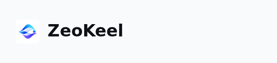

# ZeoKeel 字标规格（已定）

> 选定：**方案 A**（图形标 + “ZeoKeel”文字）。不指定品牌字体，**使用系统字体栈**，不打包字体文件。

## 组成

| 元素 | 规格 |
| --- | --- |
| 图形标 | `logo/logo.svg`（浅色）/ `logo/logo-dark.svg`（深色），渲染尺寸 24×24（2x = 48×48），不重绘、不改色 |
| 文字 | `ZeoKeel`，系统 UI 字体栈，字重 600，字号 17px（2x = 34px），字距 0 |
| 间距 | 图形标与文字间隔 8px |
| 颜色 | 浅色主题 `#0F1115`；深色主题 `#F9FAFB` |
| 对齐 | 侧栏左上品牌行：左边距 16px，垂直居中于 64px 行高 |

## 预览

## 实现约定

- mygo 里文字用系统字体（`ui` 默认字体栈）绘制；logo 用 `ui.ParseSVG` 或位图资源按主题切换。
- 品牌残留检查：除模型名（DeepSeek-V4.1-Flash 等）外，界面不得出现 "deepseek"/"DeepSeek Harness" 字样。
- 重新生成预览：`sh scripts/render-wordmark.sh`（脚本内的字体仅用于预览，实现走系统字体栈）。
